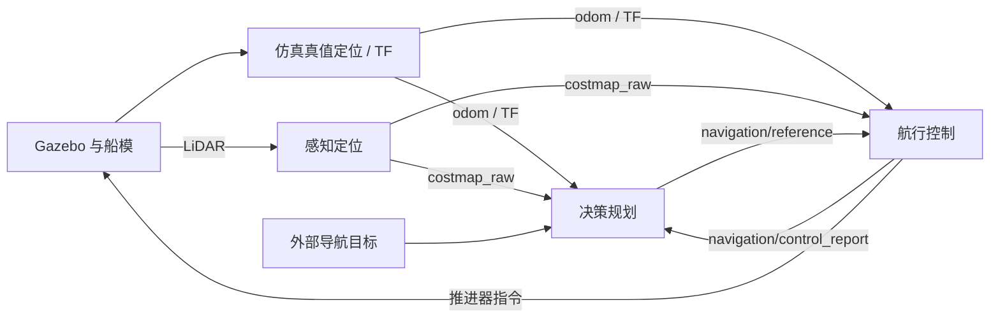

# USV ROS 2 无人艇导航仿真系统

基于 ROS 2 Humble 与 Gazebo Classic 的无人艇导航工程，用于 Otter 船模的感知、路径规划、轨迹生成与航行控制仿真。当前默认算法为 **A* → LOS → PID**，支持切换 Dijkstra、GBFS、LQR 和 0914 PI＋ADRC。

本文对应按业务模块整理后的源码，当前开发分支为 `codex/distributed-navigation`。首次接手项目可从“构建与启动”开始；模块接口与独立运行说明见[三模块普通导航](docs/distributed-navigation/README.md)。

LaDDS 联调工具与 ROS 2 的独立测试通信入口见 [LaDDS 双向通信桥](src/core/communication_module/usv_ladds_bridge/README.md)。当前支持域 1、主题 `0211`、`0411` 和 `0141` 的尽力传输 JSON/原始字节收发，使用 Windows SDK + 本机 TCP 连接 WSL；接收节点订阅 `0411` 后解成内部 `odom`，`0141` 通过 `/ladds/obstacle_tx` 接入并解回 `/otter/ladds_targets`，另提供可选的仿真 `costmap_raw` 快照适配器用于发送链路验证。

0914 控制器使用独立 Otter 参数文件启动，接入接口、参数来源、运行和回退命令见 [0914 控制器接入说明](docs/0914-controller-integration.md)，实际验证结果见[接入验证记录](docs/validation/adrc-0914-v1/README.md)。

速度 PI 参数可先用[本地调参台](scripts/control/speed_tuner/README.md)筛选：Windows 双击 `scripts/control/start_speed_tuner.bat`，无需 ROS/Gazebo，即可拖动 Kp/Ki、比较响应、批量筛选并导出候选 YAML。

## 当前能力与范围

| 部分 | 当前实现 |
| --- | --- |
| 仿真支撑 | Otter 船模、Gazebo 水动力/波浪/推进器/传感器插件、RViz 可视化；定位与 TF 来自仿真真值 |
| 感知定位 | LiDAR 累积建图、Nav2 实时代价地图及输入监测；当前未接真实定位传感器 |
| 决策规划 | 普通目标点导航，A* / Dijkstra / GBFS 全局路径搜索，LOS 轨迹生成与轨迹碰撞检查 |
| 航行控制 | PID / LQR / 0914 PI＋ADRC 跟踪、推进器输出、当前船体占用检查及控制反馈 |
| 任务管理 | 普通导航的目标替换、取消、到点与停稳判定；模块重启后需要重新下发目标 |
| 保留任务 | 定点值守、圆形巡航、固定艏向阵位保持代码位于 `mission_module`，普通导航主入口不启动这些任务 |

导航算法主要采用 Python / NumPy 实现；ROS 节点负责消息、参数、TF、调度及发布。Gazebo、RViz 插件、仿真定位及感知代价地图支撑继续使用 C++。LiDAR 累积地图与 Nav2 实时代价地图分别工作，当前没有启用 static layer。

当前版本未实现 AIS/导航雷达融合、目标跟踪、COLREGs 决策、DWA 或 MPC。源码中保留的同名历史配置模板不代表算法已经接入。现有验证范围为同机 ROS 2 / Gazebo 仿真，尚未验证实船、真实传感器或跨机部署。

## 项目结构与数据流

```text
src/
├── core/
│   ├── perception_module/
│   │   ├── usv_perception/             # 感知节点、launch、配置与 C++ costmap 支撑
│   │   └── perception/                 # LiDAR 建图算法
│   ├── decision_module/
│   │   ├── usv_decision/               # 决策节点、规划 worker 与 launch
│   │   ├── path_planner/               # A* / Dijkstra / GBFS
│   │   ├── path_processor/             # 独立路径后处理算法
│   │   └── trajectory_planner/         # LOS 与轨迹数据结构
│   ├── control_module/
│   │   ├── usv_control/                # 航控节点与 launch
│   │   └── controller/                 # PID / LQR / 0914 PI＋ADRC
│   ├── shared/
│   │   ├── common/                     # 共享模型、数学与碰撞检查工具
│   │   ├── usv_navigation/             # 公共配置、输入适配与协议支持
│   │   └── usv_navigation_interfaces/  # 模块间 ROS 消息
│   └── mission_module/
│       ├── usv_mission/                # 保留的值守与阵位保持任务
│       └── usv_mission_interfaces/     # 任务消息与服务
├── sim_env/                            # 仿真组合入口、定位、船模、场景与 RViz 配置
├── plugins/                            # Gazebo / RViz 插件及配置生成工具
└── user_config/                        # 场景选择与障碍物生成配置
scripts/                                # 构建、启动、验证及历史算法导出脚本
docs/                                   # 使用说明、接口设计与验证记录
```

`*_module` 是按职责组织源码的普通目录；其中包含 `package.xml` 的目录才是 ROS 功能包。当前 `src` 下共 **21 个 ROS 包**（含独立通信测试包 `usv_ladds_bridge`），各业务节点包拥有自己的 `launch/` 和 `config/`。



规划 worker 在决策模块内部运行，路径搜索与 LOS 通过 Python 对象调用连接。决策到航控使用 `NavigationReference` 消息传递完整轨迹；`global_path` 和 `local_trajectory` 的 `Path` 消息用于可视化。术语见 [CONTEXT.md](CONTEXT.md)，完整话题表见[三模块普通导航](docs/distributed-navigation/README.md)。

## 构建与启动

### 环境要求

| 项目 | 本项目使用的环境 |
| --- | --- |
| 操作系统 | Ubuntu 22.04；Windows 下通过 WSL2 Ubuntu 22.04 运行 |
| ROS | ROS 2 Humble |
| 仿真器 | Gazebo Classic 11；已有环境记录为 11.10.2 |
| 构建工具 | colcon、CMake、C++ 编译器、rosdep |
| Python | Ubuntu 系统 Python 3，主要依赖 NumPy、PyYAML；测试使用 pytest |
| 图形界面 | Gazebo GUI / RViz 需要可用桌面或 WSLg；无界面运行使用 `headless:=true` |

以下命令均在 **Linux / WSL 的 Bash 终端**执行。建议将收到的源码放在 Linux 文件系统中，并在项目根目录操作；不要复用其他机器的 `build/` 或 `install/`。先安装上述 ROS、Gazebo 和工具，并完成 rosdep 初始化；本项目已有环境记录见[环境变更](docs/validation/environment-changes.md)。`docker/` 中保留了容器配置，但当前模块整理的验证记录不覆盖 Docker 构建。

### 首次构建与无界面启动

在项目根目录执行，依赖安装成功后再构建：

```bash
source /opt/ros/humble/setup.bash
rosdep install --from-paths src --ignore-src --rosdistro humble -r -y
colcon build --base-paths src --executor sequential \
  --cmake-args -DCMAKE_BUILD_TYPE=Release -DBUILD_TESTING=ON
source install/setup.bash
ros2 launch sim_env main.launch.py world:=ocean headless:=true
```

`--base-paths src` 将包发现范围限定在当前源码目录，避免收集 `deliverables/` 中的旧导出副本。构建结果分别位于 `build/`、`install/` 和 `log/`；启动读取的是安装区资源，修改源码中的默认 YAML、world 或 URDF 后应重新构建。

在后续新终端中，进入项目根目录并加载同一套环境：

```bash
source /opt/ros/humble/setup.bash
source install/setup.bash
ros2 launch sim_env main.launch.py world:=ocean headless:=true
```

### 图形界面与算法选择

先结束上面的主 launch，再选择以下任一种启动方式。每次只运行一个完整导航实例：

```bash
# Gazebo GUI + RViz；先加载 Gazebo 的图形资源环境。
source /usr/share/gazebo/setup.sh
ros2 launch sim_env main.launch.py world:=ocean
```

```bash
# 无界面运行，切换为 Dijkstra + LOS + LQR。
ros2 launch sim_env main.launch.py world:=ocean headless:=true \
  planner_name:=dijkstra controller_name:=lqr
```

`planner_name` 支持 `astar`、`dijkstra`、`gbfs`；`controller_name` 支持 `pid`、`lqr`；当前 `trajectory_name` 仅支持 `los`。未提供算法覆盖参数时使用项目 YAML 中的选择。GUI 的本机记录与验证限制见 [GUI 记录](docs/validation/gui/README.md)。

### 下发目标与查看状态

带界面启动后，在 RViz 使用 `otter goal` 工具设置目标。无界面时，可在另一个已加载同一安装区的终端发布目标；以下示例使用默认 `ocean` 场景和 `/otter` 命名空间：

```bash
ros2 topic pub --once /otter/goal geometry_msgs/msg/PoseStamped \
  '{header: {frame_id: otter/map}, pose: {position: {x: 35.0, y: -10.0, z: 0.0}, orientation: {w: 1.0}}}'
ros2 topic echo /otter/navigation_status
```

等待仿真、定位及代价地图就绪后再发目标；调整场景后需自行选择水面可通行目标，坐标单位为米。`topic echo` 持续输出状态，可用 `Ctrl+C` 结束查看。取消当前导航：

```bash
ros2 service call /otter/cancel_navigation std_srvs/srv/Trigger '{}'
```

取消服务会等待控制端的零输出确认；零推力不等于船体已经停止运动。更换 `robot_namespace` 时应同步调整话题名和目标坐标系。

### 分模块运行与独立安装区

感知定位、决策规划、航行控制可以分别启动。以下四行分别在四个已加载同一安装区的终端执行，参数与命名空间保持一致：

```bash
ros2 launch sim_env simulation_support.launch.py world:=ocean headless:=true
ros2 launch usv_perception perception.launch.py
ros2 launch usv_decision decision.launch.py
ros2 launch usv_control control.launch.py
```

`main.launch.py` 已组合这四部分，完整启动与分模块启动每次选一种。旧的 `ros2 launch sim_env perception.launch.py` 等转发入口仍保留。

`scripts/main.sh` 默认加载项目内的 `install/setup.bash`，也支持选择外部安装区：

```bash
USV_INSTALL_DIR="/absolute/path/to/install" bash scripts/main.sh headless:=true
```

将示例绝对路径替换为实际安装目录。该脚本还保留场景障碍物生成步骤；普通安装使用已安装的场景，生成后的源码资源需要重新构建才能进入安装区。2026-09-14 模块整理使用的本机安装区为 `/home/usv/module-layout-20260914/install`，它只是已有验证环境的路径，不是其他机器的默认路径。

## 配置入口

| 配置 | 当前生效的源码位置 | launch 参数 |
| --- | --- | --- |
| 船体动力学 | `src/core/shared/usv_navigation/config/robots/otter/dynamics_otter.yaml` | `dynamics_config` |
| PID / LQR | `src/core/shared/usv_navigation/config/robots/otter/controller_params_otter.yaml` | `controller_config` |
| LOS 轨迹 | `src/core/shared/usv_navigation/config/trajectory_planner/trajectory_planner_params.yaml` | `trajectory_config` |
| 全局规划与导航时效 | `src/core/shared/usv_navigation/config/path_planner/common_planner_params.yaml` | `planner_config` |
| LiDAR 累积建图 | `src/core/perception_module/usv_perception/config/costmap/mapping.yaml` | `mapping_config` |
| Nav2 实时代价地图 | `src/core/perception_module/usv_perception/config/robots/otter/global_costmap_params_otter.yaml` | `costmap_config` |

四份共享算法 YAML 只维护一份，决策与航控加载同一配置。可通过启动参数指定外部文件，例如：

```bash
ros2 launch sim_env main.launch.py headless:=true \
  controller_config:=/absolute/config/controller_params_otter.yaml
```

这些文件沿用项目 YAML 格式；`ros2 param dump` 导出的 ROS 参数文件不能直接作为上述项目 YAML 使用。运行时可分别查看决策与航控的有效参数：

```bash
ros2 param dump /otter/usv_simulation
ros2 param dump /otter/usv_control
```

`src/user_config/` 用于保留的场景配置流程，其中旧的机器人算法字段不作为当前算法选择依据；当前选择以共享 YAML 和非空 launch 覆盖参数为准。参数加载顺序、热更新与导出接口见[三模块普通导航](docs/distributed-navigation/README.md)。

## 测试与已有验证

完成构建后，在未启动其他仿真的新终端中，从项目根目录运行源码与 ROS 回归：

```bash
source /opt/ros/humble/setup.bash
source install/setup.bash
export USV_DISTRIBUTED_INSTALL="$(pwd)/install"
bash scripts/validation/run_distributed_source_tests.bash \
  "$USV_DISTRIBUTED_INSTALL" "$(pwd)/validation-results/source-tests-001"
```

安装区与结果目录都必须是绝对路径，结果目录必须不存在；复跑时改用新的结果目录。`USV_DISTRIBUTED_INSTALL` 用于启用真实安装区审计测试，使用独立安装区时需同时替换加载路径与该变量。脚本保存 `command.json`、`tests.log`、`tests.xml`，并返回 pytest 的退出码。

以下是 **2026-09-14 模块整理报告记录的结果**，对应报告中的源码清单与安装区，不代表每次后续源码修改都已通过相同检查：

| 检查 | 已记录结果 |
| --- | --- |
| 全新构建 | 20 个 ROS 包完成 |
| 源码与 ROS 测试 | 最终串行复跑 926 通过、0 跳过 |
| 安装区审计 / 源码保留审计 | 76/76 与 98/98 通过 |
| 独立进程与重启 / YAML 参数探针 | 12/12 与 4/4 通过 |
| PID / LQR 场景与故障回归 | 9/9 通过，包含 6 个 Gazebo 场景、2 个目标/取消用例、1 个合成 odom 断流用例 |

原始证据、首次瞬态超时与复跑经过见[模块目录整理验证](docs/validation/module-layout-001/README.md)。每种 PID/LQR 场景仅运行一次，属于组织调整的回归，不能作为统计性能或实船安全结论。GUI 不属于该轮无界面回归范围。

Gazebo 场景验收、重复试验与性能分析见[自动验收入口](scripts/validation/README.md)；当前三模块版本调用 `ros_acceptance.py` 时需要 `--distributed`。非 ROS 环境中的跳过不能计为 ROS 集成通过。

## 代码交接与打包

让接收方编译、运行和继续开发当前完整仿真工程时，保留原目录结构并按以下清单整理：

| 内容 | 建议 |
| --- | --- |
| 完整 `src/` | 必须包含 `core/`、`sim_env/`、`plugins/`、`user_config/`；保留包声明、构建文件、`resource/`、launch、配置、模型和包内测试夹具 |
| `scripts/` | 建议完整附带构建、启动及验证脚本 |
| 根目录文件 | 附带 `README.md`、`CONTEXT.md`、`conftest.py`、`pytest.ini`、`.gitignore`、`.clang-format` |
| 当前说明文档 | 至少附带 `docs/distributed-navigation/`、`docs/planning-control-interface.md`；需要交接验收证据时附带 `docs/validation/module-layout-001/` |
| 历史文档及原始记录 | 按交付需要附带；精简文档包后，部分历史报告或原始证据链接可能不可用 |
| `docker/` | 接收方使用 Docker 时附带，需另行验证当前版本 |

压缩包通常排除 `.git/`、`build/`、`install/`、`log/`、`validation-results/`、根目录 `validation/`、各级 `__pycache__/` 与 `.pytest_cache/`，以及 `.superpowers/`、`docs/superpowers/` 和个人编辑器配置。接收方在自己的环境重新安装依赖并构建。

根目录 `adrc/`、`USV_control/` 不属于当前普通导航运行链，交接相应控制参考算法时再单独附带。`deliverables/control_workspace.zip` 是旧的控制算法数值开发快照，不能代替当前完整工程，其范围见[交付物说明](deliverables/README.md)。

打包前用 `git status --short` 核对未提交修改与未跟踪文件。2026-09-14 的模块整理基于未提交工作树；只发送远程仓库链接或执行 `git archive HEAD` 不会包含尚未提交的最新文件。通过压缩包交接时应复制当前工作目录内的所需文件，并记录打包日期与版本信息。

## 文档导航与历史版本

| 文档 | 适用范围 |
| --- | --- |
| [三模块普通导航](docs/distributed-navigation/README.md) | 当前目录、独立启动、YAML 加载、轨迹与控制反馈接口 |
| [模块目录整理验证](docs/validation/module-layout-001/README.md) | 当前模块组织的构建、测试、源码清单和回归证据 |
| [规划层与航控接口](docs/planning-control-interface.md) | 规划到 controller 的接口设计、换艇需求及当前耦合点；设计目标不等于全部落地 |
| [值守与阵位保持使用说明](docs/station-guard-guide.md) / [实施记录](docs/station-guard-implementation.md) | 保留任务的历史说明；当前普通导航主入口不启动这些任务 |
| [工程使用指南](docs/python-navigation-guide.md) | Python 迁移阶段的环境与使用说明；其中旧包路径、包数量及安装区应按当前 README 更新理解 |
| [实施与验收状态](docs/python-migration-status.md) / [验收报告](docs/python-migration-validation.md) / [迁移差异](docs/python-migration-differences.md) | Python 迁移阶段的实现、验收与比较边界 |
| [自动验收入口](scripts/validation/README.md) | 场景矩阵、重复试验、观测数据与指标；当前版本使用 `--distributed` |
| [环境变更](docs/validation/environment-changes.md) / [GUI 记录](docs/validation/gui/README.md) | 本机 ROS/Gazebo 环境与图形界面验证限制 |
| [毫米波移除验证](docs/validation/lidar-only-001/README.md) / [三模块拆分验证](docs/validation/distributed-navigation-001/README.md) | 目录整理前的阶段性历史证据 |
| [清理后的独立构建](docs/validation/python-clean-final-001/README.md) / [最终场景比较与图表](docs/validation/python-clean-release-comparison-001/README.md) | Python 迁移阶段固定源码 `dfb1fb7` 的验证与 C++ 对照，不能用于证明后续三模块改造 |

原作者 C++ 代码保存在 `main` / `cpp-baseline`；Python 导航基线为 `refactor/python-navigation`；`function/station-guard-and-keeping` 为值守与阵位保持功能分支。接手时以实际收到的源码与对应验证记录为准，分支名或 HEAD 本身不能标识未提交工作树的内容。

## 作者与许可

保留各包原作者信息、源码版权头及原许可声明。部分包的许可字段仍为 `TODO`，本次重构未为这些包指定新的许可证；具体声明以对应源码和 `package.xml` 为准。
