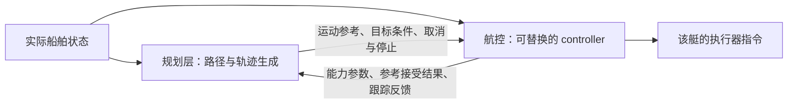

# 规划层与航控（controller）接口定义

日期：2026-09-12。状态：根据双方开发分工形成的接口核对稿，尚未修改运行时代码。

**采用顺序：第 0 章是本轮按现有 Python 系统整理的首版对接约定，优先采用。后续章节保留通用设计分析；其中新增 MotionReference 等内容是可选演进方案，不要求同事在替换现有控制器时先改变八列轨迹格式。**

## 0. 决策规划组与航行控制组的首版对接约定

### 0.1 分工与交付边界

实际分工：甲方掌握实船参数；用户所在小组开发决策规划；同事所在小组开发航行控制。双方以当前 Python 系统为基准，同事的新控制器替换当前 `controller` 实现。

| 责任方 | 负责交付或确认 | 不应默认已经具备的条件 |
| --- | --- | --- |
| 甲方 | 真实船体尺寸与参考点、导航数据定义、推进结构与已知运行限制、已有模型/试验资料 | 现有 Otter 参数不代表甲方实船；甲方不一定已有完整水动力参数 |
| 航控组 | 新控制器、实际状态的提供或转发、参考处理/控制状态反馈、经资料或辨识支持的可用运动能力 | 不要求其凭空估计无来源的状态或承诺未经验证的性能 |
| 决策规划组 | 路径和轨迹、任务/参考编号、目标要求、障碍与碰撞判断、统一跟踪评价 | 不直接使用旧艇模型推断新艇能力，也不直接使用新控制器的内部增益 |
| 双方共同 | 坐标/时间/速度语义、数据来源、完成/停止规则、联调工况与验收口径 | 同名字段不自动意味着意义一致 |

接口交付按三类信息组织：`VesselState`（实际状态）、`ControllerFeedback`（参考与控制反馈）、`VesselCapabilities`（配置及能力变化）。后两者是本文提出的字段分组名称，当前没有对应类或消息，使用现有包中的对象、字典或配置即可，不要求新增航控模块。

### 0.2 保留现有控制器输入

```python
command = controller.compute(state, trajectory, dt)

# 已有对象
state = VesselState(x, y, psi, u, v, r, stamp, frame_id)
trajectory = Trajectory(points, stamp, frame_id, goal)
# points 每行仍为 [t, s, x, y, theta, kappa, velocity, acceleration]
```

| 已有字段 | 双方采用的定义 | 类型/单位与约束 |
| --- | --- | --- |
| `t` | 相对 trajectory.stamp 的时间 | float，s；非负、严格递增 |
| `s` | 从本段参考起点起算的累计弧长 | float，m；非负、非递减；不能跨重规划版本直接当作同一进度 |
| `x,y` | 世界系中的期望控制参考点位置 | float，m；与 state.frame_id 一致 |
| `theta` | 当前 LOS 无侧滑参考中的期望艇艏 yaw | float，rad，正东零、逆时针正；不是未经转换的真北顺时针角度 |
| `kappa` | 该无侧滑前进参考的有符号曲率 | float，m⁻¹，左弯正；零速时不据此推断原地转向能力 |
| `velocity` | 当前 LOS 无侧滑前进参考的非负速度 | float，m/s；保留现有算法的不同反馈口径并单独确认新控制器语义，见下文 |
| `acceleration` | 上述参考速度对时间的变化率；现 LOS 按相邻输出点差分给出 | float，m/s²；不是 IMU 原始加速度 |
| `stamp` | 参考时间原点，与实际状态时间属于同一时钟域 | float，s；当前算法用 state.stamp−trajectory.stamp 计算参考年龄 |
| `goal` | 整个导航任务的最终位置；None 表示不按该目标做完成判定 | 有限 `(x,y)`，m；局部预测末端不是最终目标 |
| `dt` | 相邻控制调用之间的实际时间间隔 | float，s；由调用方测量；不是航控返回的导航报文间隔 |

**已有差异必须保留说明：** PID 使用 `velocity−hypot(state.u,state.v)`，LQR 将 velocity 放进期望艇体纵向速度槽，期望横向速度为零。这是两种历史反馈口径，不是一般情况下数学等价。首版兼容验证可从当前前进、侧滑较小的场景开始；实际 state.v 始终保留。新控制器交付前，航控组需明确速度闭环变量及其与本段参考运动的对应关系；明显侧滑、倒车或独立艏向/航迹向需求应另做接口扩展和验证，不能静默改变同一字段含义。

当前 PID/LQR 不直接消费 kappa 和 acceleration，LQR 的期望 r 也写为零；这不妨碍新控制器使用这些参考字段，但不能声称旧控制器已经实现对应前馈。

任务/参考编号与运行许可放在轨迹对象外的调用上下文中即可：`task_id, reference_id, valid_until`。它们是首版对接建议新增的元数据，不向八列 points 内插列。reference_id 应随新参考版本变化，不能假定现有任务 version 已经等价于每条轨迹的编号。

### 0.3 我方需要航控侧提供的实时实际状态

默认由航控组作为实际状态的对接责任方，提供或转发同一份状态给我方。若最终采用甲方设备直接向双方广播，则将唯一数据源写入接口记录，无需重复转发；传感器融合不因此被强行规定为控制算法的职责。

| 必需字段 | 定义及单位 | 当前 Python 对应 | 我方用途 |
| --- | --- | --- | --- |
| `x,y` | 统一艇体参考点的局部世界坐标，m；默认东/北为正 | `VesselState.x/y` | 路径起点、碰撞检测、CPA/相对运动计算的位置输入 |
| `psi` | 实际真艏向转换后的 yaw，rad；东零、逆时针正，统一到 [-π,π) | `VesselState.psi` | 艏向、船体轮廓朝向、速度转换 |
| `u` | 艇体参考点对地速度在艇艏方向的有符号分量，m/s；向前正 | `VesselState.u` | 本船运动预测和进退判断 |
| `v` | 对地速度在左舷方向的有符号分量，m/s；向左正 | `VesselState.v` | 横向漂移、相对运动、停车/轨迹评价 |
| `r` | 艇体系绕 z 轴角速度，rad/s；左转正 | `VesselState.r` | 转向运动预测；平面假设下近似 yaw 导数 |
| `stamp` | 状态实际对应的估计/测量时刻，s；明确与规划时钟的转换 | `VesselState.stamp` | 数据新鲜度和预测起算时刻 |
| `frame_id` | 世界系名称；另共同确认艇体参考点与地理原点 | `VesselState.frame_id` | 防止把不同原点/坐标轴的数据混用 |
| `validity` | 位置、艏向、速度、角速度分别是否有效及原因 | 当前 VesselState 没有该字段，需外围补充 | 缺测/失锁时不继续按正常状态规划 |

建议同时提供 `state_seq`、状态来源和质量/协方差信息；由哪个设备或估计器生成、是否已作安装位置补偿、是否为融合状态，需在联调记录中注明。

只有“经纬度、航速、航向”三个名称不足以完成对接。允许航控原始接口提供经纬度或东北向速度，由约定责任方换算，但最终进入我方规划时应得到上表状态。特别要区分真艏向与 COG、纵向 u 与非负 SOG、对地速度与对水速度。对地速度可由当前对象直接换算：

\[
v_E=u\cos\psi-v\sin\psi,\qquad v_N=u\sin\psi+v\cos\psi.
\]

当前 ROS 接入为 `odom`：位姿从消息 header.frame_id 转到规划 frame，速度要求已在 child_frame_id 指定的艇体系中。继续沿用 ROS 时，可保持这条状态输入接口。当前默认状态超时为 0.5 s，这是仿真配置，不是实艇允许延迟的既定指标。

### 0.4 我方需要航控侧提供的参考与执行反馈

| 字段 | 定义 | 首版要求 |
| --- | --- | --- |
| `feedback_stamp,used_state_stamp` | 反馈生成时刻与本次使用的实际状态时刻，s | 必需；防止“控制在运行、状态却已陈旧” |
| `task_id,reference_id,active_reference_id` | 被回复的任务/参考及当前真正采用的参考 | 必需；避免旧参考的完成状态结束新任务 |
| `reference_result,reason` | 接受或拒绝新参考及原因 | 必需；新参考拒绝后说明旧参考是否继续 |
| `control_state` | READY、TRACKING、SETTLING、HOLDING、LIMITED、FAILED、CANCELLED 等约定状态 | 必需；此枚举为接口建议，不是当前 AlgorithmStatus 的原样列表 |
| `compute_status` | 本周期控制计算的结果 | 沿用或映射当前 status；SUCCESS 仅表示计算成功，不能冒充实船已完成执行 |
| `goal_condition_met` | 实际状态是否满足约定到点/保持条件 | 必需；到点判断依据状态，不根据参考轨迹预测末端 |
| `limitation,replan_required,can_continue` | 控制受限原因、是否请求重规划、当前参考是否还能继续 | 必需；例如转向能力不足、状态无效、连续求解失败 |
| `capability_version` | 采用的能力配置版本，变化时通知 | 必需；按新能力重检现有参考 |
| `active_segment,reference_time` | 当前采用的参考段和参考相对时间 | 建议；我方也可按时间计算基准参考，不能与控制器内部前视点混淆 |
| `tracking_errors,compute_time` | 可选误差诊断、实际计算耗时 | 建议；统一误差优先由我方公共评估模块根据实际状态和原始参考计算 |

到点条件沿用当前基础逻辑时，为最终位置误差不超过 position_tolerance，且 `hypot(u,v)` 不超过 speed_tolerance。精度由双方按任务要求确认；不能在规划侧和航控侧分别维护冲突值。固定艏向、转向率和持续满足时间可按任务扩展。持续驻位不应因某一时刻合格就停止控制。

现有 `ControlCommand(left,right,lateral,status,message)` 中，left/right/lateral 是向执行侧的控制量；规划通常只需关联 status/message，后者也不足以代替上表。若目前无法获得实际执行或健康状态，应明确报告未知或仅“参考已被控制算法采用”，不能把发送了指令写成已在实船执行。

### 0.5 我方需要航控组整理的配置与能力参数

| 参数 | 定义与单位 | 原系统位置/当前覆盖 | 提供责任 |
| --- | --- | --- | --- |
| `footprint,reference_point` | 物理轮廓或长宽及其参考点，m；规划安全余量单独设置 | `navigation.footprint_length/width`；不能随意用另一个含义的艇长字段替代 | 甲方确认尺寸；双方确认参考点；航控/配置责任方提供版本一致的数据 |
| `speed_min/max,cruise_speed` | 约定工况下的可用速度范围和建议巡航速度，m/s；注明速度含义 | `dynamics.velocity_min/max/cruising_speed` | 航控组根据甲方资料或试验整理；我方选择任务速度 |
| `accel_min/max` | 纵向速度变化率范围，m/s²；注明速度区间和是否主动制动 | `dynamics.acceleration_min/max` 已有字段；现 LOS 并未完整按这些边界约束参考 | 航控组提供适用条件和依据；我方落实规划约束 |
| `yaw_rate_bounds(speed)` | 不同速度区间可实现的左右转向率，rad/s | 当前 LOS 使用配置 `yaw_rate_max`，不是自动由实船识别的能力 | 航控组提供；我方用于转向和弯道速度约束 |
| `yaw_accel_bounds` | 转向率变化范围，rad/s² | 当前没有通用能力接口 | 建议由航控组提供，不能凭旧艇参数填写 |
| `stop_time/distance/envelope` | 指定初态、停止策略和终止阈值下的停车时间/距离/运动包络，s/m | `common.dynamics` 含 Otter 动力学及特定制动策略；默认规划接口不提供通用停车性能表 | 航控组提供模型/辨识依据；我方做路径与障碍判断 |
| `response_delay` | 接受参考到运动产生有效响应的延迟界或估计，s；注明包含环节 | 当前没有统一字段 | 双方通过控制实现与链路实测确认，避免重复计入延迟 |
| `supported_modes` | 是否支持轨迹倒车、原地转向、定点保持等，及成立条件 | 当前轨迹 PID/LQR 不接受负参考速度；执行器能反推不等于轨迹接口支持倒车 | 航控组声明；我方只下发双方支持的模式 |
| `version,conditions,source` | 配置版本、载荷/环境适用范围、来源与未知项 | 需要补充资料记录 | 双方负责人确认；未知不得填写成 0 或虚构数值 |

这是联调前的配置资料和能力变化通知，通常无需逐控制周期回传完整表格。能力描述应保守且有适用条件，不能将单独的最大速度、最大转向率和最大加速度随意组合成必然可达状态。

质量、转动惯量、附加质量、阻尼、推进器力臂及标定曲线主要供航控同事设计控制器。我方若只消费轨迹和能力包络，不必逐项接收这些内部模型参数。**若我方保留当前基于具体动力学的制动/转向预测，则必须获得匹配新艇的模型，或与航控组约定可替代的预测/保守运动包络；不能继续使用旧 Otter 模型。**

工作树内的 `common.dynamics` 包含上述预测工具。规划若接入该工具，应明确模型与新艇一致；不能仅因工具文件存在就认定当前默认主链已经执行特定的制动/驻位任务。

### 0.6 时间、频率与联调要求

现有默认控制频率为 10 Hz、规划频率为 5 Hz。首轮软件联调可先沿用，实际状态建议至少按控制所需速率提供（例如先协商 10–20 Hz）；这些是联调起点，不是已确认的甲方设备指标。控制反馈可每控制周期生成，对规划侧按约定频率提供；拒绝参考、失败和能力变化应及时通知。能力配置初始化提供、变化时更新。

`state.stamp`、`trajectory.stamp+t`、反馈生成时刻、控制调用间隔 dt 分开定义。对重复发布的旧状态不能刷新其采样时间；ROS 仿真时间和实船时间需在切换时明确映射。消息失效期限与到点误差、反应时间一起纳入双方约定。

双方首轮验收至少覆盖：同一轨迹格式可由新旧控制器读取；状态四方向与速度符号正确；实际侧滑不被填零；新参考切换/拒绝/取消对应正确编号；状态断流明确反馈；到点基于实际状态；超过新艇能力的参考不会被无条件接受；控制误差按统一时刻与定义计算。此处只规定接口，不宣称已经通过新控制器或实艇验证。

### 0.7 可直接发给航控同事的需求

> 我方以现有 Python 系统开发决策规划，首版请保留 `compute(state,trajectory,dt)` 和 `[t,s,x,y,theta,kappa,velocity,acceleration]` 八列轨迹输入。请航控侧明确实际状态来源并提供 x、y、psi、u、v、r、时间戳、坐标系及有效性；回复当前采用的任务/参考编号、参考接受/拒绝结果、控制状态、到点情况及受限/重规划原因。另请依据甲方资料或试验整理船体轮廓与参考点、速度/加减速/转向能力、停止性能、响应延迟和支持模式，注明单位、条件、版本及尚未获得的数据。当前 PID/LQR 速度反馈口径不同，请在交付新控制器前共同确认。质量、水动力和推进器参数可保留在控制实现内部；若决策侧需要动力学预测，另约定共享模型或保守预测接口。

## 1. 本文的“航控”与设计目标

**航控就是 USV 的控制层，对应当前 `controller` 包。更换 USV 后，可能重新设计该包中的控制器；本需求是稳定规划层与控制层之间的接口，不是新增一个航控通信模块。**

上一版 `control-autopilot-interface.md` 将航控理解成独立下位机，重点放在推进器通信与硬件反馈，不作为本需求的接口定义。本文件取代它作为当前设计依据。

默认分工保持当前算法层次：`path_planner` 和 `trajectory_planner`（包括现有 LOS）属于规划/参考生成侧；`controller` 负责跟踪参考并形成具体艇型的执行指令。如果以后把 LOS 放入控制侧，应另行调整“路径接口”和“时间轨迹接口”，不能让双方都默认由对方完成制导。



这是逻辑分工，不要求新增 ROS 节点或功能包。接口类型可以扩展在现有 `common` 中。规划层不必知道底层采用 PID、LQR、MPC，或该艇使用双推进器还是推进器加舵。

目标是：**换艇时更换控制实现、艇型配置及经过验证的能力描述；规划代码继续消费同一类参考、反馈和能力接口。** 算法不需因艇型变化重写接口，不代表任意轨迹都能由任意艇执行。

## 2. 当前代码的实际边界

| 当前内容 | 已有行为 | 接口问题 |
| --- | --- | --- |
| `Controller.compute(state, trajectory, dt)` | PID/LQR 输入实际状态、时间轨迹与控制步长 | 基本可保留；需明确参考速度/艏向语义 |
| `VesselState` | `[x,y,psi,u,v,r]`、时间戳、frame | 是规划与控制共享的实际状态输入，不是控制器计算出的实测反馈 |
| `Trajectory` | 八列 `[t,s,x,y,theta,kappa,velocity,acceleration]` | `velocity` 在 PID 中用于速度大小，在 LQR 中用于纵向速度；有侧滑时不等价 |
| `ControlCommand` | 左右/侧推归一化输出，以及算法 status/message | 执行指令属于向下接口；其 status 不是完整的规划反馈 |
| `USVModel` | 包含运动限制、质量/惯量、阻尼、推进器力臂等 | 把规划需要的运动能力和具体控制动力学放在一起，且校验限定 Otter/Differential |
| 普通导航终点处理 | `runtime.py` 读取 `pid_controller` 或 `lqr_controller` 的到点容差来约束 LOS | 规划层依赖具体算法参数名；应改为统一的目标接受条件 |
| 动力学预测工具 | `common.dynamics` 可预测执行一周期命令及后续制动的运动 | 规划使用该工具时，需同步更新艇型模型；不因文件存在就认定默认主链已经启用该预测 |
| 参考发布 | `local_trajectory` 是用于显示的 `nav_msgs/Path` | 丢失速度、加速度等数值参考；独立进程通信时不能把它当成完整控制轨迹 |
| 阵位保持 | `compute(state,target_pose,dt)`，持续保持时不以 GOAL_REACHED 结束 | 与轨迹跟踪模式需要显式区分 |

代码依据：

- [状态、模型与执行量](../src/core/shared/common/common/models.py)
- [轨迹数据结构](../src/core/decision_module/trajectory_planner/trajectory_planner/trajectory.py)
- [LOS 参考生成](../src/core/decision_module/trajectory_planner/trajectory_planner/los_trajectory_planner.py)
- [PID](../src/core/control_module/controller/controller/pid_controller.py)、[LQR](../src/core/control_module/controller/controller/lqr_controller.py)
- [控制器公共逻辑](../src/core/control_module/controller/controller/controller.py)、[工厂函数](../src/core/control_module/controller/controller/controller_factory.py)
- [阵位保持](../src/core/control_module/controller/controller/station_keeping_controller.py)
- [规划与目标容差](../src/sim_env/sim_env/runtime.py)、[动力学预测工具](../src/core/shared/common/common/dynamics.py)

## 3. 可选演进：更完整的运动参考

本节是第 0 章八列基准之外的后续演进分析，不是首版替换控制器的前置要求。需要支持明显侧滑、独立艏向/航迹向或更完整运动状态时，再共同定义新版本参考；不要静默更改现有字段含义。

| 字段 | 定义 | 单位/规则 |
| --- | --- | --- |
| `mission_id, reference_id` | 任务与本次参考版本；反馈必须回指当前实际执行的 reference_id | 重规划产生新版本；旧反馈不能结束新任务 |
| `mode` | `TRACK_TRAJECTORY`、`HOLD_POSE`、`STOP` 等 | 只能选择该艇声明支持的模式；STOP 的行为必须单独约定 |
| `frame_id, origin_id` | 参考所处的局部世界系及原点版本 | 与实际状态一致；重定位/原点变化后重新对齐 |
| `start_time, valid_until` | 轨迹时间原点与最后允许使用时刻 | 统一时钟域；区分数据有效期和轨迹预测长度 |
| `time_from_start` | 每个参考点相对 start_time 的时间 | s，严格递增 |
| `x_ref,y_ref` | 艇体控制参考点的期望位置 | m，世界系 |
| `psi_ref` | 期望艇艏方向 | rad，正东为零、逆时针为正；不同于一般情况下的轨迹切向 |
| `u_ref,v_ref` | 期望对地速度在期望艇体系中的纵向/横向分量 | m/s，前/左为正；初版可按无侧滑参考令 v_ref=0，但实际 v 不得被强制填零 |
| `r_ref` | 期望艇体 z 轴角速度 | rad/s，左转为正；平面模型下是期望 yaw 的导数 |
| `du_ref_dt`（可选） | 期望纵向速度分量 u_ref 对时间的导数 | m/s²；不是自动等于 IMU 的 x 轴加速度读数 |
| `goal_condition` | 最终目标、位置/艏向/速度/转向率容差、持续满足时间，以及哪些条件适用 | 容差单位固定，双方使用同一份条件；不是读取某个 PID 配置名 |

这里选择完整的期望运动状态来消除当前 `velocity` 的歧义，并不意味着可以任意指定六个互不相容的目标，也不意味着艇具有六个独立可控自由度。平面参考应满足

\[
\dot x_d=u_d\cos\psi_d-v_d\sin\psi_d,\quad
\dot y_d=u_d\sin\psi_d+v_d\cos\psi_d,\quad
\dot\psi_d=r_d.
\]

还必须落在该艇可实现的运动范围内。欠驱动艇可跟踪某些 v_ref=0 的运动轨迹，不代表能独立命令任意横向速度。

对于当前无侧滑 LOS 参考，可在兼容适配中使用 `u_ref=velocity,v_ref=0`；在速度非零且曲率确实表示该参考轨迹切向变化率时，可用 `r_ref=velocity*kappa`。新控制器是否使用 r_ref 前馈由其实现决定，不能据此宣称现有 PID/LQR 已消费该字段。

若存在侧滑，轨迹切向 χ 与艏向 ψ 满足 `χ=ψ+β`，此时 `U*kappa=dot(χ)`，不一定等于 `r=dot(ψ)`。不应在通用接口中把曲率与艇体转向率无条件互换。

`goal_condition` 由任务要求提出、控制层检查可接受性；控制层不能默默放宽精度。到点应根据实际位置、速度等满足条件并持续指定时间判断，而不是预测轨迹末端已经到点。`HOLD_POSE` 返回保持状态，直到取消或退出，不因某一时刻误差合格就终止保持。

## 4. 控制层需要向规划层返回哪些参数

应分成四类：实际状态的访问、艇型运动能力、当前执行反馈、可选的预测/可执行性评估。它们更新频率和来源不同，不需要每帧重复发送所有模型资料。

### 4.1 实际船舶状态：共享输入或统一对外反馈

| 参数 | 定义 | 单位与符号 |
| --- | --- | --- |
| `x,y` | 统一艇体参考点在局部 ENU 下的位置 | m，东/北为正 |
| `psi` | 实际真艏向转换得到的 ROS yaw | rad，东零、逆时针正 |
| `u,v` | 参考点对地速度在当前艇体系中的分量 | m/s，前/左为正，带符号 |
| `r` | 艇体绕 z 轴角速度 | rad/s，左转正；非平面时不能直接当作欧拉 yaw 导数 |
| `state_stamp,state_seq` | 状态估计实际对应时刻及序号 | 同一时钟域；不以收包时刻掩盖旧状态 |
| `frame_id,origin_id` | 世界系、地理原点版本；艇体参考点另有固定配置 | 与参考轨迹一致 |
| `validity,quality` | 状态是否有效、精度及估计器重置情况 | 未知和无效不能当成零误差/零速度 |

若航控系统已经负责状态估计，可以统一由它对规划层返回以上状态。如果状态来自单独的定位/融合来源，规划与控制直接共享 `VesselState` 即可，不需要控制器再产生另一套“实际状态”。控制反馈应记录本次使用的 state_stamp，避免把不同时间的误差和状态拼在一起。

`u,v` 的对地语义服务于规划和轨迹跟踪；水动力控制若需要对水速度，应使用另有明确来源的对水速度/流速估计。不得让不同艇型在同名字段中分别填对地或对水速度。

### 4.2 艇型及当前可用运动能力：换艇时最关键的接口

| 建议参数 | 精确定义 | 规划层如何使用 |
| --- | --- | --- |
| `footprint` | 相对控制参考点的物理船体轮廓，多边形顶点单位 m；简化时为带参考点位置的长宽 | 碰撞检测、通道可通过性；规划安全余量另设 |
| `supported_modes` | 支持路径/时间轨迹跟踪、倒车、原地转向、定点保持等哪些模式及成立条件 | 不给普通推进器加舵艇直接安排差动原地转向 |
| `speed_range` | 约定条件下允许的有符号纵向速度范围及低速有效区间 | 速度采样、时间分配；倒车能力单独声明 |
| `surge_accel_bounds` | 随速度/工况变化的 `du/dt` 上下界，m/s² | 限制加速和减速参考；区分主动制动与停推滑行 |
| `yaw_rate_bounds` | 随速度/工况变化的 r 下上界，rad/s | 限制弯道速度、转向轨迹和动态避障候选 |
| `yaw_accel_bounds`（建议） | 随速度/工况变化的 `dr/dt` 下上界，rad/s² | 防止规划瞬间由右转切换到最大左转 |
| `response_delay` | 从接受新参考到产生有效运动响应的延迟界/估计，s；注明包含哪些环节 | 障碍预测与制动裕量，避免重复计入同一段延迟 |
| `stopping_envelope` | 给定初始状态、停止策略及条件下的停车时间、距离或扫掠轨迹范围 | 终点减速、动态避碰、不可继续跟踪时的处置 |
| `tracking_envelope`（经验证后可提供） | 指定速度/曲率/扰动范围内的跟踪误差界或统计量，明确二者区别 | 规划轨迹与障碍之间预留控制误差空间 |
| `capability_version,valid_until,conditions` | 能力版本、有效期、载荷/风流/供电等适用条件、来源与不确定性 | 能力变化时检查当前轨迹或触发重规划 |

这些参数可由艇型配置、仿真辨识或实艇试验得到；控制层对外提供统一描述，不要求控制器在线辨识所有参数。物理尺寸与艇型能力可以集中配置、让规划与控制共享，避免两边手工维护冲突的值。

不能只把 `u_max`、`r_max`、`a_max` 三个独立极值组合起来认为一定可达。更一般需要描述联合可行域：

\[
\mathcal F(\boldsymbol\nu,\mathcal C)
=\{(\dot u,r,\dot r):\text{在状态和条件 }(\boldsymbol\nu,\mathcal C)\text{ 下可实现}\}.
\]

初版可以采用经过验证的保守分段表，例如不同速度区间对应不同的转向率与加减速限制。分别给出的区间若只是各自投影极值，不能把它们的笛卡尔积视为联合可行域；必须同时约束或另做可执行性检查。

最小转弯半径只适合特定非零速度与运动假设。平面无侧滑时可用 `R=|u/r|` 换算；零速原地转向和驻位不能靠一个固定的 `R_min` 表达。支持差动推进也不代表支持任意横移。

停车距离要明确停止策略、终止速度阈值、初始速度/转向状态、延迟是否已计入以及工况。`u²/(2a)` 仅是恒定减速度且满足对应假设时的近似；一般 USV 应使用经过验证的制动过程或保守包络。横流下停推不意味着对地速度为零。返回停车中心线时，还需结合船体轮廓和误差包络得到扫掠区域。

### 4.3 运行反馈：规划层决定继续、减速或重规划的依据

| 建议字段 | 定义 | 使用方式 |
| --- | --- | --- |
| `feedback_stamp,state_stamp` | 反馈生成时刻和计算所依据的实际状态时刻 | 判断反馈是否新鲜、误差是否对齐 |
| `active_reference_id` | 当前实际采用的参考版本 | 丢弃旧任务/旧参考的完成和错误反馈 |
| `reference_result` | 对某 reference_id 的接受/拒绝及原因 | 接受表示通过约定检查，不代表未来跟踪一定成功 |
| `controller_state` | 未准备、跟踪中、接近目标/减速中、保持中、受限、失败、取消等 | 形成统一状态，不依赖 PID 或 MPC 内部变量 |
| `progress` | 当前参考段、路径弧长进度及所采用的参考时刻 | 处理轨迹更新、交叉路径和恢复执行 |
| `tracking_error` | 横向/纵向位置、艏向、速度、转向率误差及各自有效标记 | 判断是否偏离可接受范围；算法间使用同一评价口径 |
| `goal_condition_met` | 当前实际状态是否满足双方约定的目标条件 | 与持续时间和模式共同判断；规划/任务层保留最终任务管理权 |
| `limitation` | 速度、转向、加速度约束生效，求解超时，状态无效等原因 | 区分暂时限幅、轨迹不可跟踪与控制器不可用 |
| `replan_request` | 是否请求重规划、原因、相关参考区间、当前参考还能否继续 | 控制层报告执行困难，规划层负责产生新参考 |
| `current_capability_version` | 当前实际采用的能力版本；能力变化时附新的描述或标识 | 不继续使用新艇/降额前的旧约束 |

位置、速度、艏向误差可由公共评估函数计算，不必由每个控制算法各写一套。这样更换控制器时，性能反馈口径也保持一致。

时间轨迹误差用实际状态时刻 `t_s` 对齐参考，而不是控制器内部任意选取的前视点：

\[
\boldsymbol e_p=\boldsymbol p(t_s)-\boldsymbol p_d(t_s),\quad
e_\psi=\operatorname{wrap}(\psi(t_s)-\psi_d(t_s)),\quad
e_u=u(t_s)-u_d(t_s),\quad e_r=r(t_s)-r_d(t_s).
\]

如需沿轨迹/横向误差，以已定义的参考轨迹切向 χ_d 而非有侧滑时的艏向 ψ_d 建立切向与左法向：

\[
e_\parallel=\cos\chi_d\,e_x+\sin\chi_d\,e_y,\qquad
e_\perp=-\sin\chi_d\,e_x+\cos\chi_d\,e_y.
\]

`e_perp>0` 表示位于参考切向左侧。对几何路径投影误差，应沿已确认进度搜索参考段，避免在交叉路径跳到另一段；同时报告 segment_id/projection_s。时间对齐误差与空间投影误差应分字段，不能混成一个“横向误差”。静止点若无可用切向，应标记该误差无效或使用显式定义的路径切向。

### 4.4 可选：可执行性与预测

对于 DWA/MPC 或包含制动预测的规划，可提供统一的 `assess_reference` / `predict_motion` 能力：返回在指定初始状态、参考和模型条件下的可执行性、违反约束的区间，或带时间的预测运动轨迹及误差信息。

这不是要求所有 PID 控制器实现 MPC。预测可由共享的艇型运动模型提供，也可以使用经过验证的保守能力包络；不支持时返回“不支持/未知”，不能伪造预测或把未知当作可行。若规划接入现有 Otter 动力学工具，换艇时必须替换对应模型实现或规划预测方式，而不是继续套用原艇动力学。

能力声明和预测可行性都不是无碰撞保证。规划层仍需要障碍预测、状态误差、控制跟踪误差、时延及适用工况；这些条件超出验证范围时应降级处理。

## 5. 哪些参数留在控制层内部

| 参数/实现 | 所属范围 |
| --- | --- |
| PID 的 Kp/Ki/Kd、积分状态、抗饱和策略 | 具体控制器内部 |
| LQR 的 Q/R、线性化与增益求解，控制 MPC 的权重 | 具体控制器内部 |
| 质量、惯量、附加质量、阻尼系数 | 艇型动力学配置；预测模型需要时通过共享模型或明确模型接口访问 |
| 推進器数量、舵角映射、左右推力分配与驱动标定 | 控制与执行侧实现 |
| 左右归一化量、PWM、RPM、电机诊断 | 向下执行和诊断数据；不是通用规划层必须消费的反馈 |

通用规划算法消费运动能力和可执行性，不需要为了知道“能否转过这个弯”而直接读取 `k_p_course` 或推进器力臂。研究型规划器若确实采用特定动力学模型，可以显式依赖该模型，但不能声称它在只换控制器后自动适配所有艇型。

## 6. 可选演进的接口形式

以下为伪代码契约，未新增类、节点或 ROS 消息：

```python
# 使用现有 common 承载公共数据定义即可。
VesselState       # 实际状态，规划和控制共享
MotionReference   # 带版本、时间、模式、完成条件的运动参考
VesselCapability  # 物理轮廓、可用运动范围与适用条件
ControlFeedback   # 当前参考、跟踪状态、误差、限制与重规划原因

controller.capabilities(context) -> VesselCapability
controller.compute(state, reference, dt) -> ControlResult

ControlResult.actuation  # 交给本艇执行侧，不是规划输入
ControlResult.feedback  # 交给规划/任务侧，艇型无关

# 可选能力，可由共享模型提供，不要求每个控制算法都实现。
assess_reference(state, reference, capability) -> FeasibilityReport
```

对于仍采用同一进程对象调用的当前系统，可以直接返回这些数据；不需要为了梳理接口新增模块。如果以后使用 ROS 消息，同样保持字段和语义，不直接发送丢失速度/时间信息的显示用 Path。

## 7. 参考切换、失效与完成规则

1. 新参考先做版本、坐标、时间、支持模式和能力检查，再原子切换 active_reference_id。拒绝新参考时，明确回复旧参考是否仍在执行及其剩余有效性；不能让规划侧误以为新参考已生效。
2. 状态失效、参考过期、控制不可用要返回明确原因并执行约定停止/降级策略。STOP 应约定是停推、主动制动还是保持；不支持的停止/保持模式不能默默接受。
3. 控制器内部预瞄时间与规划反馈误差定义分开。用于算法控制的前视误差可进入诊断，不替代统一的时间对齐跟踪误差。
4. 到点由实际状态判断。GOAL_REACHED 是跟踪结果，任务是否结束由任务逻辑决定；持续驻位需持续反馈保持质量。
5. 控制周期、允许的参考更新间隔、反馈有效期、最大可接受状态年龄作为运行配置约定。当前控制默认 10 Hz、规划默认 5 Hz，不将这些值固定成所有艇型必须使用的标准。

## 8. 对当前工程的最小改造顺序

| 顺序 | 修改目标 | 对应位置 |
| --- | --- | --- |
| 1 | 冻结共享状态、目标条件和参考速度/艏向语义 | `common.models`、`trajectory_planner.trajectory` |
| 2 | 规划所需的几何/运动能力与控制内部模型参数明确分开 | 现有艇型配置、`USVModel` 及其消费者 |
| 3 | 规划使用统一 goal_condition，解除具体 PID/LQR 配置名依赖 | `sim_env.runtime`、任务参数生成与控制配置装配 |
| 4 | 在控制结果之外提供统一执行反馈，保留现有执行量出口 | `controller` 及调度层的结果处理 |
| 5 | 放开并验证艇型选择，替换控制、动力学预测与能力配置 | controller factory、模型验证、任务制动/转向预测 |
| 6 | 在同一规划参考协议下测试不同艇型、不同控制器 | 数值回归、仿真闭环及换艇验证 |

本次只完成接口梳理与设计修正，未执行上述运行时改造。

## 9. 接口验收建议

- 同一份 MotionReference 分别交给不同控制器，字段解释相同；不支持的模式明确拒绝。
- 更换艇型能力后，规划生成的速度、转向和减速轨迹符合新的联合约束；不再读取旧艇 PID/LQR 参数或旧动力学。
- 构造非零横向速度，确认没有把 SOG、纵向 u、航迹向和艏向混用。
- 重规划、取消、旧参考回包、状态过期和坐标原点变化时，active_reference_id 与实际执行一致。
- 到点判定采用一致的位置/速度/艏向/持续时间条件；驻位任务持续运行。
- 对比横向误差 RMS/P95/最大值、艏向和速度误差、约束触发次数、重规划次数、求解时间及目标完成率；口径由公共评估定义。
- 若要把跟踪误差或停车范围用作安全包络，另验证工况覆盖和保守性，不能用单次成功或平均误差代替界。

不同艇型的速度、加减速、转向和停车参数需要真实配置或辨识数据。本文不填造新艇数值，也不将接口设计稿表述成已经完成的换艇验证。
