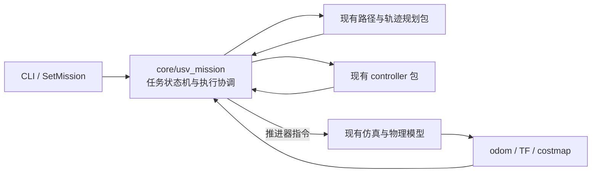

# 定点任务迁移至 core

## 已确认的职责与本轮范围

任务下发、任务参数、状态机、任务执行协调和指令发布调度归 `src/core/usv_mission`。定点值守与阵位保持是该模块支持的任务；以后新增感知、规划或控制设计时，仍按各自职责确定修改范围。

现有 `controller`、`trajectory_planner`、`common` 的算法及数值工具保持当前位置和行为，本轮调用其已有接口。`docs/planning-control-interface.md` 是规划—控制接口设计稿，本次迁移不实施其中的换艇、公共参考协议或控制器重构。独立控制开发快照和导出工具保持原样。

`sim_env` 只撤回上一版定点功能引入的改动，不覆盖同文件中的毫米波雷达改动。船体模型、世界、推进器插件、推力映射及物理参数不在本轮修改范围。

## 迁移清单

| 内容 | 新位置／处理方式 |
|---|---|
| 任务状态机、任务规划与参数校验 | `src/core/usv_mission/usv_mission` |
| ROS 任务节点、控制调度和唯一指令出口 | `usv_mission.node:main`，默认节点名 `mission_manager` |
| 任务 CLI、示例和显示配置 | 新任务包的 `mission_cli`、`config`、`rviz` |
| 单独任务节点启动 | `ros2 launch usv_mission mission.launch.py` |
| 仿真与任务组合启动 | `ros2 launch usv_mission mission_sim.launch.py`；复用原仿真节点，省去 `sim_env_node` |
| 任务服务类型 | 继续使用现有新增任务接口包 `usv_mission_interfaces` |
| 数值及 ROS 任务测试 | 新任务包 `test` |
| 任务验收、绘图、构建与安装审计工具 | 新任务包 `validation` |

新任务节点直接消费 odom、TF 和代价地图，通过已有 Python 接口调用规划与控制算法；不继承 `Simulator`，不依赖其私有状态、私有方法或任务分派逻辑。独立任务启动不会同时启动旧导航节点；运行中检测到推进器话题存在其他发布者时锁存控制冲突，停止本节点的指令发布并拒绝新任务。



启动组合保证初始只有一个指令发布节点，运行时 ROS 图检测用于发现冲突。发布者计数属于冲突检测，不提供分布式执行器租约；检测到实际冲突后保持锁定，需处理冲突并重启任务节点。

## 验证与版本边界

迁移前的源码和逐文件 SHA256 已保存在本地 `validation/station-guard-migration-001/before`。此前 `station-guard-001` 的 713 项测试和 21 次闭环验收仅代表迁移前版本，原文件与结果保留。

迁移后的测试与闭环结果使用新的独立工作区 `/home/usv/usv_migration/station-guard-core-001` 和新的证据目录。计划依次核验：

1. 任务包可以独立导入，现有包不再反向依赖任务包。
2. 仿真物理资源、并行雷达与控制工作未被修改；原仿真入口恢复任务前职责。
3. 原任务数值合同、CLI、ROS 调度及新增发布者冲突门控。
4. 新启动图中仅任务节点发布推进器指令，不存在旧 `usv_simulation` 节点。
5. 七场景各三次闭环重复和普通导航兼容性；保持原精度、时间及安全阈值。

## 构建与测试记录

新的独立工作区已构建 18 个软件包，安装审计全部通过。任务模块和原工程验证范围执行 `pytest src scripts/validation`，结果为 **838 passed**；包含独立控制导出测试的 `pytest src scripts` 为 **846 passed**。

全量结果使用一次性的 `PYTEST_ADDOPTS="-o testpaths=src/common/test"`。原因是未改动的控制导出测试采用最小夹具，只创建 `common/test`；WSL 系统 pytest 6.2.5 会拒绝其配置中的其他缺失目录，Windows pytest 9.1.1 则可通过。父命令显式收集 `src scripts`，覆盖仅影响该测试内部没有指定路径的子 pytest，原先关于 `2 failed, 1 passed, 7 skipped` 的严格断言保持生效。该设置没有写入工程或默认构建脚本。

首次测试收集冲突通过重命名新任务包中的四个测试文件解决。撤回旧任务代码时，也保留了现有雷达测试使用的 `last_published_command` 诊断记录；该字段只记录已发布指令，不包含任务逻辑，不改变控制计算或物理响应。三轮失败／兼容性定位日志均保留，未覆盖或删除。

## 迁移后的闭环结果

迁移已完成。以下结果全部来自新的 `station-guard-core-001` 工作区；源码及安装目录在任务矩阵和两套导航回归结束后仍与矩阵开始时一致。

| 验证内容 | 结果 |
|---|---|
| 全工作区构建、安装发现与入口审计 | 18 个软件包构建完成；安装审计全部通过 |
| 任务模块与原工程验证测试 | 838 项通过 |
| 加入独立控制导出测试的全量测试 | 846 项通过；pytest 6.2.5 兼容条件见上文 |
| 七任务场景，每场景三次重复 | 21/21 通过；无失败、受阻或遗漏 |
| 新任务节点的普通导航及故障回归 | 6/6 通过 |
| 恢复后的原 `sim_env` 导航入口 | 6/6 通过 |
| 任务矩阵中的运行时 ROS 图观测 | 6,898 次全部通过；没有旧导航节点或多推力发布者 |

七个场景分别为常规阵位保持、受扰动阵位保持、待机越界返中心、待机避障、顺时针绕圆、逆时针绕圆及绕圆避障。两套导航回归均覆盖直航、转向、单障碍、目标替换、取消和里程计掉线。

在本次 Otter/Gazebo 实测中，九个保持评分窗口各为 **60 秒、600 个样本**，位置 ≤0.5 m 且艏向误差 ≤5° 的联合达标率均为 **100%**。窗口内最大位置误差 **0.074912 m**，最大艏向误差 **0.224812°**；九次绕圆试验中，正常绕圆阶段径向误差 P95 的最大值为 **0.145298 m**。两类避障场景的最小全船体障碍间距为 **0.430826 m**，高于沿用的 0.2 m 验收阈值。这些数值用于迁移回归，不表示本轮改进了控制算法。

## 交付与复现

- [任务模块说明](../src/core/usv_mission/README.md)：模块边界、启动和任务下发。
- [任务验证入口](../src/core/usv_mission/validation/README.md)：新副本构建、矩阵和两套导航回归命令。
- [本次验收归档](validation/station-guard-core-001/README.md)：原始记录、三轮测试定位日志及安装审计。
- [21 次试验指标表](validation/station-guard-core-001/trial-metrics.csv)、[九个保持窗口](validation/station-guard-core-001/station-windows.csv) 和 [实测汇总](validation/station-guard-core-001/measured-summary.json)。
- [绕圆避障图](validation/station-guard-core-001/figures/orbit_obstacle/mission_plots.png)、[受扰动保持图](validation/station-guard-core-001/figures/station_disturbance/mission_plots.png)。七场景固定选择第 1 次重复出图，共 10 张 PNG 与 10 张 PDF。
- [完整构建源码快照](validation/station-guard-core-001/build-source-snapshot.tar.gz)、[逐文件源码清单](validation/station-guard-core-001/source-snapshot.json)、[修改边界核验](validation/station-guard-core-001/receipts/boundary-check.json) 和 [归档校验清单](validation/station-guard-core-001/SHA256SUMS)。完整源码快照包含现有依赖与雷达源码，不能将整个快照当作本轮修改清单。

当前项目中 341 份受检源码与配置均与验收副本一致；迁移前记录的算法、接口、根测试配置及传感器配置共 17 个文件保持原哈希，冻结后核对的物理资源、算法及独立控制工作文件共 152 个也保持一致。原 `station-guard-001` 的 643 份已归档文件校验通过，仍作为历史记录保留。

完整构建快照中的 647 个文件也与当前工作区逐一核对通过；该核对覆盖文件内容，跨平台文件权限不作相等要求。本次交付目录的 355 项校验均已通过。

本次源码指纹为 `a44de962ec71c93ccf4f414a94951ae0318de4a3e187d72ecee8ef66d652c7ec`，安装目录指纹为 `f3c70f61a774431cec45a1de8b6221166d569266f17ef74a9d7dd5a3722de80c`。这些是验收工具定义的代码、配置及安装文件指纹；完整源码归档的逐文件哈希另见源码清单。

使用已经验收的独立工作区启动：

```bash
cd /home/usv/usv_migration/station-guard-core-001
source install/setup.bash
ros2 launch usv_mission mission_sim.launch.py world:=ocean
```

在加载同一工作区的另一个终端下发阵位保持示例：

```bash
ros2 run usv_mission mission_cli start "$(ros2 pkg prefix --share usv_mission)/config/mission/examples/station_keep.yaml"
```

若在当前 WSL pytest 6.2.5 环境重建包含独立控制导出测试的完整验证副本，使用尚不存在的输出目录，并显式保留上述兼容设置：

```bash
PYTEST_ADDOPTS="-o testpaths=src/common/test" \
  bash src/core/usv_mission/validation/build_missions.bash \
  /path/to/source-checkout /home/usv/usv_migration/station-guard-core-repro
```
