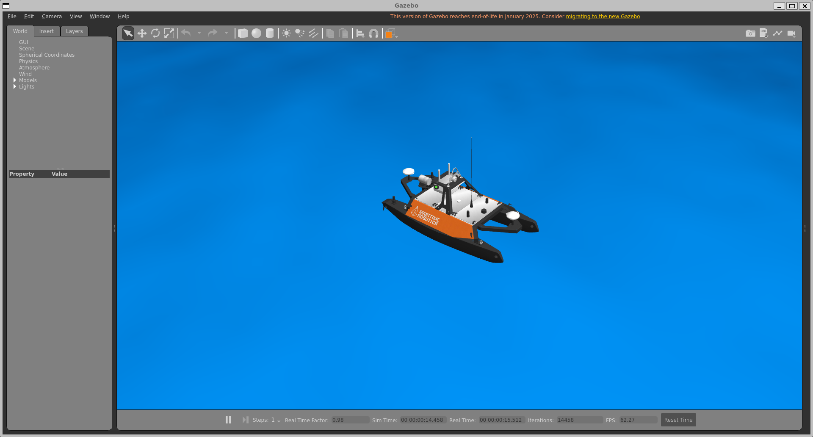
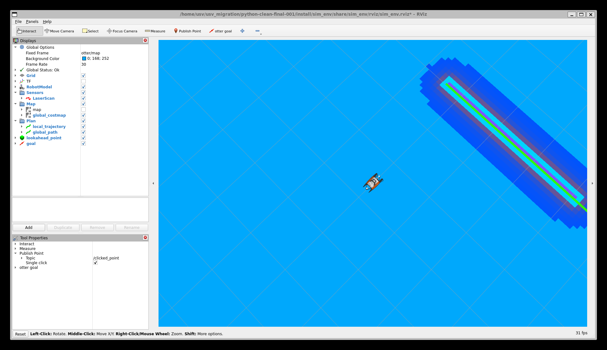

# Otter 模型与启动修复，2026-09-11

用户报告 Python/C++ 的 RViz 艇体发白、Gazebo 看不到 Otter。本次修复已经同步至
Windows Python 源码和 WSL 中以下两个实际运行目录，并重新构建安装 `sim_env`：

- Python：`/home/usv/usv_migration/python-clean-final-001`
- C++：`/home/usv/usv_migration/baseline`

两个目录现在包含本次 GUI 修复，不能再当作此前矩阵运行时完全未修改的目录。
此前固定提交及正式矩阵报告仍保留，本次没有重算或覆盖算法性能结果。
`main` / `cpp-baseline` 原始标签，以及 Windows 的原始 C++ 导出源码均未由本次修复修改。

## 根因与修改

1. 原 DAE 中 129 处贴图引用使用 `black4.JPG.001.jpg` 等多重扩展名。
   Humble RViz 日志报 `Can not find codec for 'JPG.001.jpg'`，随后贴图为空。
   改为引用原目录内 SHA256 完全一致的单扩展名贴图；没有重新绘制或压缩贴图，
   没有改变网格坐标、UV、材质参数、URDF、碰撞体、惯量或水动力参数。
2. 用户交互 shell 自动激活 `/home/usv/miniconda3/bin/python3`（3.13.13）。
   Gazebo `spawn_entity.py` 使用 `#!/usr/bin/env python3`，因此立即报
   `ModuleNotFoundError: No module named 'lxml'`。单纯向 Conda 安装 lxml 仍可能
   遇到 ROS Python 3.10 的 ABI 问题。本次通过 `prefix=[sys.executable]` 让生成节点
   和 Python 导航节点沿用启动 ROS 的系统解释器；脚本中的 world 生成器明确使用
   `/usr/bin/python3`。全局 Conda 配置未改变。
3. 直接 launch 未 source Gazebo setup 时，`gazebo_ros` 的资源路径覆盖导致
   RTShaderSystem 默认媒体不可见，Gazebo 客户端发生 Camera 空指针断言。
   `gazebo_dev` 提供安装路径，`sim_env` 的 ament 环境 hook 补充对应资源目录。
4. RViz 默认观察距离由约 145 m 调整为 35 m。Gazebo 默认相机对准默认出生区域。
   世界文件只修改 `gui/camera/pose`；物理世界内容已做 XML 精确对照。

## 实测结果

| 版本与入口 | Otter 生成 | 里程计消息 | LiDAR 消息 | 纹理错误 | Python 导入错误 | 启动期进程失败 |
| --- | --- | ---: | ---: | ---: | ---: | ---: |
| Python 脚本 | 通过 | 360 | 537 | 0 | 0 | 0 |
| Python 直接 launch（最终视角） | 通过 | 226 | 336 | 0 | 0 | 0 |
| C++ 脚本 | 通过 | 473 | 705 | 0 | 0 | 0 |
| C++ 直接 launch | 通过 | 299 | 447 | 0 | 0 | 0 |

以上均在 `bash -ic` 下运行，保留 Conda 自动激活行为；每次单独启动，使用隔离的
ROS domain 和 Gazebo 端口。脚本只观察，不发布导航目标。两种窗口均实际出现，
模型状态话题包含 `otter`，控制相关节点持续运行。纹理与参数回归检查 **20 项通过**。

实际 Windows 窗口截图确认 Python RViz 的彩色模型、C++ RViz 的彩色模型，以及
Gazebo 的完整 Otter 双体艇与橙色舷侧贴图。Gazebo 近景在本次检查中执行
`gz camera -c gzclient_camera -f otter` 后截取，是实际渲染画面；不是默认全场视角。





Windows 截图需要在能访问用户桌面的权限环境中采集；普通沙箱看不到对应窗口，
X11/Qt 抓图仍可能是黑图。此前的初始化检查不能替代此次可见画面验证。

检查状态：静态资源检查已通过，相关单元测试已通过，ROS/GUI 集成已通过。
本次没有重跑导航闭环或性能矩阵，因此这些 GUI 检查不产生新的算法性能结论。
个别测试在主动退出时仍出现 Gazebo 客户端超时后由 launch 发送 SIGTERM；
这是退出阶段记录，未计作正常运行期失败，也未宣称所有退出路径均无异常。

完整原始日志、修改前文件备份与各次结果在
`/home/usv/usv_migration/results/otter-gui-fix-001`。
本目录保留最终结果、真实截图、回归日志、补丁及文件哈希；未通过的中间测试
`python-direct` 也保留，用于记录着色器资源问题的复现。`changes.json` 记录
两个 WSL 工作目录修改前后的文件 SHA256。

## 本机重新启动

先在旧启动终端按 `Ctrl+C`，然后在一个新 Ubuntu 终端中选择一个版本：

```bash
# Python
cd /home/usv/usv_migration/python-clean-final-001
bash scripts/main.sh
```

```bash
# C++
cd /home/usv/usv_migration/baseline
bash scripts/main.sh
```

直接入口同样可用：source `/opt/ros/humble/setup.bash` 和对应工作目录的
`install/setup.bash`，然后执行 `ros2 launch sim_env main.launch.py`。
观察近景可在 Gazebo 左侧展开 Models，双击 `otter`；本次通过 CLI 跟随的命令为：

```bash
gz camera -c gzclient_camera -f otter
```

默认启动不需要本次测试使用的 `ROS_DOMAIN_ID=186` 或端口 `11496`。
不要把两套工作目录的安装环境 source 到同一个终端后同时启动。
Windows 下的 `usv_ros_motion_planning-cpp-baseline` 是原始导出源码；若直接构建
运行该副本，仍需自行应用对应 GUI 修复，或直接使用上面已修复的 C++ 运行目录。

复现自动检查时先 source 相应安装环境，再使用系统 Python 运行
`scripts/validation/gui_smoke.py WORKSPACE script|direct OUTPUT`。
执行者应选用空闲 ROS domain / Gazebo 端口；图片必须实际查看后才能宣布可见画面通过。
