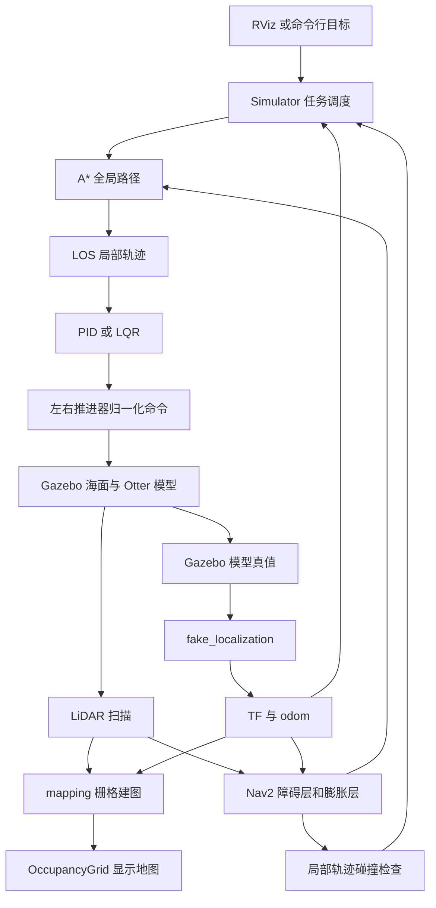
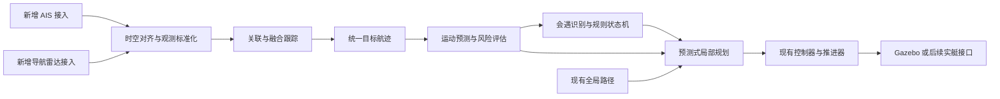

# ROS 2 无人艇运动规划仿真系统技术文档

文档版本：1.0  
编制日期：2026 年 9 月 10 日  
项目目录：`usv_ros_motion_planning-ros2-humble`  
适用对象：项目开发人员、系统集成人员、测试人员及课题研究人员

本项目以 Otter 双推进器无人艇为对象，构建 Gazebo 海面仿真、LiDAR 环境感知、栅格路径规划、LOS 轨迹生成与推进器控制之间的闭环。本文给出当前源代码的模块组织、数据接口、主要算法、配置方式和部署流程，并提供工程验收与科研扩展的实施依据。

当前默认启动链路采用 **Gazebo 真值定位、A*、LOS 和 PID**。AIS 与导航雷达融合、目标关联与跟踪、CPA/TCPA 风险评估以及 COLREGs 决策属于后续扩展，尚未进入当前执行链路。本文中的“已实现”表示已找到相应源码及连接关系，不等同于已通过运行测试或项目验收。

本文基于当前目录快照编写；该目录未包含 `.git`，无法给出提交号。后续交付应补充受控版本号或源码归档校验值。本文记录的频率、精度相关参数均为配置值，未将其作为实测性能数据。

目录：

- [1 项目定位与功能边界](#1-项目定位与功能边界)
- [2 系统架构与执行流程](#2-系统架构与执行流程)
- [3 无人艇模型与坐标约定](#3-无人艇模型与坐标约定)
- [4 感知建图与代价地图](#4-感知建图与代价地图)
- [5 路径规划与运动控制](#5-路径规划与运动控制)
- [6 通信接口与配置管理](#6-通信接口与配置管理)
- [7 部署构建与操作流程](#7-部署构建与操作流程)
- [8 测试验收与实验设计](#8-测试验收与实验设计)
- [9 已知限制与故障排查](#9-已知限制与故障排查)
- [10 科研扩展与交付建议](#10-科研扩展与交付建议)
- [附录 源代码依据](#附录-源代码依据)

## 1 项目定位与功能边界

### 1.1 系统定位

系统面向无人艇运动规划和路径跟踪的仿真开发，主要用途包括验证规划与控制模块的接口、调试静态障碍场景中的航行闭环，以及为后续感知融合和规则决策模块提供可复用的仿真环境。

目前系统使用 ROS 2 消息与 TF2 连接仿真、感知和导航模块，使用 Nav2 的 `Costmap2DROS` 提供代价地图，但任务规划、轨迹生成与控制调度由项目自己的 `Simulator` 完成。当前入口未启动完整的 Nav2 行为树导航栈，也未提供 `NavigateToPose` 任务接口。

### 1.2 当前能力清单

| 功能 | 当前状态 | 工程含义 |
| --- | --- | --- |
| Otter 船体、推进器、水动力与海面模型 | 有源码、模型和启动连接 | 可作为单艇闭环仿真基础；模型精度需独立验证 |
| LiDAR 扫描及栅格建图 | 默认启动 | 输入为平面 `LaserScan`，不是导航雷达目标报文 |
| 位姿与速度获取 | 默认使用 Gazebo 真值 | 便于隔离定位误差，不能据此评价定位或传感器融合精度 |
| A*、Dijkstra、GBFS | 工厂支持 | 共用栅格搜索实现，通过参数选择 |
| LOS 局部轨迹生成 | 工厂支持且默认选择 | 基于航点几何关系生成参考轨迹 |
| PID 与 LQR | 均有控制器实现 | 默认实际选择 PID；LQR 需显式配置 |
| 障碍触发的全局重规划 | 有实现 | 按当前代价地图检查已有局部轨迹，未预测目标运动 |
| DWA、MPC、APF、RPP、ORCA 等 | 存在同名配置文件，当前工厂无对应实现 | 不能通过修改名称直接启用 |
| IMU、GPS、EKF | 保留传感器描述及配置 | 当前主启动文件禁用 IMU/GPS，未启动 EKF 链路 |
| 多艇、目标航迹和会遇场景调度 | 当前主入口未实现 | 用户配置中的机器人列表不能直接解释为多艇支持 |
| AIS/Radar 融合与 COLREGs 决策 | 当前目录未发现完整实现链路 | 需新增观测接口、跟踪、风险评估及规则决策模块 |

依据：[主启动入口][S01]、[规划工厂][S06]、[轨迹工厂][S09]和[控制器工厂][S11]。

### 1.3 本文的验证边界

本次完成了源代码、配置和构建描述的静态核查，并对 9 个 Python 文件进行了语法解析、对 13 个 `package.xml` 进行了 XML 解析。当前文档编制环境为 Windows PowerShell，未在其中执行 ROS 2 编译、Gazebo 启动或航行测试。因此，构建成功、目标可达、无碰撞、实时性达标等结论均需要按照第 8 节在目标 Linux 环境中验证。

## 2 系统架构与执行流程

### 2.1 模块分层



图中 `mapping` 输出的累计占据地图与导航使用的代价地图是两条不同的数据链路。当前 `plugins` 列表只启用了障碍层和膨胀层，未将 `static_layer` 加入插件列表，所以 `/otter/map` 不会仅因为 YAML 中存在 `static_layer` 配置段就自动进入规划地图。

### 2.2 软件包与职责

当前目录共包含 13 个 ROS 软件包。

| 软件包 | 主要职责 | 关键产物或入口 |
| --- | --- | --- |
| `sim_env` | 系统装配、任务调度、真值定位、仿真资源 | `main.launch.py`、`sim_env_node`、`fake_localization_node` |
| `perception` | 激光扫描到占据栅格地图 | `perception_mapping_node` |
| `path_planner` | 规划器工厂、栅格搜索、规划核心封装 | `PathPlannerCore`、`AStarPathPlanner` |
| `path_processor` | 路径剪枝与平滑 | Ramer–Douglas–Peucker、Savitzky–Golay |
| `trajectory_planner` | 局部轨迹生成与轨迹数据结构 | `LosTrajectoryPlanner`、`Trajectory` |
| `controller` | 航速与航向跟踪、推进器命令计算 | `PIDControllerOtter`、`LQRControllerOtter` |
| `common` | 几何、数学、船舶状态结构与可视化 | `USV_MODEL`、`USV_STATE`、曲线与碰撞工具 |
| `usv_gazebo_plugins` | 水动力、浮力、风与推进器仿真 | Gazebo 共享库插件 |
| `wave_gazebo_plugins` | 波浪模型和显示插件 | `WavefieldModelPlugin` 等 |
| `wave_gazebo` | 波浪场景和模型资源 | `ocean_waves` 模型 |
| `dynamic_xml_config` | 依据用户配置生成场景障碍 | `main_generate.py` |
| `dynamic_rviz_config` | RViz 配置生成工具 | Python 配置生成脚本 |
| `goal_set_plugin` | RViz 目标点交互工具 | RViz 工具插件 |

核心规划器、轨迹规划器和控制器以 C++ 类和链接库的方式集成在 `sim_env_node` 进程中，并不是三个独立 ROS 节点。新增算法时，需要同时处理类实现、工厂分支、参数加载和构建链接。

### 2.3 目录组织

以下为相对于项目根目录的结构示意，不包含全部模型资源。

```text
usv_ros_motion_planning-ros2-humble/
├── docs/                         技术文档
├── scripts/                      构建、启动和进程管理脚本
├── docker/                       Humble 与历史 Noetic 容器配置
└── src/
    ├── user_config/              场景与机器人配置
    ├── sim_env/
    │   ├── launch/               ROS 2 系统入口
    │   ├── src/                  调度器与真值定位节点
    │   ├── config/               地图、规划、轨迹和控制参数
    │   ├── urdf/                 船体、传感器与推进器描述
    │   ├── worlds/               Gazebo 世界
    │   └── models/               岛屿、浮标等模型
    ├── core/
    │   ├── common/
    │   ├── perception/
    │   ├── path_planner/
    │   ├── trajectory_planner/
    │   └── controller/
    └── plugins/                  Gazebo、RViz 与配置生成工具
```

### 2.4 启动与运行调度

主启动文件声明世界名称、机器人命名空间、初始位置、仿真时间及 GUI/RViz 开关，随后装配 Gazebo、船体生成、关节状态发布、TF、建图、真值定位和导航节点。ROS launch 中列出动作的顺序不代表所有依赖节点已经就绪；运行时仍需检查 Gazebo 状态话题、TF 和代价地图是否可用。

`simulation_node.cpp` 创建 `usv_simulation` 节点、TF 缓冲区及 `Costmap2DROS`，把 `costmap.*` 参数覆盖值去掉前缀后转发给代价地图节点，并显式调用配置和激活回调。随后构造 `Simulator` 并进入 ROS 回调处理。依据：[节点入口][S02]。

`Simulator` 使用 `PENDING` 与 `NAVIGATING` 两种主要状态，执行逻辑如下：

```text
初始化船体模型、代价地图、规划器、LOS 和控制器
状态置为 PENDING

收到 goal：
    读取本艇位姿与目标坐标
    调用全局规划
    由全局路径生成局部轨迹
    设置控制器参考路径和轨迹
    状态置为 NAVIGATING

收到 odom 且处于导航状态：
    更新本艇位姿与速度
    用当前代价地图检查已有局部轨迹
    若发现碰撞栅格，则重新调用全局规划
    剪除已通过路径段并重新生成局部轨迹
    更新控制器状态和参考量，发布路径可视化

控制定时器触发：
    若待命或轨迹点不足，则返回
    检查是否到达目标
    计算并发布左右推进器命令
```

这里的碰撞检查只使用当前空间栅格，不包含障碍物速度、预测位置或会遇规则。该机制适合描述为“基于当前障碍地图的反应式重规划”，不能直接视为具有目标运动预测能力的动态避碰算法。返回值和停车行为的具体边界见第 9 节。依据：[仿真调度实现][S03]。

## 3 无人艇模型与坐标约定

### 3.1 状态与单位

代码使用 `USV_MODEL` 保存尺寸、质量、惯量、巡航速度、推力限制及水动力参数，使用 `USV_STATE` 保存位置、航向以及速度字段。仿真描述采用米、千克、秒和弧度单位体系。

平面位姿与艇体速度可写为：

$$
\boldsymbol{\eta}=[x,\ y,\ \psi]^\mathsf{T},\qquad
\boldsymbol{\nu}=[u,\ v,\ r]^\mathsf{T}.
$$

其中，$x,y$ 为世界平面坐标，$\psi$ 为绕竖直轴的航向角，$u,v$ 分别为艇体纵向和横向速度，$r$ 为艏摇角速度。世界坐标中的平面速度与艇体速度之间满足：

$$
\begin{bmatrix}\dot{x}\\\dot{y}\end{bmatrix}
=
\begin{bmatrix}\cos\psi&-\sin\psi\\\sin\psi&\cos\psi\end{bmatrix}
\begin{bmatrix}u\\v\end{bmatrix},\qquad \dot{\psi}=r.
$$

该表达式用于说明状态字段之间的几何关系。当前真值定位节点和控制器对 `Odometry.twist` 的使用存在项目内约定，外部定位数据接入前必须按第 6 节核对速度所在坐标系，不能只按话题名替换。

### 3.2 船体与推进器参数

| 参数 | 当前配置值 | 含义 |
| --- | --- | --- |
| `dynamics.name` | `otter` | 控制器支持的船型标识 |
| `dynamics.type` | `Differential` | 双推进器差动形式 |
| `cruising_speed` | 1.0 m/s | LOS 滚动预测使用的巡航速度 |
| `mass` | 29.84 kg | 控制侧模型质量 |
| `i_z` | 10.03 kg·m² | 控制侧艏摇惯量 |
| `L`、`W` | 1.35 m、1.00 m | 控制侧模型尺度 |
| `D` | 0.395 m | 推进器相对纵向中心线的横向力臂 |
| `max_force` | 50 N | 控制侧单推进器力尺度 |
| `velocity_min`、`velocity_max` | 0、1.0 m/s | 模型结构内的速度限制字段 |
| `acceleration_min/max` | −1.0、1.0 m/s² | 模型结构内的加速度限制字段 |
| `jerk_min/max` | −2.0、2.0 m/s³ | 模型结构内的加加速度限制字段 |

这些限制字段被读取到模型中，并不表示所有轨迹生成与控制分支都实施了对应约束。例如，当前 LOS 速度剖面没有完整实施非负速度及加速度约束。依据：[船体参数][S15]、[状态结构][S16]。

按当前推进器左右位置和正向推力约定，平面纵向力与艏摇力矩关系为：

$$
\tau_u=F_L+F_R,\qquad \tau_r=D(F_R-F_L).
$$

推进器插件将 `Float32` 命令视为归一化输入，默认 `mappingType=0` 为线性映射，`maxCmd=1.0`，正反向单推进器推力上限分别为 50 N 和 −50 N。因此命令 0.5 表示半量程输入，并非 0.5 N，也不是 0.5 m/s。

插件默认 `cmdTimeout=1.0` s，按仿真时间检查命令超时并将输入清零。系统还发布横向推进器话题，但当前 Otter Xacro 只配置左右推进器，横向话题不对应实际执行器。依据：[推进器配置][S17]和[推进器插件][S18]。

### 3.3 模型一致性要求

控制 YAML、URDF 惯量、Gazebo 水动力配置与代价地图足迹分别维护，不是同一份参数自动生成。例如，控制 YAML 的质量为 29.84 kg，URDF 主体质量为 29 kg；代价地图足迹为约 2.2 m × 1.2 m，控制模型的 `L/W` 为 1.35 m × 1.00 m。前者还可能包含保守几何包络，不能直接解释为数据错误，但应在交付时记录物理尺寸、总质量和安全膨胀尺度之间的对应关系。

水动力 Xacro 使用正值阻尼参数，控制 YAML 中相应线性阻尼项为负值；修改模型时应先核对各自力方程的符号定义，避免直接复制数值。海面和风插件具备扰动参数，但默认场景的风速为零；存在波浪显示也不足以证明已经完成风浪干扰下的鲁棒性验证。

## 4 感知建图与代价地图

### 4.1 传感器与定位输入

默认 LiDAR 为 Gazebo `ray` 传感器，输出 `sensor_msgs/msg/LaserScan`。实际宏调用配置为 360° 水平扫描、2000 束、15 Hz、1.2–25 m 量程，距离离散分辨率为 0.03 m；安装位置为相对 `base_link` 的 `(0,0,0.40)` m。传感器宏本身的默认最小量程是 0.2 m，但被实际调用覆盖为 1.2 m。

`fake_localization` 订阅 `/gazebo/model_states`，按模型名称提取本艇状态，生成 TF 和 `/otter/odom`。默认 `ocean.world` 中状态插件配置为 50 Hz。定位节点跳过重复时间戳，将位置的 z 分量置零，但保留 Gazebo 姿态四元数，不能据此认为 roll、pitch 也被强制清零。

定位输出由仿真真值直接派生，默认闭环没有 GPS/IMU 噪声建模、EKF 状态估计或定位失效处理。依据：[LiDAR 配置][S19]、[真值定位][S04]、[默认世界][S23]。

### 4.2 占据栅格建图

`MapServer` 维护一个 1024 × 1024 的方形栅格，分辨率为 0.5 m，对应 512 m × 512 m 的区域，原点结合初始位置偏移设置。地图初始值为 −1，表示未知；已更新栅格取值范围为 0–100。

建图过程保存最新扫描，通过扫描时间戳查询 `odom` 到 LiDAR 的 TF，等待上限为 0.1 s；查询失败后尝试使用最新 TF。每条有效射线通过 Bresenham 算法遍历网格，对射线经过的自由区域减少占据证据，对命中终点增加占据证据。

以已经进入有效取值范围的栅格为例，其更新形式可概括为：

$$
c_{k+1}=\operatorname{clip}(c_k+\Delta c,0,100),\qquad
\Delta c=\begin{cases}-25,&\text{射线清除}\\55,&\text{有效命中}\end{cases}.
$$

这里的整数累加属于占据证据更新；不能将其写成完成概率标定的贝叶斯滤波或严格 log-odds 推导。建图主循环标称 20 Hz，高于扫描的 15 Hz，并会重复处理最近一次扫描，因此输出频率与独立观测更新频率不同。依据：[建图实现][S05]。

主要流程如下：

```text
读取最新 LaserScan
查询扫描时刻 odom 到 lidar_link 的变换
若查询失败，尝试最新可用变换
将扫描起点和命中端点变换到地图坐标
对各射线执行 Bresenham 栅格遍历
更新自由区域及障碍命中区域
发布 OccupancyGrid
```

### 4.3 导航代价地图

| 参数 | 默认值 | 作用 |
| --- | --- | --- |
| `global_frame` | `otter/map` | 规划所用全局坐标系 |
| `robot_base_frame` | `otter/base_link` | 本艇位姿参考 |
| `resolution` | 0.5 m/格 | 栅格空间分辨率 |
| `width`、`height` | 400 m、400 m | 对应约 800 × 800 个栅格 |
| `rolling_window` | `true` | 地图窗口随本艇移动 |
| `track_unknown_space` | `false` | 不单独跟踪未知代价值 |
| `update_frequency`、`publish_frequency` | 2 Hz、2 Hz | 地图更新及发布标称频率 |
| `transform_tolerance` | 0.5 s | TF 容差配置 |
| `footprint_padding` | 0.3 m | 轮廓附加膨胀 |
| `obstacle_max_range` | 20 m | LiDAR 障碍标记范围 |
| `raytrace_max_range` | 22 m | 射线清除范围 |
| `inflation_radius` | 3.0 m | 代价膨胀影响范围 |
| `cost_scaling_factor` | 2.0 | 障碍代价随距离衰减参数 |

默认只加载 `nav2_costmap_2d::ObstacleLayer` 和 `nav2_costmap_2d::InflationLayer`。障碍层直接接收扫描并完成障碍标记与射线清除，膨胀层生成周边代价。`inflation_radius=3.0` 不是“艇体与所有障碍至少相距 3 m”的硬保证，实际可通行区域还取决于 footprint、代价衰减和规划器阈值。

累计占据地图尚未通过静态层进入导航地图。首次观测不足、遮挡区域或超出扫描范围的区域可能缺少障碍证据，路径可达性必须结合实际观测范围检查。需要利用历史建图时，应显式启用静态层并验证其与动态障碍清除策略的关系，不能仅增加一段 YAML 后就认定生效。依据：[代价地图参数][S14]。

## 5 路径规划与运动控制

### 5.1 全局栅格搜索

当前工厂允许 `astar`、`dijkstra` 和 `gbfs` 三个名称，均使用 `AStarPathPlanner` 的搜索实现。默认采用 A*：

$$
f(n)=g(n)+h(n),\qquad
h(n)=\sqrt{(x_n-x_g)^2+(y_n-y_g)^2}.
$$

算法采用 8 邻域，直邻移动代价为 1，斜邻为 $\sqrt{2}$，距离量以栅格为单位。Dijkstra 令启发项为零；GBFS 按启发项优先搜索，不累计通常意义下的路径代价。当前搜索代价没有引入船舶动力学、目标未来位置或 COLREGs 惩罚项。

令 $C(n)$ 为代价地图栅格值，$\alpha$ 为障碍因子。源码对邻接点的阻塞条件为：

$$
C(n)\ge254\alpha\quad\land\quad C(n)\ge C(n_{\mathrm{current}}).
$$

因此该实现允许从较高代价值向较低代价值的方向退出。默认 $\alpha=0.5$，并不是简单地将所有不低于 127 的格子无条件封闭。局部轨迹重规划检查使用另一个阈值 $254\times0.9$，两个阈值必须分别解释。

规划前可将地图边界标记为致命障碍；规划后按累计弧长进行线性重采样。`resample_ratio=0.5` 在当前实现中表示约 0.5 m 的空间采样间隔，变量名虽为 ratio，但不应解释为点数缩放比例。导航过程中还会删除最近路径点之前的路径段。

`path_processor` 中保留 Ramer–Douglas–Peucker 和 Savitzky–Golay 实现，但当前 `Simulator` 链路没有调用这两个处理器，因此不能声称默认路径已经经过这两类平滑处理。依据：[规划核心][S07]、[A* 实现][S08]及[路径基础类][S26]。

### 5.2 LOS 制导与局部轨迹

对于航段端点 $(x_i,y_i)$ 和 $(x_{i+1},y_{i+1})$，LOS 的几何关系为：

$$
\alpha_i=\operatorname{atan2}(y_{i+1}-y_i,x_{i+1}-x_i),
$$

$$
e_\perp=-(x-x_i)\sin\alpha_i+(y-y_i)\cos\alpha_i,
$$

$$
\psi_d=\operatorname{wrap}\left[\alpha_i-\operatorname{atan2}(e_\perp,\Delta)\right].
$$

其中 $\Delta$ 为前视距离，$\operatorname{wrap}$ 表示将角度归一化到一个连续主值区间。接近最后一个航点时，代码改用指向目标点的方位角。依据目标航向计算限幅艏摇角速度，再进行运动学滚动：

$$
r_k=\operatorname{clip}\left(k_\psi\operatorname{wrap}(\psi_d-\psi_k),-r_{\max},r_{\max}\right),
$$

$$
\begin{aligned}
\psi_{k+1}&=\operatorname{wrap}(\psi_k+r_k\delta t),\\
x_{k+1}&=x_k+U_c\cos\psi_{k+1}\delta t,\\
y_{k+1}&=y_k+U_c\sin\psi_{k+1}\delta t.
\end{aligned}
$$

内部积分步长固定为 0.1 s，默认输出间隔为 0.5 s，生成时域为 20 s，巡航速度 $U_c=1.0$ m/s，最大角速度为 0.3 rad/s。这是定速运动学预测，不是对水动力约束、避碰规则或控制能耗进行优化求解。

内部轨迹点包含时间 $t$、累计弧长 $s$、位置、航向、曲率、速度和加速度。当前 LOS 速度赋值为：

$$
v_0=0,\qquad
v_i=U_c\left(1-\frac{s_i}{d_{\mathrm{start,goal}}}\right),\quad i\ge1.
$$

分母为生成起点到终点的直线距离，而不是路径剩余弧长。绕行时 $s_i$ 可能超过该距离，因此当前表达式不能保证速度非负；曲率和加速度字段在这一生成分支中置零。第 9 节同时列出了 LOS 空路径访问和航向误差未赋值分支，以上公式仅说明代码中的计算方式，不代表实现已经满足所有边界条件。依据：[LOS 实现][S10]。

### 5.3 PID 控制

PID 控制器从局部轨迹中获取前视参考点，分别计算航速误差和航向误差：

$$
e_v=v_d-\|\boldsymbol{v}_b\|,\qquad
e_\psi=\operatorname{wrap}(\psi_d-\psi).
$$

当前速度反馈采用平面速度模长，不保留纵向速度正负号。离散 PID 形式为：

$$
I_k=I_{k-1}+K_i e_k\Delta t,\qquad
q_k=K_p e_k+I_k+K_d\frac{e_k-e_{k-1}}{\Delta t}.
$$

航向控制量还会经过角度归一化处理。两个通道的控制作用量通过双推进器分配矩阵映射到左右命令，最终分别限幅到 $[-1,1]$。PID 分支没有显式按 `max_force` 将牛顿换算为归一化命令，因此其环路输出应称为控制作用量，不能直接宣称单位为 N 或 N·m。

| 项目 | 当前有效值 |
| --- | --- |
| 目标距离容差 | 1.5 m |
| 前视时间 | 3.0 s |
| 航速 $K_p,K_i,K_d$ | 2.0、0.5、0.0 |
| 航向 $K_p,K_i,K_d$ | 2.0、0.0、0.0 |
| 控制定时器频率 | 工厂默认 10 Hz，采用墙钟定时器 |

控制器到达距离阈值时计算零推力，主调度器根据到达标志转入待命。当前没有完整的任务取消、故障停车和传感器失效状态机，这些应与正常到达停车分开验收。依据：[PID 控制器][S12]。

### 5.4 LQR 控制

LQR 使用六维状态和二维控制量，对参考状态附近模型进行线性化，并以前向 Euler 形式离散化：

$$
\delta\boldsymbol{x}_{k+1}=A_d\delta\boldsymbol{x}_k+B_d\delta\boldsymbol{u}_k,\qquad
A_d=I+A\Delta t.
$$

通过离散 Riccati 迭代计算反馈增益：

$$
P_{j+1}=Q+A_d^\mathsf{T}P_jA_d-
A_d^\mathsf{T}P_jB_d(R+B_d^\mathsf{T}P_jB_d)^{-1}B_d^\mathsf{T}P_jA_d,
$$

$$
K=-(R+B_d^\mathsf{T}PB_d)^{-1}B_d^\mathsf{T}PA_d,\qquad
\boldsymbol{u}=K(\boldsymbol{x}-\boldsymbol{x}_d).
$$

默认调节矩阵为 $Q=\operatorname{diag}(100,100,100,10,10,0)$、$R=\operatorname{diag}(1,1)$，离散步长为 0.1 s，迭代阈值为 0.1，最大迭代次数为 1000。当前实现使用速度模长填充纵向速度，并将当前横向速度及参考横向速度等作简化处理，不能解释为完整六自由度状态控制。

LQR 当前不是默认控制器。其跟踪精度、饱和条件下行为和闭环稳定性需通过实验验证，不能仅依据存在 Riccati 求解代码就给出稳定性保证。依据：[LQR 控制器][S13]。

## 6 通信接口与配置管理

### 6.1 默认 ROS 接口

以下名称使用默认命名空间 `/otter`。频率均为源码或配置标称值，实际速率需用 `ros2 topic hz` 测量。

| 话题 | 消息类型 | 发布者 → 订阅者或用途 | 标称时序 |
| --- | --- | --- | --- |
| `/clock` | `rosgraph_msgs/msg/Clock` | Gazebo → 使用仿真时间的节点 | 仿真时钟 |
| `/gazebo/model_states` | `gazebo_msgs/msg/ModelStates` | Gazebo 状态插件 → 真值定位 | 50 Hz 配置 |
| `/otter/odom` | `nav_msgs/msg/Odometry` | 真值定位 → 导航主节点 | 随有效真值回调 |
| `/otter/sensors/lidars/lidar/scan` | `sensor_msgs/msg/LaserScan` | LiDAR → mapping 和障碍层 | 15 Hz |
| `/otter/map` | `nav_msgs/msg/OccupancyGrid` | mapping → 地图显示或外部消费者 | 20 Hz 循环 |
| `/otter/goal` | `geometry_msgs/msg/PoseStamped` | RViz 或外部调用者 → 导航主节点 | 目标事件 |
| `/otter/global_path` | `nav_msgs/msg/Path` | 导航主节点 → 路径显示 | 导航时随里程计更新 |
| `/otter/local_trajectory` | `nav_msgs/msg/Path` | 导航主节点 → 轨迹显示 | 导航时随里程计更新 |
| `/otter/path_planner/plan` | `nav_msgs/msg/Path` | 规划核心 → 路径显示 | 规划调用 |
| `/otter/path_planner/expand` | `nav_msgs/msg/OccupancyGrid` | 规划核心 → 搜索展开显示 | 取决于开关和调用 |
| `/otter/thrusters/left_thrust_cmd` | `std_msgs/msg/Float32` | 导航主节点 → 左推进器插件 | 控制循环 |
| `/otter/thrusters/right_thrust_cmd` | `std_msgs/msg/Float32` | 导航主节点 → 右推进器插件 | 控制循环 |
| `/otter/thrusters/lateral_thrust_cmd` | `std_msgs/msg/Float32` | 保留输出，当前无侧推执行器 | 控制循环 |
| `/tf`、`/tf_static` | `tf2_msgs/msg/TFMessage` | 定位及 URDF → TF 使用者 | 动态或静态 |

`/otter/path_planner/make_plan` 使用 `nav_msgs/srv/GetPlan`，仅查询路径，不启动导航任务。请求包含 `start`、`goal` 和 `tolerance`，响应为 `plan`；当前实现未实际消费请求中的容差字段，不能依赖该字段实现终点附近搜索。

规划核心还注册 `random_tree`、`roadmap`、`particles` 等 Marker 输出，主节点注册 `/otter/debug`。注册发布器不代表默认 A* 链路持续产生这些消息。默认 RViz 预期代价地图话题为 `/otter/costmap`，实际代价地图节点名和话题展开应通过运行时图确认。

本项目未定义自有 `.msg`、`.srv` 或 `.action`。尤其要注意：发布的 `local_trajectory` 是 `nav_msgs/Path`，只表达位置与朝向，不能从该消息完整恢复内部轨迹的参考速度、加速度和相对时间。依据：[仿真接口][S03]、[规划接口][S07]及[轨迹结构][S27]。

### 6.2 TF 与速度语义

```text
otter/map
└── otter/odom                  真值定位发布恒等变换
    └── otter/base_link         Gazebo 派生的本艇位姿
        ├── otter/base_footprint
        ├── otter/lidar_link
        ├── otter/left_propeller_link
        └── otter/right_propeller_link
```

`map` 与 `odom` 在当前真值链路中对齐。`Odometry` 的 pose 位于 `otter/odom`，`child_frame_id` 为 `otter/base_link`。定位节点将世界速度按 yaw 旋转到艇体坐标：

$$
u=v_x^w\cos\psi+v_y^w\sin\psi,\qquad
v=-v_x^w\sin\psi+v_y^w\cos\psi.
$$

模拟器随后把这些艇体速度写入名为 `x_dot/y_dot/psi_dot` 的状态字段。字段名称与常见世界速度含义并不一致，外部定位和控制模块接入时应统一语义，检查下游是否再次执行坐标旋转。

目标回调直接把收到的 `frame_id` 改成 `otter/map`，未执行 TF 坐标变换。因此调用者必须预先将目标位置转换为 `otter/map` 数值；只填写其他 frame 名称不能触发自动转换。

### 6.3 配置来源及生效规则

| 配置来源 | 实际消费方 | 当前行为 |
| --- | --- | --- |
| 源码 `src/user_config/user_config.yaml` | 场景生成器 | 读取世界名称、障碍物配置文件等 |
| 用户主目录 `~/.rmp_user_config.yaml` | 主 launch | 只使用世界名称；不存在时默认 `ocean` |
| 主 launch 参数 | ROS launch | 设置世界、初始位姿、namespace 和显示开关 |
| `dynamics_otter.yaml` | `usv_simulation` | 以 `dynamics.*` 声明并读取 |
| `controller_params_otter.yaml` | 控制器工厂 | launch 包装到 `usv_simulation.controller.*` |
| `trajectory_planner_params.yaml` | 轨迹工厂 | launch 包装到 `usv_simulation.trajectory_planner.*` |
| `common_planner_params.yaml` | 规划核心 | 包含重采样、边界和可视化选项 |
| `global_costmap_params_otter.yaml` | 节点入口转发给代价地图 | 去掉 `costmap.` 前缀后配置 `Costmap2DROS` |

当前存在三个容易造成“修改配置却不生效”的差异：

1. `user_config` 中的 `robot1_controller=lqr`、定位方式和算法字段没有被当前主 launch 传入导航节点。
2. 控制 YAML 写作 `control_frequncy`，工厂读取的是 `controller_frequncy`。目前工厂默认也是 10 Hz，掩盖了差异；修改频率时必须按工厂实际键名配置。
3. YAML 中的 `path_planner.obstacle_factor` 与规划工厂读取的根级 `obstacle_factor` 层级不一致。当前均为 0.5，不代表参数覆盖链路正确。

此外，`trajectory_params_otter.yaml` 中含有 `trajecotry_planner` 拼写，且当前主 launch 没有加载该文件，应以实际加载的 `trajectory_planner_params.yaml` 为准。

### 6.4 参数查询与算法切换

启动后先读取实际声明参数：

```bash
ros2 param get /otter/usv_simulation planner_name
ros2 param get /otter/usv_simulation obstacle_factor
ros2 param get /otter/usv_simulation usv_simulation.controller.controller_name
ros2 param get /otter/usv_simulation usv_simulation.controller.controller_frequncy
ros2 param get /otter/usv_simulation usv_simulation.trajectory_planner.planner_name
ros2 param dump /otter/usv_simulation
```

例如切换到 LQR，需要在主 launch 已加载的控制配置 `controller:` 段内显式增加 `controller_name: lqr`，并使用实际声明的频率键。局部修改示例为：

```yaml
controller:
  controller_name: lqr
  controller_frequncy: 10.0
  # 保留已有 pid_controller 和 lqr_controller 参数段
```

该片段仅表示应修改的键，不能覆盖掉原文件的全部控制增益。全局规划可在已加载的规划配置中添加根级 `planner_name: dijkstra` 或 `planner_name: gbfs`。算法实例在初始化时创建，修改后应重新启动并确认启动日志及参数值；当前未实现运行期间的算法热切换。

`robot_namespace` 虽是 launch 参数，但代价地图和 RViz 中仍硬编码了若干 `otter` frame 与话题。变更 namespace 或扩展多艇时，需要同步修改全部相关配置并检查 TF，不能只改变单个启动参数。依据：[主启动入口][S01]、[控制工厂][S11]和[规划工厂][S06]。

## 7 部署构建与操作流程

### 7.1 目标环境与依赖

以下步骤面向 Linux Bash 环境，由现有脚本和依赖声明整理，尚未在本次文档编制环境中实际执行。ROS 2 Humble 的 Ubuntu 二进制基线为 Ubuntu 22.04 Jammy，见 [ROS 2 Humble 官方发布说明](https://docs.ros.org/en/humble/Releases/Release-Humble-Hawksbill.html)。当前代码依赖 Gazebo Classic 的插件 API，不能直接替换成新版 Gazebo 后假定无需迁移。

| 类别 | 环境要求或依赖 |
| --- | --- |
| 操作系统与 Shell | Ubuntu 22.04、Bash；Windows 可作为编辑端，运行端另行配置 Linux 环境 |
| ROS | ROS 2 Humble、`ament_cmake`、`colcon`、`rosdep` |
| C++ | 支持 C++17 的编译器、CMake、Eigen3、glog |
| 导航与坐标变换 | `nav2_costmap_2d`、`nav2_util`、TF2、标准消息 |
| 仿真 | Gazebo Classic、`gazebo_ros`、Gazebo 开发库 |
| 模型与显示 | xacro、robot_state_publisher、joint_state_publisher、RViz2、Qt5 |
| 脚本及模型生成 | Python 3、PyYAML、Ruby `erb`；其他依赖按包声明核查 |
| 图形条件 | 有界面运行需要可用的图形/OpenGL 环境；Docker 脚本采用 Linux X11 方式 |

硬件最低配置和仿真实时因子目前没有实测基线，本文不设定未经测试的 CPU、内存或显卡门槛。首先使用无界面启动测量 CPU、内存及仿真时间推进情况，再决定部署资源。

Gazebo Classic 已于 2025 年 1 月结束生命周期，官方状态见 [Gazebo Classic 发行说明](https://classic.gazebosim.org/distributions/releases/)。维护当前版本时应保存可复现镜像与依赖清单；迁移仿真器属于独立开发任务。

### 7.2 本机构建

先按照 [ROS 2 Humble 官方安装说明](https://docs.ros.org/en/humble/Installation/Ubuntu-Install-Debians.html) 配置 ROS 软件源和基础环境，再在 Linux 的项目根目录执行：

```bash
# 将路径替换为 Linux 运行端的实际项目目录。
cd /path/to/usv_ros_motion_planning-ros2-humble
source /opt/ros/humble/setup.bash

# 补足构建与配置工具；已有依赖由包管理器跳过。
sudo apt update
sudo apt install -y \
  build-essential cmake python3-colcon-common-extensions python3-rosdep \
  python3-yaml ruby libeigen3-dev libgoogle-glog-dev \
  ros-humble-ament-lint-auto ros-humble-ament-lint-common

# rosdep 从未初始化时，先执行一次 sudo rosdep init。
rosdep update
rosdep install --from-paths src --ignore-src --rosdistro humble -r -y
rosdep check --from-paths src --ignore-src --rosdistro humble

command -v erb
colcon list
bash scripts/build.sh
source install/setup.bash
```

`scripts/build.sh` 本身不加载 ROS 环境，因此前面的 `source` 必须执行。脚本采用 Release 构建、开启编译命令导出并使用 `--symlink-install`，完成后把各包编译数据库汇总为 `build/compile_commands.json`。该文件用于编辑器索引，不是测试报告。依据：[构建脚本][S20]。

若 `rosdep` 未覆盖某些 CMake 依赖，应根据具体缺包错误补足依赖，而不是用成功生成 build 目录判断构建完成。出现 `ament_lint_auto` 缺失时优先补装对应工具；禁用 `BUILD_TESTING` 只会跳过测试相关配置，不能作为已经验证质量的依据。

构建后检查可执行文件和共享库：

```bash
ros2 pkg executables sim_env
ros2 pkg executables perception
ldd install/sim_env/lib/sim_env/sim_env_node
```

当前 CMake 创建并链接了 `libsim_env.so`，但安装目标列表没有同时列出该共享库。符号链接构建目录可能掩盖该问题，交付前必须检查 `ldd` 中是否存在 `not found`，并验证不依赖原始 build 目录的安装包。依据：[sim_env 构建配置][S25]。

### 7.3 生成场景与启动

常规交互启动使用：

```bash
bash scripts/main.sh
```

该脚本加载 ROS、工作区和 Gazebo 环境，尝试生成障碍场景，再执行主 launch。不过场景生成命令末尾有 `|| true`，生成失败仍会继续启动。需要严格复现时，应把场景生成和启动拆开：

```bash
source /opt/ros/humble/setup.bash
source install/setup.bash
if [ -f /usr/share/gazebo/setup.sh ]; then
  source /usr/share/gazebo/setup.sh
fi

# 以下示例要求源码用户配置中的 world 为 ocean。
(
  cd src/plugins/dynamic_xml_config
  python3 main_generate.py user_config.yaml
) && ros2 launch sim_env main.launch.py world:=ocean
```

生成器会按 YAML 重写对应的源码 `.world` 文件，清除并重新生成匹配的障碍模型。当前障碍 YAML 启用了 4 个 BOX 配置，并支持 BOX、CYLINDER、SPHERE 的尺寸、位置、质量及颜色。生成的浮体带有物理插件，未统一设为 `static=true`；这不等于配置了按给定航向航速航行的目标船。场景生成实现见 [场景生成器][S22]。

直接执行 `ros2 launch` 不会重新生成障碍。源码配置与 `~/.rmp_user_config.yaml` 的世界名称可能不同，建议复现实验始终显式传入 `world:=...`。使用非符号链接安装时，还应重新安装修改后的世界资源。

默认启动参数为：

| 参数 | 默认值 | 说明 |
| --- | --- | --- |
| `world` | 用户主目录配置中的值，或 `ocean` | 不含 `.world` 后缀 |
| `robot_namespace` | `otter` | 变更时需同步 frame 与话题配置 |
| `robot_x`、`robot_y` | 23.0、−10.0 m | 初始平面位置 |
| `robot_z` | 0.0 m | 初始高度 |
| `robot_yaw` | 0.0 rad | 初始航向 |
| `use_sim_time` | `true` | 节点仿真时钟配置 |
| `gui` | `true` | Gazebo 客户端 |
| `rviz` | `true` | RViz 显示 |

无界面启动示例：

```bash
ros2 launch sim_env main.launch.py world:=ocean gui:=false rviz:=false
```

不要将所有 world 文件视为可直接互换。默认真值定位依赖 `libgazebo_ros_state.so`；`example_course.world` 当前没有对应状态插件配置，切换前需要补齐并验证状态源。

### 7.4 基础检查与目标下发

在另一个已加载 ROS 和工作区环境的终端中检查：

```bash
ros2 node list
ros2 topic list -t
ros2 topic echo /clock --once
ros2 topic hz /otter/sensors/lidars/lidar/scan
ros2 topic hz /otter/odom
ros2 run tf2_ros tf2_echo otter/map otter/base_link
```

`topic hz` 和 `tf2_echo` 会持续运行，可在取得足够样本后用 Ctrl+C 退出。没有 `/clock`、有效扫描、里程计或完整 TF 时，应先恢复数据链路，再下发目标。

RViz 的 Fixed Frame 应为 `otter/map`，目标工具输出应为 `/otter/goal`。在代价地图中选择可通行的水域位置，并检查全局路径与局部轨迹是否连贯。

命令行目标示例：以下 `(28,-10)` 仅演示消息格式，使用前必须确认实际场景中该点及连接路径可通行，不是已验证的验收航点。

```bash
ros2 topic pub --once /otter/goal geometry_msgs/msg/PoseStamped \
  "{header: {frame_id: 'otter/map'}, pose: {position: {x: 28.0, y: -10.0, z: 0.0}, orientation: {x: 0.0, y: 0.0, z: 0.0, w: 1.0}}}"
```

目标位置必须事先转换到 `otter/map`。下发后观察 `/otter/global_path`、`/otter/local_trajectory`、`/otter/odom` 与左右推进器命令；不能仅凭 RViz 中出现目标箭头判断规划成功。该接口不提供任务 Action 的反馈、取消或结果消息，外部调度器需要另行实现任务状态接口。

正常退出优先在启动终端使用 Ctrl+C。现有 `killpro.sh` 会匹配系统中的相关进程并强制终止，可能影响其他仿真，不适合作为多任务环境下的精确停止接口。

### 7.5 Docker 使用边界

仓库提供 Humble Dockerfile，默认基础镜像为 `ros:humble-perception`，目标镜像名为 `ros-motion-planning:humble`，容器名为 `rmp_humble`，源码挂载到 `/rmp`。现有 `docker/run.sh` 使用 X11、host 网络/IPC、特权模式和源码读写挂载，并会强制删除同名容器后重建；容器未挂载目录中的数据应在使用前另行保存。

该脚本发现镜像已存在时跳过构建，修改 Dockerfile 不会自动更新镜像。Humble Dockerfile 的 LLVM 安装段还使用了 `focal` 源，镜像构建兼容性需要核查。因此本文以本机 ROS 环境为主要复现路径，不将容器脚本描述为已经通过全新环境构建验证的交付镜像。

`docker/noetic` 为历史 ROS 1 配置，其中引用了当前目录不存在的 `3rd/conanfile.py` 等文件，不作为本版本构建入口。当前软件包均采用 ament，不需要按 catkin 工程构建。依据：[Humble Dockerfile][S24]。

## 8 测试验收与实验设计

### 8.1 已有验证证据

| 验证项 | 本次状态 | 可支持的结论 |
| --- | --- | --- |
| 源代码与有效启动链路核查 | 已完成 | 可描述模块组成、默认算法和接口连接 |
| 13 个 `package.xml` XML 解析 | 已通过 | 包描述语法可解析；不证明依赖完整 |
| 9 个 Python 文件 AST 解析 | 已通过 | Python 语法可解析；不证明 ROS 导入和运行正确 |
| ROS 2 C++ 构建 | 未执行 | 不能给出编译通过结论 |
| Gazebo 和 RViz 运行 | 未执行 | 不能给出启动、跟踪及避障通过结论 |
| 定量实验结果 | 当前快照未提供 | 不能填写成功率、误差、计算耗时等实测数据 |

仓库保留 `Wavefield_TEST.cc` 中的 4 个 GoogleTest 波场数值求解测试，但该文件未加入当前 CMake 目标，也未注册到 CTest/colcon。当前未发现已注册的规划、控制、融合功能测试或对应运行结果；若干 CMake 中的 `ament_lint_auto` 模板不等同于算法测试。依据：[波场测试源码][S28]。

### 8.2 分层验收

以下为建议执行的验收计划，不是已经完成的测试报告。第 9 节中影响路径与轨迹有效性的高优先级问题应先整改，再开展性能统计。

| 层级 | 测试内容 | 通过判据 | 留存证据 |
| --- | --- | --- | --- |
| L0 构建与资源 | 包发现、依赖、构建、共享库、模型资源 | 应有包可发现，无失败包；共享库无缺失 | 软件版本、构建日志、依赖检查 |
| L1 启动 | `ocean` 无界面运行、实体创建、插件加载 | 状态源持续输出，无重复崩溃或缺失模型 | 启动日志、节点与话题清单 |
| L2 通信与 TF | clock、scan、odom、TF、QoS | 类型正确，时钟递增，TF 连通，消息持续到达 | `topic hz`、`topic info -v`、TF 检查 |
| L3 建图 | 已知几何障碍扫描、地图标记与清除 | 地图位置与场景对齐，量程和外参符合设置 | 场景配置、地图、扫描及 TF 数据 |
| L4 规划 | 自由区目标、绕行、阻塞、越界目标 | 可行情况给出有效路径；失败情况受控退出 | 规划日志、路径、耗时与失败原因 |
| L5 跟踪 | 直线、转弯、接近目标、停止 | 误差满足约定，命令有限且在范围内，停车行为可解释 | odom、参考量、推力与指标表 |
| L6 交付复现 | 干净环境重建、安装区独立运行 | 不依赖开发机遗留目录和未记录配置 | 源码归档、镜像或依赖清单、操作记录 |

ROS 标准测试入口可执行：

```bash
colcon test --event-handlers console_direct+
colcon test-result --verbose
```

必须同时记录测试发现数量。报告零失败且零功能测试，不构成规划、控制或避碰通过的证据。

### 8.3 可复现的数据记录

启动录制后再下发目标，避免遗漏目标事件：

```bash
mkdir -p validation
ros2 bag record -o validation/ocean_case_01 \
  /clock /tf /tf_static /gazebo/model_states \
  /otter/goal /otter/odom /otter/map \
  /otter/sensors/lidars/lidar/scan \
  /otter/global_path /otter/local_trajectory \
  /otter/thrusters/left_thrust_cmd \
  /otter/thrusters/right_thrust_cmd
```

每次实验使用新的输出目录。同步保存源码版本或归档校验值、world、用户 YAML、有效 ROS 参数、初始位姿、控制器名称、环境版本、日志和数据处理脚本。`ros2 bag info` 可检查录制内容，但回放消息不能直接重建 Gazebo 的完整物理状态；回放验证与重新进行闭环仿真应分别记录。

建议实验元数据至少包含：

```yaml
experiment_id: ocean_case_01
source_snapshot: <源码归档校验值或提交号>
world_file: ocean.world
initial_pose: [23.0, -10.0, 0.0]
planner: astar
trajectory_planner: los
controller: pid
parameter_dump: <本次参数快照路径>
bag_directory: <本次录制目录>
result_status: not_evaluated
```

该例仅是记录格式，不是已经生成的实验记录。用于评价参考速度跟踪时，应增加内部参考速度、控制误差等调试数据输出，因为当前 `nav_msgs/Path` 不携带完整速度剖面。

### 8.4 评价指标

设一次航行记录有 $N$ 个时间样本，实际位置为 $\boldsymbol{p}_i$，采样间隔为 $\Delta t_i$。建议至少报告以下指标：

| 指标 | 定义或计算方式 | 使用边界 |
| --- | --- | --- |
| 任务成功率 | $N_{\mathrm{success}}/N_{\mathrm{attempt}}$ | 同时定义超时、碰撞及软件失败 |
| 航程 | $L=\sum_{i=2}^N\lVert\boldsymbol{p}_i-\boldsymbol{p}_{i-1}\rVert$ | 记录数据采样与滤波方式 |
| 到达时间 | 有效目标接收至满足到达判据的仿真时间 | 不混用墙钟与仿真时间 |
| 横向误差 RMSE | $\sqrt{N^{-1}\sum_i e_{\perp,i}^2}$ | 明确参考原始全局路径还是在线更新轨迹 |
| 最大横向误差 | $\max_i \lvert e_{\perp,i}\rvert$ | 需说明起始过渡段是否纳入 |
| 最小障碍间距 | 本艇轮廓与障碍物几何边界的最小距离 | 中心距或 LiDAR 最近回波距离不能直接代替 |
| 规划计算耗时 | 每次 `makePlan` 的墙钟耗时 | 报告中位数、P95、最大值及成功/失败分组 |
| 重规划次数 | 一次任务触发的全局重规划数量 | 区分新目标触发与碰撞检查触发 |
| 控制输入变化 | $\sum_i\lVert\boldsymbol{a}_i-\boldsymbol{a}_{i-1}\rVert$ | $\boldsymbol{a}=[a_L,a_R]$ 为归一化命令 |
| 输入平方积分 | $\sum_i(a_{L,i}^2+a_{R,i}^2)\Delta t_i$ | 仅为控制负担代理量，不能直接称为耗电量 |

实际成功判据应同时包含任务超时、目标位置误差、碰撞和软件运行状态。PID 默认距离容差为 1.5 m，LQR 为 1.0 m；比较算法时应统一终止条件，不能让不同容差造成表面性能差异。

### 8.5 建议场景矩阵

| 场景 | 目的 | 当前或后续条件 |
| --- | --- | --- |
| 开阔水域直线航行 | 检查坐标、推力方向和稳态跟踪 | 当前基础链路，先核对通航区域 |
| 单障碍绕行 | 检查建图、A* 与跟踪衔接 | 使用可控尺寸障碍与固定起终点 |
| 连续转弯和长距离绕行 | 暴露 LOS 切换、负速度及插值问题 | 先完成边界修复，再统计性能 |
| 起点邻近高代价格 | 检查规划器退出高代价区域的行为 | 单独记录起点代价与规划结果 |
| 目标被占据、越界、无可行路径 | 检查失败路径与停车处理 | 当前存在风险分支，属于整改后的回归用例 |
| 暂停与恢复仿真 | 检查墙钟控制和仿真时钟关系 | 记录命令时间戳及超时行为 |
| 定位或扫描中断 | 检查过期状态和受控停车 | 需要补充失效处理机制 |
| 不同风浪条件 | 检查跟踪鲁棒性 | 先确认扰动实际作用于 Otter 并固定随机种子 |
| 对遇、交叉、追越、多目标 | 验证预测避碰与规则决策 | 需新增目标运动与 COLREGs 模块 |

固定场景和输入后，可比较 A*、Dijkstra、GBFS 的搜索效率，以及 PID/LQR 的跟踪效果。随机场景应保存种子和全部生成参数；重复次数、统计区间和验收阈值由实验方案明确，本文不虚构已经完成的试验规模与数值。

## 9 已知限制与故障排查

### 9.1 需要优先处理的实现边界

下表来源于静态源码核查，未在本次环境运行复现，也未随本文修改源码。优先级用于安排后续工程工作：P0 为可能造成非法访问或无效控制的分支，P1 为影响结果正确性和复现的项，P2 为接口与维护完善项。

| 优先级 | 问题与触发条件 | 影响及建议措施 | 源码依据 |
| --- | --- | --- | --- |
| P0 | 全局规划返回值未检查，LOS 在判断空路径前访问首点 | 规划失败后可能越界；统一失败出口、清空旧计划并停车 | [Simulator][S03]、[LOS][S10] |
| P0 | LOS 多航点分支中，下一航点距离不小于 `switch_dist` 时 `phi_err` 未赋值 | 后续滚动使用未初始化值；确保所有路径分支产生有效航向误差 | [LOS][S10] |
| P0 | 碰撞检查未检查 `worldToMap` 返回值 | 越界点可能导致无效索引；地图外位置应显式处理 | [Simulator][S03] |
| P0 | 轨迹时间/距离插值使用 `lower_bound` 后取 `[idx,idx+1]` | 非采样点可能选错区间，近末端可能越界；完善端点与区间测试 | [Trajectory][S27] |
| P1 | LOS 以直线距离生成速度剖面，未做范围保护 | 绕行可能产生负参考速度；改用正确距离定义并执行动力学限制 | [LOS][S10] |
| P1 | 算法名非法时部分工厂仍返回 true | 可能保留空指针；校验名称并显式失败退出 | [轨迹工厂][S09]、[控制工厂][S11] |
| P1 | 目标 frame 被改名，未进行坐标变换 | 外部坐标可能被误用；入口验证 frame 或实际调用 TF | [Simulator][S03] |
| P1 | 速度字段命名与艇体速度语义不一致 | 接入真实定位和新控制器容易重复旋转；统一接口约定 | [真值定位][S04]、[Simulator][S03] |
| P1 | 控制频率和障碍因子的参数键/层级不匹配 | 修改 YAML 可能不生效；统一键名并增加加载检查 | [控制工厂][S11]、[规划工厂][S06] |
| P1 | 累计地图未启用静态层，未知区域不跟踪 | 显示地图与规划依据不同；设计明确的静态/动态地图合成策略 | [代价地图参数][S14] |
| P1 | 轨迹碰撞只检查离散中心点，且缺少运动目标预测 | 不能保证整艇连续扫掠安全；补充轮廓与轨迹段检查 | [Simulator][S03] |
| P1 | `libsim_env.so` 未列入安装目标 | 安装区独立运行可能依赖开发目录；补齐安装与移植测试 | [CMake 配置][S25] |
| P2 | 使用墙钟控制定时器，建图重复处理最近扫描 | 仿真暂停、慢速运行和观测计权需核查 | [Simulator][S03]、[建图][S05] |
| P2 | 缺少任务取消、故障状态和完整参考轨迹接口 | 不利于外部调度和验收；增加明确的任务与诊断协议 | [Simulator][S03]、[Trajectory][S27] |

轨迹生成参数还应验证为正数且满足内部采样要求。当前 `scale=int(traj_dt/0.1)`，若把输出步长设为小于 0.1 s，`scale` 可能为零；不能在未加校验前任意减小采样间隔。

### 9.2 常见现象与定位顺序

| 现象 | 优先检查 | 处理方向 |
| --- | --- | --- |
| 找不到 `sim_env` 包 | 是否 source ROS 和 `install/setup.bash`；构建是否成功 | 加载正确工作区，排除多个 overlay 混用 |
| Gazebo 缺模型或插件 | 插件编译与安装、模型搜索路径、Gazebo 环境 | 核对资源导出及 `ldd`，读取首个加载错误 |
| Gazebo GUI 闪退，无界面可运行 | 图形环境、OpenGL、Gazebo shader 资源 | 使用主启动脚本加载 Gazebo 环境后再定位图形端问题 |
| `/gazebo/model_states` 或 `/otter/odom` 不存在 | 世界是否含状态插件；模型名是否匹配 | 先恢复真值源，再检查定位回调 |
| RViz 报 TF 错误或地图偏移 | `otter/map`、`otter/odom`、传感器外参与初始偏移 | 检查完整 TF 链、仿真时间及 frame 前缀 |
| 有地图显示但规划穿过障碍阴影 | 实际 costmap 与 `/otter/map` 是否来自同一路径 | 核查 plugins，勿只看累计地图显示 |
| 有目标箭头但没有路径 | 目标是否在地图内；机器人位姿、地图代价、规划失败日志 | 先验证输入与数据链路，禁止把旧路径当新成功 |
| 有路径但艇不动 | 实际控制器及 PID 增益、推力话题、插件订阅 | 核对 `usv_simulation` 参数前缀和推力非零情况 |
| 修改 LQR/频率却没有变化 | 算法名称、实际参数键、是否重启 | 用 `ros2 param get` 核对初始化结果 |
| 修改障碍 YAML 后场景不变 | 生成器退出状态、生成世界与启动世界、安装区资源 | 显式生成成功后启动同一 world |
| 接近终点出现异常轨迹或停滞 | LOS 速度公式、参考插值、容差与轨迹长度 | 按 P0/P1 条目构造最小回归用例 |

若话题存在但没有数据，执行 `ros2 topic info -v <话题名>` 检查发布者、订阅者及 QoS。代价地图节点的最终名称、话题和回调调度依赖所安装的 Nav2 版本，应在运行端确认，本文不将外部库内部行为推测为已经发生的故障。

## 10 科研扩展与交付建议

### 10.1 与研究主线衔接

当前平台适合作为后续研究的执行和验证端。建议沿“观测接入—融合跟踪—风险评估—规则决策—可行轨迹—闭环控制”的顺序扩展。下图中的新增模块均为建议设计，不是现有节点。



AIS 与导航雷达都可能提供外部目标信息，但其更新频率、时间戳、坐标形式和误差模型不同。应新增统一观测接口，至少记录来源、测量时刻、接收时刻、坐标系、观测值、协方差及质量标志；目标航迹则至少包含内部 ID、关联的 AIS 身份、位置速度、协方差、更新时间、来源集合和生命周期状态。

现有 `LaserScan` 用于扫描建图，不应强行承载导航雷达的目标 ID、速度、航迹质量等数据。新接口需要独立的消息定义和适配器，再按用途向局部规划器提供目标列表、预测轨迹或动态代价层。

### 10.2 风险评估与规则决策接口建议

以下数学定义用于规划后续接口，目前代码没有实现 CPA/TCPA。设目标相对本艇的位置、速度分别为 $\boldsymbol{r}=\boldsymbol{p}_t-\boldsymbol{p}_o$、$\boldsymbol{v}=\boldsymbol{v}_t-\boldsymbol{v}_o$。在恒速近似且 $\|\boldsymbol{v}\|^2>\varepsilon$ 时：

$$
t_{\mathrm{CPA}}=-\frac{\boldsymbol{r}^{\mathsf T}\boldsymbol{v}}{\|\boldsymbol{v}\|^2},\qquad
d_{\mathrm{CPA}}=\|\boldsymbol{r}+t_{\mathrm{CPA}}\boldsymbol{v}\|.
$$

面向未来有限时间窗 $[0,T]$ 的风险判断应另计算 $t^*=\operatorname{clip}(t_{\mathrm{CPA}},0,T)$ 和该时刻距离，保留原始 TCPA 的正负含义；相对速度接近零时单独处理当前距离。CPA 是运动学近似，应与目标航迹不确定性、船舶轮廓和预测有效期一起使用。

规则模块建议输入本艇状态、目标航迹和风险集合，输出会遇状态、让路/直航角色、可行动作约束及其有效期。规则适用条件、状态转换和例外处理需要依据正式 COLREGs 条文另行设计和验证。当前文档不预先声称某个控制方向、代价函数或特定轨迹已经具有规则合规性。

实现预测式局部规划时，可以保留现有 A* 作为静态全局航路层，在其后新增具有运动目标预测、操纵限制和规则约束的局部规划器，再对接 PID/LQR 或后续实艇控制接口。DWA 或 MPC 需要补充对应求解实现和工厂入口，当前同名 YAML 不足以构成实现基础。

### 10.3 毕业论文与两篇小论文的可用方向

| 成果方向 | 研究问题 | 必须新增的实现与证据 | 适合的论文形态 |
| --- | --- | --- | --- |
| AIS/Radar 融合小论文 | 异步观测、误关联、漏测条件下如何保持目标状态精度与航迹连续性 | 真实或可控仿真观测、时间与坐标标定、关联跟踪算法、误差与身份切换评价 | 方法改进；若重点是接入和部署，则为系统实现与实验验证 |
| COLREGs 动态避碰小论文 | 多目标会遇下如何兼顾规则约束、碰撞风险和可执行轨迹 | 运动目标场景、预测与会遇状态机、局部规划器、无规则/有规则对比与消融 | 规则融合与规划方法改进 |
| 毕业论文主线 | 从多源感知到安全决策与闭环执行如何形成可验证系统 | 融合跟踪、态势风险、决策规划、仿真与必要实测的统一接口和数据链 | 系统方法与综合实验 |

这些方向是基于项目缺口提出的研究选题候选，不是已经确认的新颖性结论。论文立项前还需完成相关文献核查、基线选择及数据可获得性确认。当前 A* + LOS + PID/LQR 可以作为工程基础或对照基线，不宜仅因模块组合就直接宣称方法创新。

### 10.4 建议交付清单与实施顺序

后续工程交付建议包含以下材料：

1. 受控源码快照、版本标识、第三方依赖及许可清单。
2. 可重建环境和依赖版本；若使用容器，则保存镜像 digest 与构建日志。
3. 明确区分有效参数与历史参数的配置目录，以及默认场景、边界场景和启动命令。
4. 本技术文档、接口协议、异常停车与恢复流程。
5. 已注册的单元/集成测试、实际执行结果与问题闭环记录。
6. 场景参数、rosbag2 数据、指标处理脚本及定量验收报告。

实施顺序宜先处理规划失败、LOS 和轨迹插值边界，随后统一配置和坐标语义、补齐安装与回归验证，再接入 AIS/Radar 与 COLREGs 模块。每个阶段均以可运行版本、可复现输入和有来源的测试结果为产物，避免将未来研究能力与当前工程交付混写。

## 附录 源代码依据

下列链接对应本地当前项目快照。由于本文在本地工作区交付，链接采用绝对路径；迁移目录后应按新的根目录更新链接。

| 编号 | 文件 | 支撑内容 |
| --- | --- | --- |
| S01 | [main.launch.py][S01] | 系统装配、实际定位方式、参数加载 |
| S02 | [simulation_node.cpp][S02] | 主节点、TF 和 Costmap2DROS 初始化 |
| S03 | [simulation.cpp][S03] | 目标、里程计、控制调度与接口 |
| S04 | [fake_localization_node.cpp][S04] | 真值定位与坐标转换 |
| S05 | [mapping.cpp][S05] | 栅格地图及扫描更新 |
| S06 | [path_planner_factory.cpp][S06] | 支持的搜索算法与参数层级 |
| S07 | [path_planner_core.cpp][S07] | 规划封装、服务、裁剪与发布 |
| S08 | [astar_planner.cpp][S08] | 8 邻域搜索与代价阈值 |
| S09 | [trajectory_planner_factory.cpp][S09] | LOS 工厂与参数声明 |
| S10 | [los_trajectory_planner.cpp][S10] | 制导、滚动预测和速度剖面 |
| S11 | [controller_factory.cpp][S11] | PID/LQR 选择与频率参数 |
| S12 | [otter_pid_controller.cpp][S12] | PID、前视参考与推力分配 |
| S13 | [otter_lqr_controller.cpp][S13] | 线性化模型与 Riccati 迭代 |
| S14 | [global_costmap_params_otter.yaml][S14] | 地图层、范围、足迹和频率 |
| S15 | [dynamics_otter.yaml][S15] | 控制侧船舶模型参数 |
| S16 | [usv_model.h][S16] | 模型与状态结构 |
| S17 | [otter_gazebo_thruster_config.xacro][S17] | 单推进器量程与线性映射 |
| S18 | [otter_usv_gazebo_thrust_plugin.cc][S18] | 命令接收、超时与施力 |
| S19 | [otter_lidar.xacro][S19] | 扫描传感器参数与话题 |
| S20 | [build.sh][S20] | colcon 构建与编译数据库 |
| S21 | [main.sh][S21] | 环境加载、场景生成和启动 |
| S22 | [obstacles_generate.py][S22] | 场景文件改写和障碍模型生成 |
| S23 | [ocean.world][S23] | 默认海面世界与真值状态插件 |
| S24 | [Humble Dockerfile][S24] | 镜像依赖及开发环境 |
| S25 | [sim_env CMakeLists.txt][S25] | 目标构建与安装 |
| S26 | [path_planner.cpp][S26] | 坐标转换、路径重采样 |
| S27 | [trajectory.cpp][S27] | 轨迹字段与参考点插值 |
| S28 | [Wavefield_TEST.cc][S28] | 未接入当前构建的波场测试 |

[S01]: <D:/ROS2轻量仿真系统/usv_ros_motion_planning-ros2-humble/src/sim_env/launch/main.launch.py>
[S02]: <D:/ROS2轻量仿真系统/usv_ros_motion_planning-ros2-humble/src/sim_env/src/simulation_node.cpp>
[S03]: <D:/ROS2轻量仿真系统/usv_ros_motion_planning-ros2-humble/src/sim_env/src/simulation.cpp>
[S04]: <D:/ROS2轻量仿真系统/usv_ros_motion_planning-ros2-humble/src/sim_env/src/fake_localization_node.cpp>
[S05]: <D:/ROS2轻量仿真系统/usv_ros_motion_planning-ros2-humble/src/core/perception/src/mapping/mapping.cpp>
[S06]: <D:/ROS2轻量仿真系统/usv_ros_motion_planning-ros2-humble/src/core/path_planner/path_planner/src/utils/path_planner_factory.cpp>
[S07]: <D:/ROS2轻量仿真系统/usv_ros_motion_planning-ros2-humble/src/core/path_planner/path_planner/src/path_planner_core.cpp>
[S08]: <D:/ROS2轻量仿真系统/usv_ros_motion_planning-ros2-humble/src/core/path_planner/path_planner/src/graph_planner/astar_planner.cpp>
[S09]: <D:/ROS2轻量仿真系统/usv_ros_motion_planning-ros2-humble/src/core/trajectory_planner/src/trajectory_planner_factory.cpp>
[S10]: <D:/ROS2轻量仿真系统/usv_ros_motion_planning-ros2-humble/src/core/trajectory_planner/src/los_trajectory_planner.cpp>
[S11]: <D:/ROS2轻量仿真系统/usv_ros_motion_planning-ros2-humble/src/core/controller/controller/src/controller_factory.cpp>
[S12]: <D:/ROS2轻量仿真系统/usv_ros_motion_planning-ros2-humble/src/core/controller/controller/src/pid_controller/otter_pid_controller.cpp>
[S13]: <D:/ROS2轻量仿真系统/usv_ros_motion_planning-ros2-humble/src/core/controller/controller/src/lqr_controller/otter_lqr_controller.cpp>
[S14]: <D:/ROS2轻量仿真系统/usv_ros_motion_planning-ros2-humble/src/sim_env/config/robots/otter/global_costmap_params_otter.yaml>
[S15]: <D:/ROS2轻量仿真系统/usv_ros_motion_planning-ros2-humble/src/sim_env/config/robots/otter/dynamics_otter.yaml>
[S16]: <D:/ROS2轻量仿真系统/usv_ros_motion_planning-ros2-humble/src/core/common/include/common/structure/usv_model.h>
[S17]: <D:/ROS2轻量仿真系统/usv_ros_motion_planning-ros2-humble/src/sim_env/urdf/otter/thrusters/otter_gazebo_thruster_config.xacro>
[S18]: <D:/ROS2轻量仿真系统/usv_ros_motion_planning-ros2-humble/src/plugins/gazebo_plugins/usv_gazebo_plugins/src/otter_usv_gazebo_thrust_plugin.cc>
[S19]: <D:/ROS2轻量仿真系统/usv_ros_motion_planning-ros2-humble/src/sim_env/urdf/otter/sensors/otter_lidar.xacro>
[S20]: <D:/ROS2轻量仿真系统/usv_ros_motion_planning-ros2-humble/scripts/build.sh>
[S21]: <D:/ROS2轻量仿真系统/usv_ros_motion_planning-ros2-humble/scripts/main.sh>
[S22]: <D:/ROS2轻量仿真系统/usv_ros_motion_planning-ros2-humble/src/plugins/dynamic_xml_config/plugins/obstacles_generate.py>
[S23]: <D:/ROS2轻量仿真系统/usv_ros_motion_planning-ros2-humble/src/sim_env/worlds/ocean.world>
[S24]: <D:/ROS2轻量仿真系统/usv_ros_motion_planning-ros2-humble/docker/humble/Dockerfile>
[S25]: <D:/ROS2轻量仿真系统/usv_ros_motion_planning-ros2-humble/src/sim_env/CMakeLists.txt>
[S26]: <D:/ROS2轻量仿真系统/usv_ros_motion_planning-ros2-humble/src/core/path_planner/path_planner/src/path_planner.cpp>
[S27]: <D:/ROS2轻量仿真系统/usv_ros_motion_planning-ros2-humble/src/core/trajectory_planner/src/trajectory.cpp>
[S28]: <D:/ROS2轻量仿真系统/usv_ros_motion_planning-ros2-humble/src/plugins/gazebo_plugins/wave_gazebo_plugins/src/Wavefield_TEST.cc>
