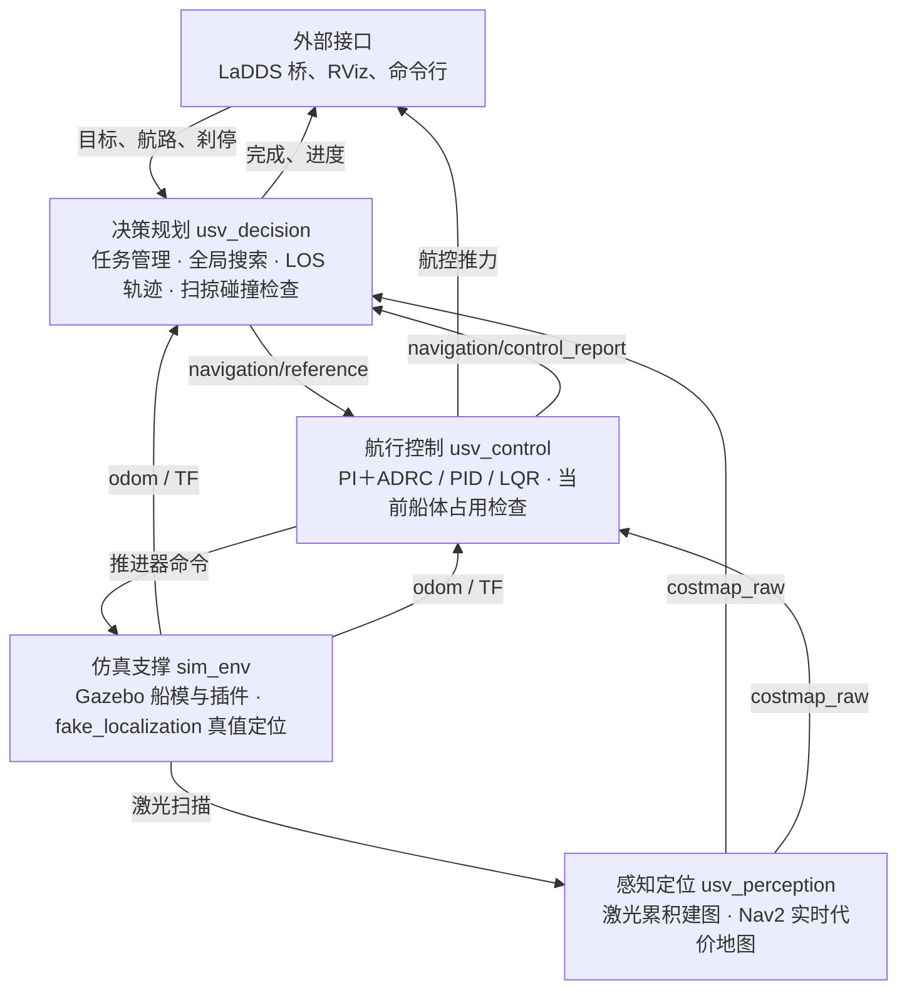

# USV 无人艇导航仿真项目总览

日期：2026-10-10。分支 `chore/reorg-naming-docs`，HEAD `026cc28`，工作区另有未提交的 WAM-V 改动。本文说明项目现在做到了什么程度、各部分用了什么方法。文中的验证数字都带日期，是当日快照，不随代码更新。

操作步骤见[项目 README](../README.md)，接口与话题全表见[三模块普通导航](distributed-navigation/README.md)，术语见 [CONTEXT.md](../CONTEXT.md)。

## 1. 项目概述

本项目是一套无人艇自主导航的仿真工程，已在同一台机器上跑通“感知定位 → 决策规划 → 航行控制”的完整闭环。给定一个目标点或一条多航点航路，仿真船能自己建图、规划路线、生成轨迹并跟踪到点。

默认算法链是 A* 全局搜索 → LOS 轨迹 → PI＋ADRC 跟踪，启动时可切换成其他规划器和控制器。验证范围目前只到 ROS 2 / Gazebo 同机仿真，没有上过实船，也没有接过真实定位传感器。

| 项目 | 内容 |
| --- | --- |
| 操作系统 | Ubuntu 22.04，Windows 下通过 WSL2 运行 |
| 中间件与仿真器 | ROS 2 Humble、Gazebo Classic 11 |
| 导航算法 | Python / NumPy，与 ROS 解耦，可单独测试 |
| 仿真支撑 | C++：Gazebo 水动力、推进器、传感器插件，仿真定位，Nav2 代价地图 |
| 船型 | Otter、WAM-V |
| 对外通信 | LaDDS 桥接：接收航路、刹停等指令，回报状态与进度 |

## 2. 当前进度一览

普通导航主链路和 LaDDS 桥接已经完成并提交；在途的是 WAM-V 船型、双容器跨机联调和仓库整理；实船和真实传感器还没有开始。

| 能力 | 状态 | 时间 | 说明 |
| --- | --- | --- | --- |
| 感知、决策、航控拆成三个独立进程 | 已完成 | 2026-09-14 | 模块间只靠消息协作，任一模块可单独启动和重启 |
| 全局规划：A*、Dijkstra、GBFS、Hybrid A* | 已完成 | 2026-09-17 | Hybrid A* 于 09-15 接入，普通 A* 的直连剪枝于 09-17 完成 |
| LOS 轨迹生成与船体扫掠碰撞检查 | 已完成 | 2026-09-11 | 每条轨迹下发前都按完整船体轮廓检查 |
| 控制器：PID、LQR、PI＋ADRC | 已完成 | 2026-09-14 | PI＋ADRC 是现行默认 |
| 多航点航路 | 已完成 | 2026-09-15 | 按顺序走 1–255 个必经点 |
| 主动刹停与终点值守 | 已完成 | 2026-09-17 | 只在仿真中验证过 |
| LaDDS 桥接，9 个主题 | 已完成 | 2026-10-08 | 本机 Windows 中继链路双向可用 |
| WAM-V 船型与侧推横向控制 | 进行中 | 2026-10-10 | 代码在工作区，尚未提交 |
| LaDDS 双容器跨机联调 | 进行中 | 2026-09-28 | 两容器 ROS 已互通；容器发出的 LaDDS 消息，局域网另一台联调工具收不到 |
| 仓库结构、命名、文档整理 | 进行中 | 2026-10-10 | 23 项获批，完成 9 项后暂停，等 WAM-V 开发结束 |
| 任务包：定点值守、圆形巡航、阵位保持 | 已冻结 |  | 代码保留，主入口不启动，不再维护 |
| 实船、真实传感器、跨机部署 | 未开始 |  | 目前全部验证都在同机仿真内 |
| AIS 与雷达融合、目标跟踪、COLREGs、DWA、MPC | 未开始 |  | 没有接入运行链 |

“时间”是完成日期或最近一次记录的日期。

## 3. 系统架构与数据流

系统由四个可以分别启动的部分组成：仿真支撑、感知定位、决策规划、航行控制。三个导航模块之间只通过 ROS 消息协作，没有共享内存，也没有直接的函数调用。



决策和航控都直接订阅定位和代价地图，两者之间只传轨迹参考和控制回报。

### 模块间的三条消息

| 消息 | 方向 | 内容 |
| --- | --- | --- |
| `navigation/reference` | 决策 → 航控 | 完整的 8 列轨迹、目标、任务身份、完整参数快照，以及艇附近的一段航线 |
| `navigation/control_report` | 航控 → 决策 | 实际控制模式和推力、是否完成、参考是否已撤销 |
| `navigation/heartbeat` | 三个模块各自广播 | 进程身份和存活状态 |

### 几条结构约定

- **节点包与算法包分开。** 每个模块有一个处理 ROS 消息、参数和定时器的节点包，加若干不依赖 ROS 的纯 Python 算法包，算法可以脱离 ROS 单独测试。`src` 下共 21 个 ROS 包。
- **任务有身份。** 每条参考都带任务编号、规划版本和三方进程的会话号。任一模块重启都能被心跳发现，旧任务随即作废。
- **配置只有一份。** 动力学、控制器、LOS、全局规划四份 YAML 由决策和航控共同加载；航控会校验收到的参数快照与自己的启动配置一致。
- **碰撞检查分两处。** 未来轨迹的扫掠检查在决策侧，当前船体的占用检查在航控侧，见 [ADR 0002](adr/0002-collision-check-placement.md)。

## 4. 感知定位

感知只用一台二维激光雷达，产出两张互相独立的地图；定位直接取仿真真值，没有做状态估计。

| 环节 | 方法 |
| --- | --- |
| 定位与 TF | `fake_localization` 读取 Gazebo 真值，发布 odom 和 TF |
| 累积建图 | 整数证据栅格：射线经过的格减 25，命中的格加 55，取值 0–100。当前 1473 × 1473 格，1 米/格 |
| 实时代价地图 | Nav2 costmap：激光障碍层加膨胀层，窗口随船滚动。当前 8500 米窗口，5 米/格，障碍标记距离 20 米 |
| 外部障碍 | LaDDS 0141 目标画成栅格，作为额外一层叠进代价地图；只在 LaDDS 入口启用 |
| 输入监测 | 监测 odom、代价地图、累积地图的发布者身份，广播感知模块心跳 |

规划和控制只读实时代价地图 `costmap_raw`。累积地图没有作为 static layer 并入代价地图，所以激光看不到的障碍背面不会被记住。

三个需要知道的取舍：

- 扫描按自身时间戳查询 TF，没有准确 TF 的扫描不积分；队列只保留最新 5 帧。
- 整数证据分值不是经过概率标定的 log-odds。
- 5 米/格是为约 4 公里的联调航路放大的。3 米膨胀半径小于一格，软代价带基本不再起作用。

建图内核单帧耗时 P95 约 24 毫秒（2026-09-11 实测，1024 × 1024 格、2000 束），低于 15 Hz 扫描的 66.7 毫秒周期。细节见 [perception 包说明](../src/core/perception_module/perception/README.md)。

## 5. 决策规划

决策把“目标 → 路线 → 带时间的轨迹”分步完成，每一步都在最新地图上复核，最后按完整船体轮廓做碰撞检查。任何一步不过，这一轮就不下发轨迹。

1. **复用旧路线。** 把上一轮路线裁掉已走部分，连同“船到路线”的连接段，在最新地图上逐格复核。
2. **必要时重新搜索。** 复核不过或没有旧路线时，才做一次全局搜索。
3. **接上精确目标。** 栅格终点离用户给的目标太远时，追加真实目标点并检查这段连线；完成判定始终用用户给的坐标。
4. **生成轨迹。** LOS 从最新实测船位向前滚动积分 10 秒，每 0.5 秒一个点，输出时间、弧长、位置、艏向、曲率、速度、加速度八列。
5. **扫掠碰撞检查。** 轨迹上每个位姿都放上船体矩形，碰到致命格或未知格就整条拒绝。

### 全局搜索

| 算法 | 做法 | 适用与限制 |
| --- | --- | --- |
| A*（默认） | 八邻域栅格搜索，搜索后做带碰撞检查的直连剪枝，再按 0.5 米等弧长重采样 | 路线是折线，不考虑转弯半径 |
| Dijkstra、GBFS | 与 A* 同一个实现，只换代价与启发项 | 对照用 |
| Hybrid A* | 在连续位姿 (x, y, 艏向) 上搜索，动作为直线、左圆弧、右圆弧，用 Dubins 曲线接到目标；最小转弯半径 4 米，艏向分 72 箱 | 只能前进，无倒车和原地转向；必须精确连到目标；转弯半径是仿真起点，不是实艇测量值 |

代价不小于 254 × `obstacle_factor`（当前 0.05）的格视为不可通行。起点落在软膨胀区内时，允许沿代价严格下降的方向驶出，避免船贴着障碍时无路可走。参数与开关见 [path_planner 包说明](../src/core/decision_module/path_planner/README.md)。

### LOS 轨迹

LOS 把横向偏差换成艏向修正，再按限幅的偏航角速度向前积分出参考轨迹：

```text
期望艏向 = 当前航段方向 − atan2(横向偏差, 预瞄距离)
```

预瞄距离当前取 3 米，偏航角速度限幅 0.8 rad/s，速度按剩余路程线性减到零。

### 多航点航路

多航点按顺序逐段规划，每段终点是精确的必经点，剪枝不跨必经点。

- 每个航点带自己的航段速度。转角处按通过半径和转弯时间限速，并按制动包络提前减速。
- 船实测进入航点半径后才切换到下一段，不以预测轨迹为准。
- 一次最多规划 32 段；后续航段暂时搜不通时，先沿已验证的前缀走并在其末端停车。

### 运行方式与任务管理

规划跑在独立子进程里，不阻塞决策节点的消息回调。

- 队列最多一个运行中的请求加一个待处理请求，新请求覆盖旧的；结果带版本号，过期结果直接丢弃。
- 规划每秒投递 5 次，单次预算 10 秒，搜索展开上限 50 万格。
- 任务支持目标替换、取消、到点等待停稳和完成判定。取消要等航控确认已发出零推力才返回成功。
- 任一模块重启后，旧任务不会自动恢复，需要重新下发目标。

## 6. 航行控制

航控每 0.1 秒算一次推力：先检查输入是否新鲜、船体当前是否压在障碍格上，再取轨迹上“当前时刻往前预瞄”的参考点做跟踪。任一检查不过就停推。

### 跟踪控制器

| 控制器 | 方法 | 备注 |
| --- | --- | --- |
| PI＋ADRC（默认） | 速度环 PI 输出总纵向力；艏向环用误差反馈，角速度由带时间戳的艏向窗口做线性回归估计，输出转艏力矩 | 0914 交付代码移植；名称沿用交付源码，没有实现扩张状态观测器 |
| PID | 速度、航向双环 PID，直接输出归一化双桨命令 | 6 个增益可以在运行中修改 |
| LQR | 六状态 (x, y, ψ, u, v, r) 线性化模型，离散 Riccati 迭代求反馈增益，每拍求解限时 0.08 秒 | Q 惩罚位置、艏向和速度误差，R 惩罚左右两路输入 |

纵向力 F 和转艏力矩 M 按力臂 D 分配到左右桨，超限时两桨等比缩小以保持方向：

```text
left  = (F − M/D) / (2 × max_force)
right = (F + M/D) / (2 × max_force)
```

跟踪预瞄时间为 2.6 秒（LQR 为 2.0 秒）。到点判定是距目标不超过 1.5 米且速度不超过 0.25 m/s；只进入距离容差、速度还没降下来时，状态是“到点等待停稳”。PI＋ADRC 的接口和调参见 [0914 控制器接入说明](0914-controller-integration.md)。

### 叠加环与专用模式

| 功能 | 方法 | 生效条件 |
| --- | --- | --- |
| 横向侧推环 | 0924 横向控制器：输入艇到航线最近点的横向偏差，比例加微分（60 / 150，积分取零），输出横向力 | 只在带侧推器的 WAM-V 上、普通导航跟踪时 |
| 主动刹停 | 带符号速度阻尼反推，命令限幅 0.4；速度不超过 0.05 m/s 且偏航角速度不超过 0.02 rad/s 持续 1 秒才确认停稳 | 收到刹停指令（LaDDS 0331） |
| 终点值守 | 位置外环加独立的 PI＋ADRC 速度、艏向内环；位置容差 0.5 米，艏向容差 5° | 航路任务类型为 80 时，到终点后持续守点 |
| 执行器映射 | 0924 推力分配器把归一化命令换算成桨角和转速，推力 = 推力系数 × 水密度 × 桨径⁴ × 转速² | 每个控制周期，经 LaDDS 0054 发出 |

### 安全与时效

- 当前船体占用检查在航控侧每个控制周期做一次；轨迹扫掠检查在决策侧，两者分工明确。
- 状态超过 0.5 秒、地图超过 1.5 秒、轨迹超过 1.0 秒没有更新，都会停推，恢复后继续。
- 同一任务内替换参考轨迹不重置控制器积分；新任务、取消、时间回退才复位。
- 运行中可改的参数只有 PID 的 6 个增益和 LOS 的 4 个导引参数，其余参数改后需要重启。
- 停推只表示推进输出为零，船仍会滑行；软件刹停不替代独立的硬急停。

速度环增益可以先用[本地调参台](../scripts/control/speed_tuner/README.md)筛选，它调用正式控制器和数值艇模，不需要启动 ROS 或 Gazebo。

## 7. 仿真环境与船型

仿真用 Gazebo Classic 11 加一组 C++ 插件提供水动力、浮力、波浪、风和推进器。Otter 是已经做过完整仿真验收的船型，WAM-V 是正在接入的第二种船型。

- **场景。** 默认世界是 `ocean`，另有 `example_course` 和 `stationkeeping_vrx`；障碍物由场景配置文件生成。
- **传感器。** 船模带激光雷达、IMU 和 GPS，导航链目前只用激光雷达。早期做过的虚拟毫米波雷达已经移除。
- **界面。** RViz 里有设置目标点的插件；也可以加 `headless:=true` 无界面运行。
- **船型切换。** 启动参数 `robot_type` 选 `otter` 或 `wamv`，它同时决定船模、控制参数、代价地图配置和话题命名空间。

| 项目 | Otter | WAM-V |
| --- | --- | --- |
| 推进布局 | 差速双桨 | 两台艉推加一台横置侧推 |
| 质量 | 29.84 kg | 251.28 kg |
| 船体占用（长 × 宽） | 2.2 × 1.2 米 | 5.7 × 2.5 米 |
| 单桨最大推力 | 180 N | 250 N，侧推另有 250 N |
| 巡航速度 | 2.0 m/s | 1.0 m/s |
| 跟踪控制参数 | 在仿真闭环中调定 | 由 Otter 按质量和阻尼等比放大，只是仿真起点 |
| 刹停与值守参数 | 已在仿真中验证 | 仍是 Otter 的数值，没有调整，也不用侧推 |
| LaDDS 联调 | 支持 | 桥配置和启动脚本还只按 Otter 写 |
| 代码状态 | 已提交 | 在工作区，未提交 |

WAM-V 的侧推效果在无界面仿真的转弯场景里测过：转弯 15 秒后艇到航线的最大距离，[三模块文档](distributed-navigation/README.md#船型选择)记为 0.03 米，控制器 YAML 的注释记为 0.07 米；关掉侧推的对照为 2.4 米。两处数字不一致，需要复测后统一。

多航点航路模式下，航线每次都从当前船位重新连线，横向偏差约为零，侧推基本不出力。

## 8. 外部通信

系统通过一个桥接包与 LaDDS 上位机通信：收到航路、靠离泊和刹停指令后调用决策的导航服务，并把模块状态、任务完成、航点进度、推力和本船位置发回去。报文是带 `head` 和 `content` 外壳的 UTF-8 JSON，DDS 域 1，尽力传输。

| 主题 | 方向 | 内容 | 本系统的处理 |
| --- | --- | --- | --- |
| 0211 | 收 | 航路，1–255 个航点 | 任务类型 16 为普通航路，80 为到终点后持续值守；每次收到都算一次新执行 |
| 0212 | 收 | 靠离泊 | 目前按单点航路执行，不做靠泊导轨、侧推或锁船 |
| 0331 | 收 | 刹停 | 打断当前任务并主动刹停，停稳后零输出，不保持原地 |
| 0141 | 收 | 目标运动 | 画成障碍栅格叠进代价地图，每包整张替换 |
| 0411 | 发、收 | 本船导航 | 仿真真值编成 0411 发出，再解回内部 odom |
| 0051 | 发 | 模块状态 | 感知、决策、航控的心跳，约每秒各一条 |
| 0052 | 发 | 任务完成 | 每次执行只回一次；刹停不回 |
| 0053 | 发 | 航点进度 | 已到达的航点数变化时发送 |
| 0054 | 发 | 航控推力 | 桨角与转速，每秒 10 次；0.5 秒收不到航控命令就改发零推力 |

### 链路方式

默认链路是 Windows 上的 LaDDS SDK → 本机 TCP 中继 → WSL 里的 ROS 桥。这样绕开了一个问题：厂商的麒麟 Linux SDK 在 Ubuntu 里创建通信句柄时报授权失败。另外保留了直接加载 Linux SDK 的 `native` 后端，双容器部署用的是它。原理和排错见 [LaDDS 通信桥](../src/core/communication_module/usv_ladds_bridge/README.md)，刹停与值守的协议语义见[停船与终点值守](../src/core/communication_module/usv_ladds_bridge/README.stop-guard.md)。

### 已联通与未联通

- **已通，经真实 LaDDS。** 2026-09-15 本机中继链路[双向通信通过](validation/ladds-communication-20260915/README.md)；[单段航渡](validation/ladds-single-leg-20260915/README.md)跑通了“LaDDS 下发 → Gazebo 导航 → 0052 回报”的完整闭环。
- **已通，但报文是从 ROS 侧注入的。** 2026-09-15 的[多航点 Gazebo 验证](validation/ladds-multi-waypoint-20260915/README.md)没有经联调工具和厂商 LaDDS 再发一遍，记录里写明不能代替工具端验收。
- **有代码和单元测试，没有联调记录。** 0212、0051、0053、0054、0141 是 09-23 至 10-08 陆续加入的，仓库里没有对应的联调验证记录。
- **未通。** 双容器跨机联调：截至 2026-09-28，容器里发出的 LaDDS 消息，局域网另一台电脑上的联调工具收不到。备选做法是宿主机跑 Windows 中继、容器改用 TCP 后端。

航路配置里的经纬度原点目前是临时值 39.9450901 / 116.3342309，已决定改回 30.5453 / 114.392931，尚未执行。

## 9. 测试与验证现状

2026-10-10 在当前工作区、不加载 ROS 的条件下跑了一遍源码测试：1693 项通过，5 项失败，34 项跳过，用时约 79 秒。带 ROS 的集成测试和 Gazebo 场景验收当天没有重跑，最近的完整记录停在 9 月中旬。

### 2026-10-10 这次运行

在 WSL 的仓库根目录执行 `python3 -m pytest -q -p no:cacheprovider`，没有 `source` 任何 ROS 环境。

- **范围。** `pytest.ini` 列出的全部测试目录，包含未提交的 WAM-V 改动。
- **4 项失败是夹具校验。** `test_grid_planning.py` 的 `test_real_factor025_soft_start_snapshots_recover_a_valid_grid_route` 四个参数组合在第一步校验夹具文件哈希时失败：Windows 检出把 JSON 夹具的换行转成了 CRLF，与清单记录的哈希不符。后面的规划断言没有执行到。
- **1 项失败是过时断言。** `scripts/validation/test_adrc_numeric_probe.py` 仍期望 Otter 单桨最大推力为 50 N，而船模配置在 2026-09-24 已改为 180 N。
- **34 项跳过不算通过。** 多数是因为没有加载 ROS（缺 `rclpy`、`launch_ros`），其余要求特定安装环境或只在 Windows 上运行。

### 各层验证的最近记录

| 验证层 | 内容 | 最近记录 |
| --- | --- | --- |
| 源码测试，不含 ROS | 算法、配置、协议、桥接的单元测试 | 2026-10-10：1693 通过，5 失败，34 跳过 |
| 源码加 ROS 集成测试 | 真实节点、消息、launch、模块重启 | 2026-09-14：[1050 通过，0 跳过](validation/adrc-0914-v1/README.md) |
| 安装区审计 | 核对安装内容、模块路径和配置哈希 | 2026-09-14：83 项通过 |
| Gazebo 场景验收 | 直航、转弯、单障碍，三种控制器各重复 3 次 | 2026-09-14：27/27 通过 |
| 故障用例 | 目标替换、取消等 | 2026-09-14：PI＋ADRC 3/3 通过 |
| LaDDS | 真实链路双向通信；单段、多航点、[刹停与值守](validation/stop-guard-20260917/README.md) | 2026-09-15 至 09-17，见第 8 节 |

### 读这些数字时要注意

- 每份验证记录都绑定当时的源码版本，不随代码更新。README 里的通过数字也是快照。全部记录见[证据索引](validation/README.md)。
- 证据索引里最新的记录是 2026-09-17。此后的改动没有对应的验证记录，包括 LaDDS 新增的 5 个主题、Otter 推力上限改为 180 N，以及 WAM-V。
- 2026-09-14 的[全量回归](validation/module-layout-001/README.md)里出现过一次规划等待超时，单项复跑和串行复跑都通过，原因没有定位，记录为测试稳定性待观察项。

## 10. 已知限制与在途工作

系统现在能在同机仿真里完成静态障碍环境下的自主导航，离实船还差定位、动态避碰和现场联调三块。

### 已知限制

| 方面 | 限制 |
| --- | --- |
| 定位 | 用仿真真值，没有接 GPS、IMU 或任何状态估计 |
| 验证范围 | 只有同机 ROS 2 / Gazebo 仿真，没有实船、真实传感器、跨机部署的证据 |
| 动态目标 | 没有目标跟踪、COLREGs 决策和局部避碰；0141 目标只当作静态障碍栅格 |
| 地图 | 实时代价地图只记当前激光可见的障碍；5 米/格下膨胀层基本失效 |
| 规划 | Hybrid A* 只能前进，最小转弯半径不是实艇测量值 |
| 靠离泊与区域 | 0212 只当单点航路执行；航路报文里的区域约束和值守半径没有适配，只给告警 |
| WAM-V | 刹停、值守参数和 LQR 权重沿用 Otter；LaDDS 脚本没有适配 |
| LaDDS | Linux SDK 授权问题没有解决，本机依赖 Windows 中继；跨机联调未通 |
| 文档 | 部分说明落后于配置：README 写默认 PID，规划包说明写默认 Hybrid A*，实际默认是 PI＋ADRC 和 A* |

### 在途工作

- [ ] WAM-V 船型：34 个文件的修改和一批新增文件还没有提交，提交后补 Gazebo 场景验收
- [ ] 仓库整理：剩余 14 项已获批未执行，等 WAM-V 结束后恢复，见[整理审计](maintenance/2026-10-08-reorg-audit.md)
- [ ] 航路原点改回 30.5453 / 114.392931，重建桥接包并跑测试
- [ ] 处理 2026-10-10 发现的 5 项测试失败
- [ ] 带 ROS 重跑全量回归和 Gazebo 场景验收，更新 README 里的通过数字
- [ ] 双容器 LaDDS 跨机联调
