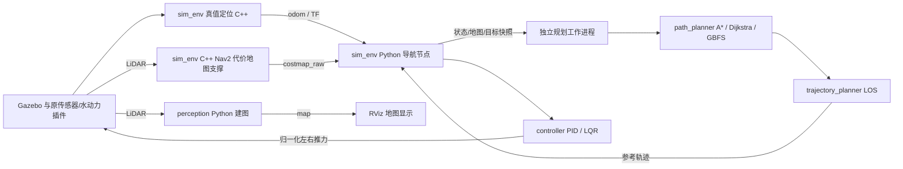

# Python 导航版本工程使用指南

本文说明当前源码的组织、构建方法、配置接口和运行行为。实际构建、ROS 集成、Gazebo 闭环及性能结果统一记录在 [迁移状态](python-migration-status.md)；本文中的命令和验收步骤不表示相关检查已经通过。算法行为变化见 [迁移差异](python-migration-differences.md)。

## 1. 迁移范围与包结构

保留原有 ROS 包名和工程目录，在原包中增加同名 Python 导入包。数值算法使用普通 Python/NumPy 数据，通过 ROS 适配层接收消息、读取参数和发布结果。

| ROS 包与目录 | Python 入口 | 当前职责 |
| --- | --- | --- |
| `common`：`src/core/common` | `common.models`、`common.math_helper` | 船舶状态、模型、只读栅格快照、结果状态、角度及路径碰撞辅助函数 |
| `path_planner`：`src/core/path_planner/path_planner` | `path_planner.path_planner_core.PathPlannerCore` | A*、Dijkstra、GBFS，路径裁剪、重采样和搜索工厂 |
| `path_processor`：`src/core/path_planner/path_processor` | `path_processor` | RDP 简化及插值、Savitzky–Golay 平滑；不自动加入导航主链 |
| `trajectory_planner`：`src/core/trajectory_planner` | `trajectory_planner.los_trajectory_planner`、`trajectory_planner.trajectory` | LOS 轨迹预测、轨迹按时间/弧长查询 |
| `controller`：`src/core/controller/controller` | `controller.controller_factory.create_controller` | Otter PID、LQR 与归一化左右推进器控制量 |
| `perception`：`src/core/perception` | `perception.mapping`、`perception.mapping_node` | LiDAR 整数证据栅格建图内核及 ROS 节点 |
| `sim_env`：`src/sim_env` | `sim_env.configuration`、`sim_env.runtime`、`sim_env.simulation` | 配置校验、独立规划进程、导航节点和启动编排 |

前六个包采用 `ament_python`；`sim_env` 采用 `ament_cmake + ament_cmake_python`，同时安装 Python 包以及 C++ 基础设施节点 `fake_localization_node`、`costmap_support_node`。其 `sim_env_node` 是带 `__main__` 防护的 Python wrapper，调用 `sim_env.simulation.main`，不再链接旧 C++ 导航算法库。

基本导入关系为：`sim_env.runtime → path_planner / trajectory_planner / common`，`sim_env.simulation → controller / common / runtime`；`controller → trajectory_planner / common`。建图内核不依赖导航规划，ROS 消息和 TF 处理集中在各自适配层。



规划进程中的包通过 Python 对象调用连接。`common` 提供这些模块共享的数据与几何接口；
`path_processor` 保留 RDP/SG 的独立可调用实现。上图没有把建图输出连接到 Nav2 static layer，
与当前实际插件配置一致。

Gazebo、波浪/水动力/浮力/推进器插件、Otter URDF、RViz 目标设置插件、动态 XML/RViz 配置工具保持在原工程中。被替换的78个C++算法、头文件和旧CMake已从Python分支移除，见 [清理记录](validation/m5-cleanup/README.md)；原实现仍保存在`main/cpp-baseline`。Dubins、Reeds–Shepp、Bezier、B 样条、三次样条和五次多项式等非活跃通用曲线库尚未提供对应 Python 全量实现。

本次实现使用已有 LiDAR 和仿真真值定位，未新增 SLAM、AIS/Radar 融合、目标跟踪或 COLREGs 动态避碰算法。它为后续算法研究提供可单独测试的接口。

## 2. 在 WSL 中按提交建立独立工作区

目标环境为 Ubuntu 22.04 / ROS 2 Humble / Gazebo Classic。源码、`build`、`install`、`log` 都放在 WSL Linux 文件系统内，并与 C++ 基线分开。切换实现时使用新的终端，只加载 ROS 基础环境及当前一个工作区。

本机清理后的验收副本为 `/home/usv/usv_migration/python-clean-final-001`，固定提交
`dfb1fb7fcb77feb868ee87ac986c70d7c4cab537`，使用独立的普通 `build/install/log`。
后续主分支的报告和文档提交不自动更新该副本。复用现有安装时设置
`PY_WS=/home/usv/usv_migration/python-clean-final-001` 后从第 3 节启动；需要构建新源码时，
按下列步骤选择新的提交和目录。历史 `/home/usv/usv_migration/python` 保留 `3afb25f`
及其试验来源，不作为本轮默认安装区。

下面从 Windows 仓库复制指定提交，不改动原工作目录。必须先将准备验收的源码形成提交；未提交修改不会进入新副本。

```bash
PROJECT_SRC="/mnt/d/ROS2轻量仿真系统/usv_ros_motion_planning-ros2-humble"
PY_REV="$(git -C "$PROJECT_SRC" rev-parse refactor/python-navigation)"
PY_WS="$HOME/usv_migration/python-${PY_REV:0:12}"

test ! -e "$PY_WS" || { echo "工作区已存在，请复用其记录或选择新目录"; exit 1; }
mkdir -p "$(dirname "$PY_WS")"
git clone --no-hardlinks --no-checkout "$PROJECT_SRC" "$PY_WS"
git -C "$PY_WS" checkout --detach "$PY_REV"
cd "$PY_WS"
git rev-parse HEAD
```

随后加载 Humble、检查依赖并在该副本构建：

```bash
source /opt/ros/humble/setup.bash
cd "$PY_WS"
rosdep install --from-paths src --ignore-src --rosdistro humble -r -y
colcon --log-base "$PY_WS/log" build \
  --base-paths "$PY_WS/src" \
  --build-base "$PY_WS/build" \
  --install-base "$PY_WS/install" \
  --symlink-install \
  --cmake-args -DCMAKE_BUILD_TYPE=Release
source "$PY_WS/install/setup.bash"
```

这里没有复用旧分支的构建缓存。仓库 `scripts/build.sh` 也会在其所在工作区使用默认 `build/install/log`，适合已经建立独立副本的情况。调试使用 `--symlink-install` 后，还应按项目验收要求进行独立的普通安装检查，以发现遗漏共享库等安装问题。

确认实际加载的是当前副本：

```bash
ros2 pkg prefix sim_env
ros2 pkg executables sim_env
ros2 pkg executables perception
python3 -c "import common, path_planner, trajectory_planner, controller, perception, sim_env; print(sim_env.__file__); print(path_planner.__file__)"
```

源码测试入口为 `bash scripts/validation/run_source_tests.bash`。该入口显式设置源码 `PYTHONPATH`，用于源码/ROS 测试，不代替上面的安装路径和可执行入口检查。非 ROS 环境中的跳过用例不计为 ROS 集成通过。

验收使用新的普通安装区（不加 `--symlink-install`，不使用 `--merge-install`），并在只加载
该安装区的新终端执行下列检查。审计会核对 13 个原包的位置、Python 模块真实文件路径、
节点可执行入口以及 C++ 支撑节点的动态链接；从源码路径意外导入会判为失败。

也可以通过 `build_clean.bash` 一次完成固定提交复制、干净普通安装、安装审计和源码测试。
目标目录必须不存在，其父目录必须已存在并位于现有 Git 工作区之外；脚本遇到已有目录
会拒绝执行。构建、测试和前后指纹保存在新工作区的 `validation` 目录：

```bash
CLEAN_WS="$HOME/usv_migration/python-clean-${PY_REV:0:12}"
bash "$PROJECT_SRC/scripts/validation/build_clean.bash" \
  "$PROJECT_SRC" "$PY_REV" "$CLEAN_WS"
```

该脚本已经在独立环境执行安装审计。需要手动复查时，打开新 WSL 终端，将
`CLEAN_WS` 设置为刚才实际构建的绝对路径；下面以本机已经完成的固定安装为例。
不要沿用此前调试安装的 `$PY_WS` 或 overlay：

```bash
CLEAN_WS="$HOME/usv_migration/python-clean-final-001"
source /opt/ros/humble/setup.bash
source "$CLEAN_WS/install/setup.bash"
PY_WS="$CLEAN_WS"
python3 "$PY_WS/scripts/validation/verify_install.py" \
  --source "$PY_WS" --install "$PY_WS/install" \
  --output "$PY_WS/validation/install-audit-manual.json"
```

每次正式矩阵开始和结束时，使用 `capture_provenance.py` 分别生成 `--phase before` 与
`--phase after` 记录。它保存 Git 提交与未提交差异、实际安装文件 SHA256 和采集时刻。
两次记录应与原始试验一起保存；运行后补采的文件不能替代运行前证据。

```bash
python3 scripts/validation/capture_provenance.py \
  --workspace "python=$PY_WS" --phase before \
  --run-directory "$PY_WS/results/fixed-matrix" \
  --output "$PY_WS/results/fixed-matrix-before.json"
```

## 3. 启动与选择配置

默认节点名为 `/otter/usv_simulation`，算法为 A* / LOS / PID：

```bash
source /opt/ros/humble/setup.bash
source "$PY_WS/install/setup.bash"
ros2 launch sim_env main.launch.py
```

需要无界面运行或切换到 LQR 时，先结束当前 launch，再执行以下一种启动方式：

```bash
ros2 launch sim_env main.launch.py headless:=true controller_name:=lqr
# 与 headless:=true 等效的窗口设置：
ros2 launch sim_env main.launch.py gui:=false rviz:=false
```

`headless:=true` 同时关闭 Gazebo GUI 和 RViz，但仍启动 Gazebo 服务端及传感器/导航节点。`controller_name`、`planner_name`、`trajectory_name` 默认空字符串，含义是保留项目 YAML 已指定的选择；非空值才覆盖 YAML。支持的名称分别为 `pid/lqr`、`astar/dijkstra/gbfs`、`los`。

| Launch 参数 | 默认项目文件，位于安装后的 `share/sim_env/config` |
| --- | --- |
| `dynamics_config` | `robots/otter/dynamics_otter.yaml` |
| `controller_config` | `robots/otter/controller_params_otter.yaml` |
| `trajectory_config` | `trajectory_planner/trajectory_planner_params.yaml` |
| `planner_config` | `path_planner/common_planner_params.yaml` |

为一次实验保留独立配置副本，并显式传入四条路径：

```bash
CONFIG_DIR="$HOME/usv_run_configs/trial_001"
mkdir -p "$CONFIG_DIR"
cp "$PY_WS/src/sim_env/config/robots/otter/dynamics_otter.yaml" "$CONFIG_DIR/dynamics.yaml"
cp "$PY_WS/src/sim_env/config/robots/otter/controller_params_otter.yaml" "$CONFIG_DIR/controller.yaml"
cp "$PY_WS/src/sim_env/config/trajectory_planner/trajectory_planner_params.yaml" "$CONFIG_DIR/trajectory.yaml"
cp "$PY_WS/src/sim_env/config/path_planner/common_planner_params.yaml" "$CONFIG_DIR/planner.yaml"

ros2 launch sim_env main.launch.py headless:=true \
  dynamics_config:="$CONFIG_DIR/dynamics.yaml" \
  controller_config:="$CONFIG_DIR/controller.yaml" \
  trajectory_config:="$CONFIG_DIR/trajectory.yaml" \
  planner_config:="$CONFIG_DIR/planner.yaml"
```

启动日志列出四个最终绝对路径，并说明 `graph_planner_params.yaml` 当前不加载。路径使用的是运行该命令的 WSL/Linux 文件系统语义，不能直接填写 Windows 的 `D:\...` 路径。

保留的其他启动参数包括 `world`、`robot_namespace`、`robot_x/y/z/yaw`、`use_sim_time`。`robot_namespace` 同时决定导航坐标系与 `dynamics.ns`。`~/.rmp_user_config.yaml` 当前只用于选择 `world`；旧 `robots_config` 中的算法字段不是本启动文件的算法选择入口。使用 `scripts/main.sh` 时可以追加相同参数，该脚本会透传给 `ros2 launch`；它还保留原有 world 障碍配置生成步骤。固定场景验收使用直接 launch 或验收脚本，以保存实际场景来源。

## 4. 项目 YAML 层级兼容规则

四个配置文件继续使用原项目的普通字典形式，由 `load_project_parameters()` 加载，再由 `resolve_parameters()` 归一化和校验。不能把 `ros2 param dump` 结果直接作为其中一个文件。

| 原文件中的键 | 节点最终参数名或行为 |
| --- | --- |
| 动力学文件 `dynamics: {mass: ...}` | `dynamics.mass`，其余模型字段同理 |
| 控制文件 `controller: {controller_name: lqr}` | `usv_simulation.controller.controller_name` |
| 控制文件 `controller: {control_frequency: 10.0}` | `usv_simulation.controller.control_frequency` |
| 旧拼写 `controller.control_frequncy`、`controller.controller_frequncy` | 兼容归一化到上述 `control_frequency` |
| 控制文件 `controller.pid_controller.k_p_speed` | `usv_simulation.controller.pid_controller.k_p_speed` |
| 控制文件 `controller.lqr_controller.Q_matrix_diag` / `R_matrix_diag` | 对应 `usv_simulation.controller.lqr_controller.*`，整数列表转为 ROS double 数组 |
| 轨迹文件 `trajectory_planner.planner_name` / `trajectory_planner.los.*` | `usv_simulation.trajectory_planner.planner_name` / `.los.*` |
| 规划文件 `path_planner.obstacle_factor` | 兼容归一化到顶层 `obstacle_factor` |
| 规划文件顶层 `obstacle_factor` / `planner_name` | 保持同名顶层参数；`planner_name` 不是 `path_planner.planner_name` |
| 规划文件 `path_planner.outline_map`、`enable_resample`、`resample_ratio` | 对应 `path_planner.*`；`resample_ratio` 的单位实际为米 |
| 规划文件 `navigation.*` | 支持配置表中的规划频率、时效阈值、搜索预算、costmap 话题等 |
| `graph_planner_params.yaml` 中 visibility/quartree/hybrid_astar 等 | 模板未接入，当前启动不加载；强行合并未知键会被拒绝 |

别名与规范键同时出现且数值相同，可以归一化；数值冲突直接报错，不采用文件顺序静默覆盖。重复 YAML 键、冲突的显式配置来源和未知参数也会被拒绝。控制、轨迹文件由加载器统一增加 `usv_simulation` 前缀，文件中不要再手动增加一层同名前缀。

PID/LQR 的 `goal_distance_tolerance` 必须为有限数且严格大于 `1e-9 m`。
这是 LOS 相邻航点去重的空间精度下限；更小或相等的值在启动及纯算法对象创建时
明确拒绝，不会自动改成另一个容差。默认 PID 1.5 m、LQR 1.0 m 保持不变。
可复现边界及配置检查见 [容差记录](validation/goal-tolerance-boundary/README.md)。

当前控制配置的 PID 预瞄为 2.6 s，LQR 预瞄为 2 s；ROS 导航的 `obstacle_factor`
默认校准值为 0.25。该因子越小，拒绝的软膨胀代价范围越大；它不是以米表示的安全距离。
实际验收版本及候选状态以验收报告为准，不能把不同提交的参数混用到同一组结果中。

Otter 的生效控制文件是 `config/robots/otter/controller_params_otter.yaml`。
`config/controller/pid_controller_params.yaml` 等通用旧模板未被上述默认入口加载，
修改这些模板不会改变当前 Otter PID。以启动日志列出的最终路径和
`ros2 param get` 的有效值核对一次实验实际使用的配置。

以下兼容键目前不产生新的算法行为：`path_planner.convert_offset`、`default_tolerance`、`expand_zone`、`show_safety_corridor`。当前实现不会因此获得目标容差搜索、安全走廊算法或旧版搜索展开区可视化。调试统计通过结果中的展开节点数和 `navigation_status` 提供。

costmap 仍单独读取原 `global_costmap_params_otter.yaml`；LiDAR mapping 单独读取 `config/costmap/mapping.yaml`，不属于上面的四条导航配置路径。当前 costmap YAML 的插件列表为 obstacle layer 和 inflation layer，mapping 发布的 `/otter/map` 尚未经 static layer 输入导航 costmap。Launch 保留 YAML 插件列表；若其中实际启用了 StaticLayer，则报配置冲突。

## 5. 运行时参数与独立快照

先查看最终规范参数名和值：

```bash
ros2 param list /otter/usv_simulation
ros2 param get /otter/usv_simulation usv_simulation.controller.controller_name
ros2 param get /otter/usv_simulation usv_simulation.controller.control_frequency
ros2 param get /otter/usv_simulation obstacle_factor
```

仅以下十个参数允许在线修改：PID 的 `k_p_speed/k_i_speed/k_d_speed/k_p_course/k_i_course/k_d_course`，以及 LOS 的 `lookahead_distance/switch_dist/kp_yaw/yaw_rate_max`。示例：

```bash
ros2 param set /otter/usv_simulation usv_simulation.controller.pid_controller.k_p_speed 2.5
ros2 param set /otter/usv_simulation usv_simulation.controller.pid_controller.k_i_speed 0.3
ros2 param set /otter/usv_simulation usv_simulation.trajectory_planner.los.lookahead_distance 1.2
ros2 param set /otter/usv_simulation usv_simulation.trajectory_planner.los.yaw_rate_max 0.25
```

节点先校验更新，再在控制周期应用已提交的值。PID 更新现有对象的配置，保留积分和历史误差，不重建控制器；取消、目标替换和任务重置才会清控制器状态。LOS 参数修改会使旧规划版本失效并清除参考，等待新轨迹期间输出零推力。使用 LQR 时修改 PID 增益不会改变当前 LQR 行为。

控制器类型、频率、船舶模型、LQR 矩阵/求解设置、规划器类型、阈值和离散时间等是启动时配置。它们在节点中声明为只读，修改项目 YAML 后应重启，而不是用旧别名尝试绕过只读约束。非法值和不允许热更新的键会被拒绝，成功设置参数也不会回写项目 YAML。

按实验目录保存完整 ROS 参数快照：

```bash
SNAPSHOT_DIR="$HOME/usv_runs/$(date +%Y%m%d_%H%M%S)/parameters"
mkdir -p "$SNAPSHOT_DIR"
ros2 param dump /otter/usv_simulation --output-dir "$SNAPSHOT_DIR"
```

Humble 的该命令生成 `otter__usv_simulation.yaml`。所核对的 Humble 实现保留 `--output-dir`，同时将其标记为 deprecated；也可用 `ros2 param dump /otter/usv_simulation > "$SNAPSHOT_DIR/otter__usv_simulation.yaml"` 明确重定向。两种方式都应写入独立结果目录。[ROS 2 Humble dump 实现](https://raw.githubusercontent.com/ros2/ros2cli/humble/ros2param/ros2param/verb/dump.py)

另有服务：

```bash
ros2 service call /otter/export_parameters std_srvs/srv/Trigger "{}"
```

服务返回 `success` 和 `message`，其中 `message` 是包含节点全名及 `ros__parameters` 的 YAML 字符串，只导出本导航配置表内的参数，不自动在磁盘创建文件。CLI 打印的是服务响应包装，直接将整个打印结果重定向并不等于纯 YAML；程序调用者应单独保存 `response.message`。

ROS 快照用于追溯实际运行值，项目 YAML 用于组织下一次启动配置，二者结构不同。项目加载器明确拒绝 ROS dump 包装；要复用快照中的设置，应将需要的值按上一节层级映射回新的项目配置副本。直接向运行节点 `ros2 param load` 整份快照也会遇到启动参数只读限制。

## 6. 话题、取消与失效行为

| 默认话题/服务 | 类型 | 语义 |
| --- | --- | --- |
| `/otter/goal` | `geometry_msgs/msg/PoseStamped` | 导航目标，示例坐标系为 `otter/map` |
| `/otter/odom` | `nav_msgs/msg/Odometry` | fake localization 输出；姿态在 odom 帧，速度在 `otter/base_link` 船体帧 |
| `/otter/sensors/lidars/lidar/scan` | `sensor_msgs/msg/LaserScan` | LiDAR；mapping 与 costmap 障碍层分别消费 |
| `/otter/map` | `nav_msgs/msg/OccupancyGrid` | mapping 累积图，`-1..100`，与 raw costmap 数值语义不同 |
| `/otter/costmap_raw` | `nav2_msgs/msg/Costmap` | 导航输入，`0..255` 原始代价，可靠且 transient-local |
| `/otter/costmap` | `nav_msgs/msg/OccupancyGrid` | Nav2 为显示转换后的 costmap |
| `/otter/global_path`、`/otter/local_trajectory` | `nav_msgs/msg/Path` | 全局路径与局部参考几何；Path 消息不包含速度剖面 |
| `/otter/thrusters/left_thrust_cmd`、`right_thrust_cmd`、`lateral_thrust_cmd` | `std_msgs/msg/Float32` | 三路归一化命令，范围 `[-1,1]`；差动控制的 lateral 为零 |
| `/otter/navigation_status` | `std_msgs/msg/String` | JSON 状态、原因、任务版本、计数及耗时分位数 |
| `/otter/cancel_navigation`、`/otter/export_parameters` | `std_srvs/srv/Trigger` | 取消任务、返回参数 YAML 字符串 |

```bash
ros2 topic pub --once /otter/goal geometry_msgs/msg/PoseStamped \
  "{header: {frame_id: 'otter/map'}, pose: {position: {x: 35.0, y: -10.0, z: 0.0}, orientation: {w: 1.0}}}"
ros2 topic echo /otter/navigation_status --once
ros2 service call /otter/cancel_navigation std_srvs/srv/Trigger "{}"
```

目标示例使用验收直线场景的终点；实际可达性由当前地图和规划结果确定。使用 RViz 时保留原目标插件，其目标话题应与上表一致。

规划使用一个执行中的工作项和一个可替换的最新待处理快照，不累计无限请求。目标替换、取消和 LOS 热更新增加任务版本，过期版本的结果不进入控制。地图更新时复核当前轨迹，接收工作进程结果时再用最新地图复核。

| 状态 | 触发条件与后续行为 |
| --- | --- |
| `IDLE` | 尚无任务，持续输出零推力 |
| `WAITING_STATE` / `WAITING_MAP` | 状态或地图缺失/过期；暂停非零控制，输入恢复后可继续当前目标 |
| `WAITING_REFERENCE` | 没有有效参考、参考过期、地图使轨迹失效或 LOS 参数刚更新；等待规划 |
| `FRAME_MISMATCH` | 状态、地图或参考坐标系不一致；输出零推力 |
| `NAVIGATING` | 输入和参考通过检查，按控制器输出命令 |
| `SIMULATION_PAUSED` | 控制周期中 ROS 时间没有前进；steady-clock 定时器继续发零推力 |
| `NO_PATH` / `TIMEOUT` / `INVALID_INPUT` / `PLANNING_ERROR` | 规划失败、搜索预算耗尽、非法输入或工作进程异常；清参考并保持零推力，保留原因 |
| `CONTROL_ERROR` | 控制计算失败、非有限或越界输出；使用零推力 |
| `CURRENT_FOOTPRINT_BLOCKED` | 当前实艇与 lethal/unknown 方格相交；清参考并保持零推力，保留目标 |
| `SETTLING` | 已进入位置容差但速度仍大于 0.25 m/s；零推力、保留任务，直到稳定到达或漂出后重新引导 |
| `CANCELLED` / `GOAL_REACHED` | 清目标、轨迹、路径和控制器历史；以后保持零推力，直到收到新目标 |
| `INVALID_GOAL` | 新目标格式或 TF 不可用；旧任务已先清除，不继续上一目标 |
| `CLOCK_RESET` | ROS 时间回跳；清目标、输入、参考、待处理 odom 和 TF 历史；等待输入恢复后需重新发目标 |

默认规划频率 5 Hz、控制频率 10 Hz；状态、地图、参考时效阈值分别为 0.5、1.5、1.0 s。A* 搜索默认 1 s/200000 展开节点；LQR 配置另有 `solve_timeout=0.08 s` 和迭代上限。搜索预算不等于整条导航链路的硬实时保证，碰撞复核、进程传输、ROS 回调和执行器通信仍需分别测量。

全局搜索继续使用 `254 × obstacle_factor` 作为障碍偏好阈值。局部轨迹和当前实艇采用
`navigation.footprint_length=2.2`、`navigation.footprint_width=1.2` 的完整矩形检查
lethal/unknown 方格，避免把软膨胀代价重复当成物理障碍。尺寸必须覆盖所用模型的真实艇体，
属于启动参数。LQR 复验默认使用 `lookahead_time=2.0`，
`Q=[1,1,100,10,10,10]`、`R=[20,20]`，最大迭代数 5000；
零预瞄候选已因实测转圈撤回。LOS 的 `slowdown_distance=3.0` 保持近目标
重规划的减速参考，这些参数只在启动时配置。

## 7. 数值接口与验收入口

```python
import numpy as np
from common.models import GridSnapshot, VesselState
from path_planner import PathPlannerCore

grid = GridSnapshot(np.zeros((20, 20), dtype=np.uint8), resolution=0.5)
state = VesselState(x=0.25, y=0.25, psi=0.0)
result = PathPlannerCore({"planner_name": "astar"}).make_plan(
    state.pose, (5.25, 5.25, 0.0), grid)
```

`GridSnapshot` 复制并只读保存 `[y,x]` 二维 uint8 代价图；`VesselState.u/v/r` 是船体坐标速度。
`PlanResult.path` 为 `(N,3)` 的 `x,y,theta`；纯网格搜索返回格中心。格中心位于真实
目标容差内时，导航调度保留该末点并缩小 LOS 停止圆；否则追加经过地图检查的
真实目标连接段。控制器始终以真实请求目标判定完成，具体包含关系见
[迁移差异](python-migration-differences.md)。`Trajectory.points` 为 `(N,8)`，
列顺序为 `time,s,x,y,theta,curv,velocity,acceleration`，时间相对于 `trajectory.stamp`。

实际验收使用 [验收脚本说明](../scripts/validation/README.md)，例如先运行一个直线用例：

```bash
python3 "$PY_WS/scripts/validation/ros_acceptance.py" \
  --workspace "$PY_WS" --controllers pid --scenario straight --repeats 1 \
  --output "$HOME/usv_runs/python_straight_001"
```

结果目录必须为新目录。分别记录源码提交、配置副本、运行参数快照、环境版本、launch 日志及试验输出。`--dry-run` 只生成试验计划，不启动 ROS/Gazebo，不计为闭环通过。当前验收结果以 [迁移状态](python-migration-status.md) 及对应 `summary.json` 为准。

## 8. 回退与 C++ 对照

原始源码由标签 `cpp-baseline` 保存，Python 在 `refactor/python-navigation` 分支开发。
可执行的 C++ 对照使用单独的 `baseline-validation` 分支；它包含原项目运行所需的
最小安装/启动修复及已记录的校准参数。原 tag 本身不包含这些修复。
回退运行时使用另一个工作区，不在 Python 工作区复用旧 `build/install`：

```bash
CPP_REV="$(git -C "$PROJECT_SRC" rev-parse baseline-validation)"
CPP_WS="$HOME/usv_migration/cpp-${CPP_REV:0:12}"
test ! -e "$CPP_WS" || { echo "基线工作区已存在，请核对其版本"; exit 1; }
git clone --no-hardlinks --no-checkout "$PROJECT_SRC" "$CPP_WS"
git -C "$CPP_WS" checkout --detach "$CPP_REV"
```

在新的 WSL 终端按第 2 节方式为 `CPP_WS` 建立自己的 `build/install/log`，只 source 基线安装目录。这样保留 Python 副本、结果和未完成的修改。

当前基线验收副本位于 `/home/usv/usv_migration/baseline`。`d9a6023` 补齐 `libsim_env`
安装、LQR 等值数组类型，并增加 `baseline_validation.launch.py` 支持 GUI/headless/RViz
及 `controller_name` 注入原控制器工厂；`632734b` 将 LOS 前视设为 1 m、spawn 等待设为
120 s。未改变 C++ 数值算法公式。基线存在 LQR 闭环和退出问题，详见验证报告，不能
把本分支试验当作未经修改的原 tag 直接运行结果。若仅需恢复原始源码，单独 clone 后
checkout `cpp-baseline`，保留上述可执行对照工作区。

对照脚本通过 `--baseline-workspace` 和 `--baseline-launch-file baseline_validation.launch.py` 选择该副本，并查询实际控制器参数核实 PID/LQR 选择。旧版本不具备的取消服务应标记为不支持，不伪造与 Python 相同的能力。
