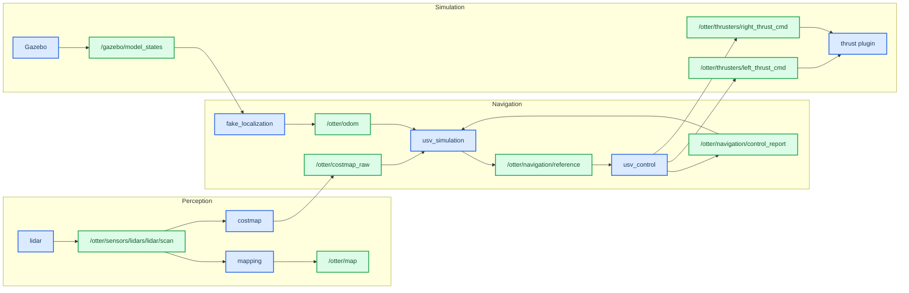
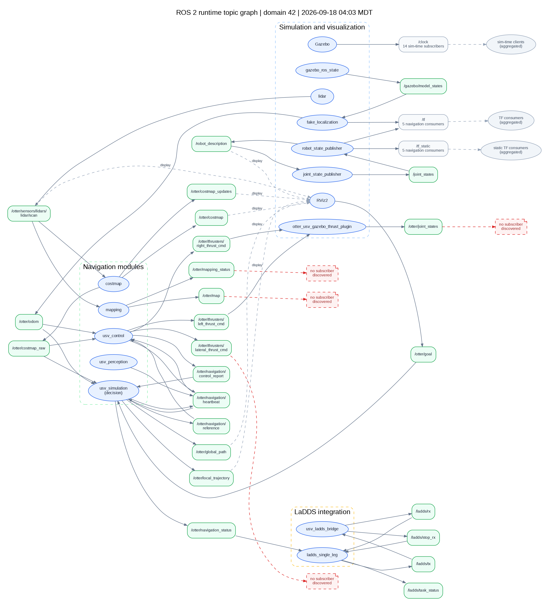

# 运行时 ROS 2 话题图

_从正在运行的 LaDDS 单腿联调仿真实例实时采样；完整端点采样时间为 2026-09-18 04:03 MDT，04:16 MDT 再次复核仍在同一 ROS 域运行。_

---

## 📋 采样结论

已直接连接到 WSL `Ubuntu-22.04` 中的 ROS 2 Humble 运行域 `42`（`ROS_LOCALHOST_ONLY=1`），发现 **43 个话题**和 **19 个节点条目**（去重后 **18 个节点名**，其中 `/rviz2` 重名两次）。本次图以业务数据流和关键仿真支撑为主；`/rosout`、`/parameter_events` 这类每个节点都会参与的基础话题没有画进主图，避免遮挡导航闭环。

### 主链路概览

下面的 Mermaid 图保留最关键的感知—规划—控制闭环；完整端点和辅助话题见后面的 Graphviz 图。





*图 1：当前运行实例的节点—话题—节点连接；箭头方向为发布者 → 话题 → 订阅者。虚线表示 RViz 显示、聚合的 `/clock`/TF 消费者或未发现订阅者。*

图例：蓝色椭圆是节点，绿色圆角框是话题，红色虚线是采样时未发现订阅者，灰色节点是为保持可读性而聚合的基础通信消费者。

也提供可无限放大的 [SVG 图](runtime-topic-graph-20260918.svg) 和可编辑的 [Graphviz 源文件](runtime-topic-graph-20260918.dot)。

## 🔗 主链路说明

| 链路 | 当前运行时连接 |
| --- | --- |
| 感知输入 | `/otter/sensors/lidars/lidar/scan` → `mapping`、`costmap`、RViz |
| 地图输入 | `costmap` → `/otter/costmap_raw` → `usv_simulation`、`usv_control` |
| 定位输入 | `fake_localization` → `/otter/odom` → `usv_simulation`、`usv_control` |
| 规划到控制 | `usv_simulation` → `/otter/navigation/reference` → `usv_control` |
| 控制反馈 | `usv_control` → `/otter/navigation/control_report` → `usv_simulation` |
| 推进器输出 | `usv_control` → 左/右推力话题 → `otter_usv_gazebo_thrust_plugin` |
| 任务桥接 | `ladds_single_leg` ↔ `/ladds/tx`、`/ladds/rx` ↔ `usv_ladds_bridge` |

## 📊 其他已发现话题

以下 15 个话题也在同一次运行时发现中，但没有放进主图，以免把显示、诊断和字节级传输细节挤进导航闭环：

| 类别 | 话题 | 运行时端点 |
| --- | --- | --- |
| Gazebo / RViz | `/clicked_point`、`/gazebo/link_states`、`/performance_metrics` | RViz 或 Gazebo 发布；采样时无订阅者 |
| Costmap 诊断 | `/otter/costmap/transition_event`、`/otter/published_footprint` | `costmap` 发布；采样时无订阅者 |
| Costmap 输入/显示 | `/otter/footprint`、`/otter/debug`、`/otter/debug_array` | 采样时无发布者；`costmap` 或 RViz 保留订阅 |
| LaDDS 原始传输 | `/ladds/rx_bytes`、`/ladds/rx_info`、`/ladds/tx_bytes` | 字节/诊断端点；部分端点只有一侧发现 |
| 风场诊断 | `/vrx/debug/wind/direction`、`/vrx/debug/wind/speed` | `usv_gazebo_wind_plugin` 发布；采样时无订阅者 |
| ROS 基础通信 | `/parameter_events`、`/rosout` | 节点生命周期/日志基础话题，主图省略 |

## ⚠️ 运行时注意

- `ros2 node list` 报告了两个同名 `/rviz2` 实例；图中合并显示为一个 `RViz2` 节点，避免重复绘制。
- `/otter/thrusters/lateral_thrust_cmd`、`/otter/map`、`/otter/mapping_status` 等话题在采样时有发布者但没有发现订阅者，图中用红色虚线标出。这是“当前发现结果”，不等同于一定是程序错误。
- `/clock` 有 14 个使用仿真时间的订阅节点；`/tf` 和 `/tf_static` 的多个 TF 消费者在图中聚合显示。
- 图是这一次运行时快照；重启、改 namespace、改 ROS domain 或关闭 LaDDS 后，节点和端点可能变化。

## 🧪 复核命令

在同一个 WSL 终端中可再次查看当前实例：

```bash
source /opt/ros/humble/setup.bash
export ROS_DOMAIN_ID=42 ROS_LOCALHOST_ONLY=1
ros2 node list
ros2 topic list -t
ros2 topic info -v /otter/navigation/reference
ros2 topic info -v /otter/costmap_raw
```

本图的端点关系由 ROS 2 graph discovery API 采集，而不是根据 launch 文件推测；因此如果运行中的图与源码文档不一致，应以新的采样为准。
