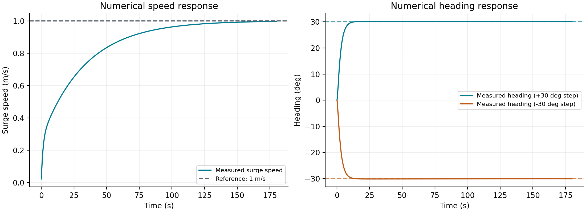
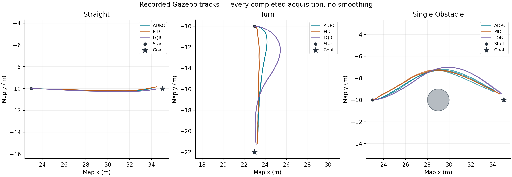

# 0914 PI＋ADRC 接入验证

本记录对应用户确认的完整五步接入计划。源码、配置及启动方式见 [接入说明](../../0914-controller-integration.md)。2026-09-14 完成数值、生产 ROS 节点、安装审计、Gazebo 重复对照与故障验证；定稿参数下三算法矩阵 **27/27 通过**，ADRC 故障矩阵 **3/3 通过**。

## 实现与环境

- 原始算法：仓库根目录 `0914controller`，四文件未改；[源哈希与移植差异](../../../src/core/control_module/controller/controller/adrc_core/SOURCE.md)。
- 正式代码：`controller/adrc_core` 数值核心和外层 `controller/adrc_controller.py`；复用 `usv_control` 的唯一推进器发布链路。
- 运行平台：WSL Ubuntu 22.04、ROS 2 Humble、Gazebo Classic；新工作区 `/home/usv/adrc-0914-20260914-mRBVAh`，完整构建 20 包。
- 安装审计：[83 项通过](install-audit-final.json)，核对实际模块路径、源码/安装核心哈希、专用 YAML 哈希及 decision/control 配置。
- 最终完整源码回归：**1050 passed，36.06 s，无跳过**，包括真实 ROS 消息与生产节点测试。[测试日志](tests-final.log)、[JUnit 明细](tests-final.xml)；新工作区原始目录为 `validation-results/source-tests-final-002`。
- 当前仓库与已测快照的 [186 个源码/配置文件哈希](source-snapshot-hashes.json) 一致；原始交付四文件逐一核对一致。
- 测试使用独立 ROS 域和 Gazebo master 端口；用户原有 `/home/usv/module-layout-20260914/install` 仿真保持运行。

第一次构建遇到既有海面资源生成目标的 ERB/xacro 并发竞争，记录在 `build.log`；本轮使用 `MAKEFLAGS=-j1` 串行编译完成，未改海面插件源码。两次新增测试夹具/导入兼容失败及修复后的完整结果均保留，不能将早期失败命令误记为通过。

## 参数匹配过程

| 参数 | 来源默认值 | 当前 Otter 配置 |
| --- | ---: | ---: |
| 速度比例 / 积分增益 | 8 / 0.8 | 8 / 0.8 |
| 总纵向力上下限（N） | ±8 | ±40 |
| 速度积分贡献上下限（N） | ±8 | ±30 |
| 艏向比例 / 微分 / 积分增益 | 1.5 / 0.5 / 0.03 | 8 / 4 / 0.03 |
| 偏航力矩上下限（N·m） | ±2 | ±10 |
| 艏向积分贡献上下限（N·m） | ±0.25 | ±2 |
| 角加速度反馈增益 | 0 | 0 |
| 窗口 / 历史长度 | 10 / 50 | 10 / 50 |
| 名义周期 / 最大样本间隔（s） | 0.1 / 无 | 0.1 / 0.5 |

先增大物理限幅，保留原始增益。该候选通过数值稳态测试和 Gazebo 直线测试，但转弯偏慢，在最大横向偏差 4.013 m 时触发既有 4 m 边界并停止，后续单障碍用例当轮未执行。

随后仅把艏向比例和微分增益调为 8 与 4。该候选通过转弯（最大横向偏差 0.923 m）和单障碍（最小保守船体间隙 1.089 m）试验。全过程未改艇模阻尼、LOS 轨迹、验收位置/速度/间隙阈值；失败数据保留。原始参数仍在核心 DEFAULTS 中作来源对照。

## 数值验证

使用实际 [dynamics_otter.yaml](../../../src/core/shared/usv_navigation/config/robots/otter/dynamics_otter.yaml)，通过 `common.step_dynamics` 和正式外层适配器进行 0.1 s 步进，每场景 180 s，统计末 20 s。

| 场景 | 定稿配置结果 | 门槛 |
| --- | ---: | ---: |
| 固定期望速度 1 m/s | 纵向速度 MAE 0.00478 m/s | ≤0.1 m/s |
| +30° 艏向阶跃 | 艏向 MAE 0.0990° | ≤5° |
| −30° 艏向阶跃 | 艏向 MAE 0.0990° | ≤5° |

5400 拍状态与指令均有限，指令在 [-1,1]，控制状态均 SUCCESS。配置与动力学哈希、完整模型、每拍状态/参考/命令及耗时见 [result.json](numeric-final/result.json) 和 [samples.csv](numeric-final/samples.csv)。这组速度增益能达到稳态门槛，但加速过程较缓；本轮没有把稳态达标表述为瞬态性能最优。

数值脚本的耗时仅包含 `ADRCController.compute`，不包含模型推进和文件写出；它与下方生产节点回报的整个控制回调耗时是不同口径。

## 生产 ROS 与故障验证

生产节点测试覆盖新算法参数、任务切换、旧参考拒绝、取消、状态丢失、仿真暂停/恢复、时钟回退、重复状态门控，以及两次 timer 之间出现短暂无效参考时立即清历史。PID/LQR 原行为纳入回归。

固定参数下的故障矩阵结果：

| 用例 | 结果 | 实测 |
| --- | --- | --- |
| Gazebo 中替换目标 | 通过 | 新目标完成 |
| Gazebo 中取消任务 | 通过 | 约 0.004 s 收到零推力，随后持续为零 |
| 受控 ROS 输入断流 | 通过 | 约 0.420 s 停推，门槛 0.7 s |
| 同一断流试验恢复输入 | 通过 | 约 0.313 s 恢复 NAVIGATING 和新非零命令，观测超时 5 s |

断流使用受控 ROS 发布器和实际生产进程，不使用 Gazebo；地图持续更新，只有里程计暂时停止。决策和控制进程加载完全相同的规范化参数，并从实际 `usv_control` 回读算法身份。持续零输出窗口要求各通道数据新鲜，不能用一条缓存零指令代替。

## 同场景重复对照

ADRC、PID、LQR 各运行直线、转弯、单障碍三次，共 27 次，全部到达并通过，27 次控制器身份回读与选择一致。使用同一配置文件中保留的 PID/LQR 参数，艇模与规划参数相同。算法原有到点距离容差不同：ADRC/PID 为 1.5 m，LQR 为 1.0 m；速度容差均为 0.25 m/s。每次报告记录实际回读的距离阈值。

| 算法 / 场景 | 通过 | 平均到达用时（仿真 s） | 初始路径横向 RMSE 均值（m） | 最大横向误差（m） | 最小保守间隙（m） |
| --- | ---: | ---: | ---: | ---: | ---: |
| ADRC / 直线 | 3/3 | 36.90 | 0.156 | 0.353 | 无障碍 |
| ADRC / 转弯 | 3/3 | 40.17 | 0.472 | 0.925 | 无障碍 |
| ADRC / 单障碍 | 3/3 | 41.33 | 0.183 | 0.517 | 1.019 |
| PID / 直线 | 3/3 | 21.50 | 0.159 | 0.353 | 无障碍 |
| PID / 转弯 | 3/3 | 20.70 | 0.120 | 0.353 | 无障碍 |
| PID / 单障碍 | 3/3 | 23.40 | 0.186 | 0.588 | 0.703 |
| LQR / 直线 | 3/3 | 15.83 | 0.116 | 0.353 | 无障碍 |
| LQR / 转弯 | 3/3 | 18.17 | 0.982 | 2.190 | 无障碍 |
| LQR / 单障碍 | 3/3 | 18.20 | 0.353 | 0.675 | 0.999 |

横向误差按每次初始全局路径计算，表中 RMSE 是各次 RMSE 的算术均值，不是把所有采样合并后重新算 RMSE。轨迹线为实际采集的位置，无平滑；图上终点星号是目标位置，实际停止点满足对应容差即可。不同算法的到点容差、前视和原参数并不完全相同，结果用于本系统首版验收，不是公平调优后的算法排名。

本轮 ADRC 到达用时明显更长，转弯 RMSE 大于 PID、小于 LQR；不能据此宣称全面优于现有控制器。ADRC 单桨归一化指令绝对值峰值为 0.341；按当前 50 N 单桨最大力的静态映射约为 17.1 N 指令力，这不是测得的实艇推力。所有算法的逐次推力指令峰值、绝对值均值、误差、配置哈希与耗时详见 [完整对照表](comparison-final/comparison.md)、[CSV](comparison-final/trials.csv) 和 [JSON](comparison-final/comparison.json)。推进器均值覆盖采集窗口内三个通道的消息，包含本轮恒零的侧推通道，不能解释为能耗。

ADRC 的各次最终上报窗口 P99 最大为 **0.393 ms**，窗口最大耗时为 **0.622 ms**；LQR 对应最大 P99 为 51.230 ms、最大耗时 79.273 ms，均小于 100 ms 控制周期。这里取各次上报 P99 的最大值，不是合并 P99。生产节点采用仅在事件发生时增加的稀疏计数器，本次未上报 `control_overruns` 事件；通用汇总仍把缺失字段保留为 null，而不伪造显式零计数。未提供逐周期耗时原始序列，因此不把这些窗口统计解释为无限期实时性保证。

所有 27 次使用的专用配置 SHA-256 均为 `1ac971d9244ba1ae409648b5c17dee62a6fa79087a0f939a93c5912921c98767`。

## 证据文件

- [矩阵原始总结果](evidence/matrix-final/summary.json) 和 [运行清单](evidence/matrix-final/manifest.json)；同目录各 trial 保留 JSONL、ROS 进程日志和参数回读。
- [故障总结果](faults-summary.json)；全部故障日志位于下方阶段归档中的 `validation-results/adrc-faults-final`。
- [原增益转弯失败](original-gains-failure.json)，用于保留调参原因，未计入定稿参数的 27 次矩阵。
- [矩阵原始证据压缩包](matrix-evidence.tar.gz)（约 4.9 MB）和 [开发阶段证据压缩包](development-evidence.tar.gz)（约 1.4 MB）。后者包含构建失败/修复日志、回归失败/修复日志、安装审计、初始及候选闭环和定稿故障日志。
- [证据清单及 SHA-256](evidence-manifest.json) 记录主要交付文件的大小、哈希、回归/矩阵计数，以及 PID/LQR 配置段与旧文件逐项相同的核对结果。

## 复现与边界

所有 ROS 命令在 WSL Bash 中执行；详见 [接入说明](../../0914-controller-integration.md)。数值记录由 Windows Python 3.12 执行，ROS 回归和 Gazebo 由 WSL Python 3.10.12 执行。新输出目录不能与旧结果目录同名。原始失败试验、构建与回归日志、参数哈希、最终对比和故障 JSONL 均已归档。

验收仅覆盖本次 Otter 船模、三类静态场景及所测软件故障。控制器沿用交付代码名称，本轮未新增 ESO、COLREGs、动态目标预测或实艇驱动，也未验证实艇与传感器噪声鲁棒性。
