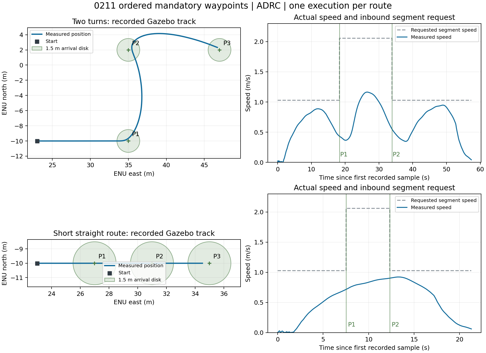

# 0211 多必经航点验证记录

日期：2026-09-15。实现要求：原数组顺序、全部必经、中间点半径1.5m连续通过、最后停稳、入点段速度按节换算、每个新0211重新执行、整条完成一次0052。

## 结论

已完成整包协议解析、NavigateRoute接口、连续轨迹、实测顺序进度和终点完成门控。新独立安装区为 `/tmp/usv_ladds_multi_waypoint_20260915/install`。本轮保留用户共享配置的 **ADRC** 选择和 **10s** 预测时域；未改变控制律。PID另有纯数值闭环验证。

本次 Gazebo 验证从桥的 ROS 侧 `/ladds/rx` 单次注入0211 JSON，经真实适配器、决策、控制、Gazebo里程计，收到 `/ladds/tx` 的0052内容。**本轮没有经Windows联调工具和厂商LaDDS再次发送多点报文**。DDS/TCP传输代码沿用已有版本，ROS夹具和Gazebo结果不能代替工具端本轮收发验收。

## 构建与回归

- `bash scripts/build_ladds_route.bash`：10包成功，23.1s，允许已有输出目录增量构建。见 `build-final.log`。
- 最终相关回归：**442 passed, 1 skipped**，64.23s。跳过项为Linux不具备的Windows `os.add_dll_directory` 检查。见 `regression-final.log`、`regression-final.xml`。
- 测试范围：决策、轨迹规划、PID/ADRC等现有控制器、控制节点、共享协议、桥接包、旧sim_env运行兼容和多点ROS服务夹具。
- 首轮出现4个启动测试失败：测试把控制器硬编码为PID，而实际共享YAML是ADRC。仅更新两份测试以读取默认YAML并验证显式PID覆盖，未修改生产配置。原失败报告保存在 `regression-tests.xml`。
- 独立审查发现后续预览点不可达时丢弃可行前缀，已用地图外/障碍runtime失败测试复现并修复：沿已验证前缀减速等待，失败点保留；当前必经点本身不可达仍明确拒绝规划。
- 三个启动/构建脚本通过bash语法和帮助检查；新仿真入口忽略旧 `LADDS_SINGLE_LEG_INSTALL` 残留，以 `LADDS_ROUTE_INSTALL` 或显式 `--install` 选择多点安装区。

最终回归命令（已加载Humble及新overlay）：

```bash
export ROS_DOMAIN_ID=86 ROS_LOCALHOST_ONLY=1
/usr/bin/python3 -m pytest \
  src/core/decision_module/usv_decision/test \
  src/core/decision_module/trajectory_planner/test \
  src/core/control_module/controller/test \
  src/core/control_module/usv_control/test \
  src/core/shared/usv_navigation/test \
  src/core/communication_module/usv_ladds_bridge/test \
  src/sim_env/test/test_runtime.py \
  scripts/validation/test_ladds_route_execution_ros.py -q
```

## 实际Gazebo闭环

隔离设置：ROS域88、`ROS_LOCALHOST_ONLY=1`、Gazebo端口11359。两次均从默认实际位置约 `(23,-10)` 开始，现有ADRC控制器；注入一次0211，入点段速度均为2/4/2节。

| 场景 | 必经点ENU（m） | P1/P2实际首次进入距离 | P1/P2实际通过速度 | 最终位置误差 | 最终速度 | 0052次数 |
|---|---|---|---|---|---|---|
| 两次转弯 | (35,-10)→(35,2)→(47,2) | 1.460 / 1.478m | 0.434 / 0.552m/s | 0.435m | 0.042m/s | 1 |
| 短直线 | (27,-10)→(31,-10)→(35,-10) | 1.475 / 1.489m | 0.717 / 0.903m/s | 0.486m | 0.062m/s | 1 |

每次整条执行只出现一个活动task_id；进度均0→1→2→3；中间点无SETTLING/GOAL_REACHED，最终点停稳后完成。最终位置/速度取收到反馈后继续观察2s的结果。通过距离与速度来自独立观察器的实测里程计，非绿色预测轨迹。实际航速可因短航段和转弯低于报文期望，不强制在短段达到4节。

完整记录：`gazebo-three-point.json`、`gazebo-straight.json`；对应 `.log` 保存启动及运行日志。测试自行启动的进程组已停止，未停止用户原有Gazebo。



复现（一次只运行一个case；脚本只允许隔离ROS域并检查Gazebo端口未占用）：

```bash
source /opt/ros/humble/setup.bash
source /tmp/usv_ladds_multi_waypoint_20260915/install/setup.bash
export ROS_DOMAIN_ID=88 ROS_LOCALHOST_ONLY=1
/usr/bin/python3 scripts/validation/validate_ladds_multi_gazebo.py \
  --output /tmp/ladds-turn-validation.json
# 短直线：同命令加 --shape straight，改用另一输出文件。
```

## 数值与异常覆盖

现有PID、2.6s预瞄、项目3自由度动力学数值闭环，在10s和20s预测时域均通过三点直线、双90°、2/4/2节、掉头返回起点；中间点实际经过1.5m范围，最终速度小于0.25m/s。未知前向路径另验证已知段末端减速等待且不错误完成。

纯进度和ROS测试覆盖：相邻/非相邻重复点、闭合航线、倒退/重复时间戳、定位大跳变、采样线段穿越顺序、整包非法不接受、内部幂等重试、相同travelId新执行、取消零输出确认后替换、旧回调和旧完成报告隔离、中间不发0052、最终只发一次。

验证范围不包含实船扰动、任意障碍布局或所有航速/转角组合；缺少安全路径仍允许暂停，不放宽必经半径或跳点。当前转弯速度策略偏保守，后续可基于更多航速与转角数据单独标定。

操作入口见 `docs/ladds-multi-waypoint-quickstart.md`，可复制报文见 `docs/examples/ladds-0211-three-waypoint.json`。
