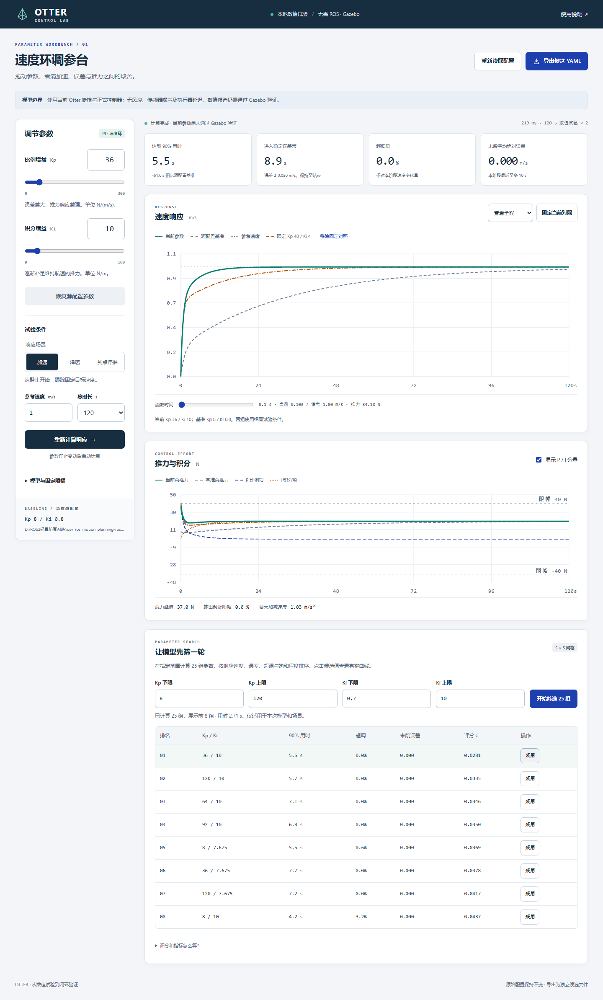

# 本地速度环调参台验证

2026-09-14 完成。运行和使用说明见 [调参台 README](../../../scripts/control/speed_tuner/README.md)。界面采用用户指定的 ui-ux-pro-max 技能，复用正式 ADRC 适配器与 Otter 数值模型。本轮没有执行新的 Gazebo 或实艇试验。

## 检查结果

| 检查 | 结果 |
| --- | --- |
| 数值、指标、导出及 HTTP 专项 | 16 项通过 |
| 上述专项 + 现有 controller 全套 + adrc_numeric_probe 回归 | 149 项通过，2.66 s，见 [JUnit](tests-final.xml) |
| 实际 Chromium 浏览器 | [通过](browser-final/browser-results.json)，无 JavaScript 页面异常 |
| 响应式 | 375、768、1024、1440 像素宽度检查；无整页横向溢出 |
| 原配置保护 | SHA-256 仍为 `1ac971d9244ba1ae409648b5c17dee62a6fa79087a0f939a93c5912921c98767` |
| 重复启动 | 检测同一已运行服务并返回既有地址，未启动第二个实例 |

浏览器操作覆盖：首次加载、连续修改 Kp/Ki、自动计算、固定对照、P/I 分量开关、图表时间范围、键盘读数、25 组筛选、采用候选、真实导出、切换降速/停推场景、无效输入阻止导出、恢复基准、帮助弹窗、键盘焦点。

初次浏览器自动化使用字符串形式的 wait_for_function，触发页面 CSP 对 eval 的限制；测试改为基于实际 DOM 的 Playwright 断言，不放宽产品 CSP。初次导出单元测试使用 Windows 默认编码读取 UTF-8 报告失败，修正测试读取编码后通过。未把这些早期失败记作成功。

## 已观测的数值响应与速度

- 固定 1 m/s、0.1 s 控制周期、180 s 试验：原参数 Kp=8 / Ki=0.8 精确复现先前末 20 s MAE=0.004780707154923185 m/s，首次达到 0.9 m/s 为 67.1 s。
- 界面默认 120 s 试验：Kp=40 / Ki=4 的 T90 为 17.0 s。此处是数值示例，并非定稿参数。
- 浏览器验收中的 5×5 网格范围为 Kp=8～120、Ki=0.7～10，25 组、每组 120 s；本机实测约 2.71 s 完成。性能依赖机器和其他负载。
- 此轮筛选首行 Kp=36 / Ki=10，数值 T90=5.5 s。已自动化验证其 YAML/JSON/CSV 导出；只作为工具功能测试样例，尚未进行 Gazebo 验证。
- 停推测试在 60 s 切断推力，80 s 读数为零指令；该模式模拟生产 SETTLING 的零推力与清积分策略，不是主动制动调参。



[窄屏截图](browser-final/mobile.png)。截图包含自动化测试时的候选参数，正常打开页面时仍读取项目源 YAML 的当前参数。

## 验证命令

```powershell
python -B -m pytest -q scripts/control/test_speed_tuner.py src/core/control_module/controller/test scripts/validation/test_adrc_numeric_probe.py --junitxml=docs/validation/speed-tuner-v1/tests-final.xml
python -B scripts/control/speed_tuner/browser_smoke.py --url http://127.0.0.1:8767 --output docs/validation/speed-tuner-v1/browser-final
```

浏览器回归以交付时的原配置 Kp=8 / Ki=0.8 为基准。测试生成的候选位于浏览器结果 JSON 所记录的 `export_path`，原 YAML 保持不变。

当前本地服务地址 `http://127.0.0.1:8767`。8765 已被用户原有 NavPy 工具占用，本轮没有停止或改写该服务。后台服务日志与 PID 在本目录；普通使用可直接双击 `scripts/control/start_speed_tuner.bat`。
