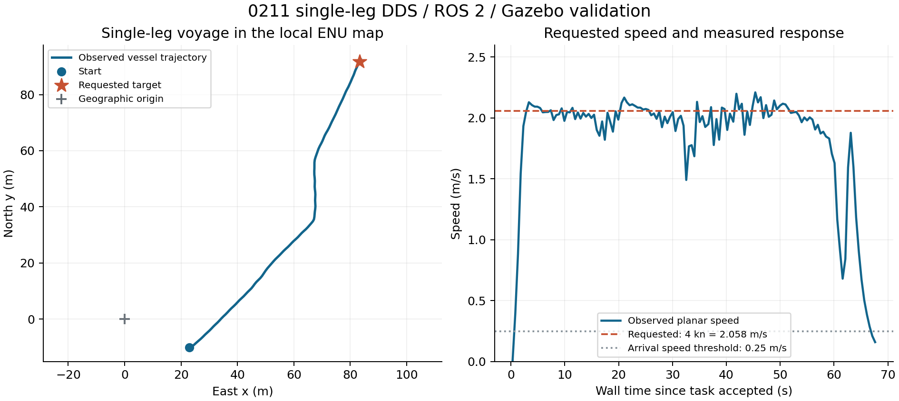

# 0211 单段航渡联调

## 航线编号与执行约定（2026-09-15）

《东湖游艇_协议整理》在0211和0052中均将`travelId`定义为**观光航线编号**。它标识航线，不能据此要求同一航线每执行一次就更换编号。此前“修改坐标、速度或重新执行必须换travelId”的指引撤回。

- 协议中的`taskType: 0`表示修改航路，`taskType: 16`（10H）表示航渡。当前单段适配器只支持16，尚未实现0。
- **用户确认的发送端约定：每条航线执行指令只发送一次，再次收到0211就表示重新执行。** 因此每次合法接收都生成新的内部`request_id`，即使`travelId`、坐标、速度和头部完全相同也重新执行。该触发约定来自本次联调确认，文档正文未单独定义。
- **航行中再次下发：结束当前执行，从当前位置执行新航线。** 适配器调用现有取消服务，确认取消成功后才提交新目标。若取消期间又收到新指令，尚未提交的候选被最新指令替换。
- 航线编号不再用于执行去重。同一航线重新下发时可以使用新坐标、速度；当前每条受支持的`taskType: 16`报文都代表执行请求，不提供仅保存航路而不执行的功能。
- 一次执行内部的ROS服务超时重试沿用该次`request_id`，导航服务继续按这个内部标识防止重复启动。旧提交结果未知时先等待确认，不越过它启动新执行。
- 0052继续回传原航线编号，仅在本次执行实际到达后发送一次。被新指令替换的执行不报完成；再次收到0211不会补发旧执行的0052。

## 约定与实现

| 项目 | 数值 |
|---|---|
| 地图原点 | latitude=30.5453，longitude=114.392931 |
| 目标点 | latitude=30.546127，longitude=114.3938 |
| 地图目标 | x=83.38367675 m 向东，y=91.68293913 m 向北 |
| 航速 | JSON `speed: 4`表示4节，换算为2.05777778 m/s |
| 任务 | `taskType: 16`（10H，航渡），`count: 1`，航点`type: 1` |
| DDS | 域1，订阅字符串`0211`，发布字符串`0052`，best_effort |
| ROS仿真 | 默认域42，所有ROS进程的域及ROS_LOCALHOST_ONLY必须一致 |

**地图原点不是船的初始位置。** 默认船位为地图`(23,-10)`，规划起点取实时里程计。转换复用`common.geodesy.GeoReference`的WGS84→ECEF→ENU实现。目标在当前地图范围内，路径由A*和当前障碍地图确定。

```text
工具 --LaDDS 0211--> Windows relay --TCP--> /ladds/rx
  → ladds_single_leg：解析、换算、生成本次执行ID；必要时先确认取消旧执行
  → /otter/navigation/navigate_to：原子提交目标和速度
  → 原有A*、LOS、PID导航 → /otter/navigation_status确认GOAL_REACHED
  → /ladds/tx --TCP--> relay --LaDDS 0052--> 工具
```

任务适配器和通信桥是两个节点。原通信透传和RViz `/otter/goal`保持可用。新`NavigateTo`服务提交`request_id`、`PoseStamped goal`、`desired_speed_mps`，响应接受结果、规划进程及任务编号。任务航速仅覆盖本次规划模型的巡航速度，经轨迹点`velocity`传给现有控制器，不修改共享启动配置。

独立仿真profile把`velocity_max=1.0`提高到`2.1 m/s`，生成上述原点的world副本；原默认航速、控制参数、障碍和初始船位保留。上限用于请求校验和模型，不是实际船速的物理硬限。

## 构建（本机WSL、ROS 2 Humble）

基线安装区包含Gazebo、感知和控制模块。其他机器应先构建完整项目，并通过`--base-install`指定自己的基线。

```bash
cd '/mnt/d/ROS2轻量仿真系统/usv_ros_motion_planning-ros2-humble'
source /opt/ros/humble/setup.bash
export PATH="/usr/bin:/bin:$PATH"
unset PYTHONHOME
source /home/usv/module-layout-20260914/install/setup.bash
colcon --log-base /tmp/usv_ladds_single_leg_20260915/log build \
  --base-paths src/core \
  --packages-select common usv_navigation_interfaces usv_navigation usv_decision usv_ladds_bridge \
  --build-base /tmp/usv_ladds_single_leg_20260915/build \
  --install-base /tmp/usv_ladds_single_leg_20260915/install \
  --allow-overriding common usv_navigation_interfaces usv_navigation usv_decision \
  --symlink-install
```

`/tmp`安装区可能被系统清理，可重新构建；长期使用可选固定安装路径，并设置`LADDS_INSTALL_BASE`和仿真脚本`--install`。

## 启动三个终端

每类终端只启动一份：同端口的Windows中继、同ROS域的仿真、ROS通信桥各一份。重新启动前，在已有终端按Ctrl+C结束旧实例；先结束ROS桥，再结束中继和仿真。

### 1. Windows PowerShell：原生LaDDS中继

```powershell
cd 'D:\ROS2轻量仿真系统\usv_ros_motion_planning-ros2-humble'
.\scripts\start_ladds_relay.ps1 -DomainId 1 -ReceiveTopic '0211' -SendTopic '0052'
```

默认端口17880，仅绑定WSL虚拟网卡。若有旧中继占用，在旧终端按Ctrl+C。**TCP模式的DDS主题由Windows中继决定**，只改ROS YAML不能改变已运行中继。

### 2. WSL：4节单段仿真

```bash
cd '/mnt/d/ROS2轻量仿真系统/usv_ros_motion_planning-ros2-humble'
export ROS_DOMAIN_ID=42 ROS_LOCALHOST_ONLY=1
export GAZEBO_MASTER_URI=http://127.0.0.1:11347
bash scripts/start_ladds_single_leg_sim.bash --headless false
```

`--headless false`显示Gazebo和RViz；自动测试用`true`。避免同时运行另一套向同一艇输出推进器命令的导航或值守节点。

### 3. WSL：任务适配与通信桥

```bash
cd '/mnt/d/ROS2轻量仿真系统/usv_ros_motion_planning-ros2-humble'
export ROS_DOMAIN_ID=42 ROS_LOCALHOST_ONLY=1
bash scripts/start_ladds_single_leg.bash
```

脚本自动获取WSL默认网关，也可用第一个参数指定Windows中继IP。`LADDS_RELAY_PORT`可改端口，`LADDS_INSTALL_BASE`可改安装区。原生Linux后端仍需可用Linux SDK和授权，本轮实际验证使用Windows SDK加TCP。

这三个WSL启动脚本在自己的进程内优先使用系统Python，与Humble的Python 3.10扩展匹配；可以从Conda base或vrx_rl终端运行。脚本不会修改父终端的Conda设置。

### ROS域与常见启动错误

- `0211`是LaDDS主题名，`1`是工具和Windows中继的LaDDS域；`42`是ROS侧仿真、适配器和观察命令共同使用的域。TCP桥在两侧转发应用数据，两个域不要求相等。
- 之前的`211`只是测试隔离值，没有协议含义。现默认改为`42`，属于[ROS官方建议的0–101范围](https://github.com/ros2/ros2_documentation/blob/humble/source/Concepts/Intermediate/About-Domain-ID.rst)。脚本尊重已有环境变量，旧终端必须显式`export ROS_DOMAIN_ID=42`才能切换。下文历史实测仍记录当时使用的211。
- `timed out waiting for relay hello`表示TCP连接后未收到中继握手。本机曾因助手留下的旧后台桥占用单客户端中继而触发，旧实例已关闭。更新后，第二个桥会明确收到`relay busy: another ROS bridge is already connected`；应结束旧桥，不需要改主题或增加超时。
- Windows中继现在独占监听端口。重复启动会直接报端口绑定错误；应在旧中继终端按Ctrl+C，再启动一份。
- `rclpy._rclpy_pybind11`且路径包含`python3.13`表示使用了不匹配的Conda解释器。上述脚本已选择系统Python；手动运行其他ROS命令时，应使用匹配Humble的环境。
- 通信桥退出会一起结束本次launch的任务适配器。此行为不取消已被导航接受的航行任务，导航取消仍使用下文服务。
- 若之前重复启动过仿真，状态可能为`MODULE_RESTART`。关闭旧仿真后重新启动一套，再启动桥并发送新任务。

## 工具发送与完成反馈

**关闭工具的定时/循环发送，每次下达只发送一包。** `travelId`按实际航线编号填写，再次点击发送就是重新执行，不必更换编号。循环发送会反复请求取消并重启航行。编辑完成并检查JSON后再发送；修改`points`的数量时同步修改`count`。

在**域1、主题0211、尽力传输**下发送仓库`docs/examples/ladds-0211-single-leg.json`。原三点报文须同时改`count`和`points`；适配器明确拒绝多点，不会偷偷只执行首点。

业务内容如下，也接受`head`/`content`包装：

```json
{
  "travelId": 53,
  "taskType": 16,
  "count": 1,
  "points": [
    {"type": 1, "latitude": 30.546127, "longitude": 114.3938, "speed": 4}
  ],
  "guardingRadius": null,
  "guardingHeading": null,
  "areasCount": 0,
  "areas": []
}
```

完整文件里的`head.time`是示例时间。当前执行判断不依赖`head.time`或`head.packageSeq`的变化，每次收到合法报文本身就是一次新指令；无需为了重新执行而修改这些字段。

工具另加订阅**0052**。到达后收到裸业务JSON：

```json
{"travelId": 53, "taskFinish": 1}
```

反馈依照文档的裸JSON示例，未推断未提供定义的通用`head`。已验证DDS原始收发；工具能否把裸0052渲染成专用界面，仍需现场确认。

## 观察与取消

```bash
source /tmp/usv_ladds_single_leg_20260915/install/setup.bash
export ROS_DOMAIN_ID=42 ROS_LOCALHOST_ONLY=1
ros2 topic echo /ladds/task_status std_msgs/msg/String
# 需要取消时：
ros2 service call /otter/cancel_navigation std_srvs/srv/Trigger '{}'
```

- `SUBMITTING`表示调用服务，`ACTIVE`表示导航已接受，`COMPLETED`表示实际到达后发送0052。接收、解析、服务接受和规划成功都不会提前报完成。
- 单次下发会等待导航服务及新鲜状态后自动推进，不需要发送端补发。服务无回应时用相同request_id最多重试3次。观察到决策会话变化时中止旧会话的执行；如果当前服务请求先获得新会话的明确接受响应，则保留该接受关联，随后依据新会话状态确认完成。
- 耗尽重试后`SUBMIT_UNKNOWN`表示是否接受仍不明确，此时新指令等待旧请求结果确认，不能把超时当作已取消或已完成。取消服务未确认成功时同样不会提交新目标。
- 同一发送平台、同一`travelId`及相同内容再次下发，会产生新的执行；本次执行的内部服务重试仍保留同一个request_id。
- 同一航线编号再次下发时，目标和速度采用新报文的值。`taskType: 0`的“修改航路”功能尚未实现，目前仍要求航渡类型16。
- 一次新的导航执行若目标已在到达容差内，会很快确认完成，不会为了演示再次绕行。重复观察完整航路还需要恢复仿真初始船位；恢复船位本身不触发航线重新执行。
- 新0211会替换当前航行；GUI `/otter/goal`也可替换当前航行。被替换的DDS执行不报成功。
- 取消、模块重启、时钟重置不产生0052成功。协议未定义失败/取消反馈，原因在上述ROS状态话题中显示。
- 适配器保留128项执行历史，导航保留256项内部服务请求记录。新0211使用独立随机执行ID，适配器重启后也不会复用旧ID；这不提供跨进程的执行恢复或持久化保证。
- 导航接受后，DDS短时断连不自动取消任务，需要时使用取消服务。
- 本机shell可能预设`ROS_LOCALHOST_ONLY=0`，因此操作命令明确export为1；混用0/1会导致观测或通信异常。

## 历史实测结果与范围

当前同航线重执行的实现、测试结果与本机更新方法见[重新执行修正记录](../../../../docs/validation/ladds-single-leg-20260915/route-execution.md)。

以下循环重发测试使用修正前的实现，保留为当时的通信、坐标和航速传递证据；不代表当前“每次下发重新执行”的验证结果。当前测试发送脚本`ladds_single_leg_peer.py`已改成只发一次，`ladds_single_leg_observer.py`也按单次下发验收。

自动测试使用DDS域21、TCP17881、ROS域211，避开工具域1。Windows独立DDS端每秒发送同一任务，Gazebo实际执行后回传0052，没有注入假到达信号。

完整记录：接收68包、导航请求ID仅1个、轨迹最高期望速度2.05777778 m/s。从接受到完成约67.65秒；完成时误差0.9625 m、速度0.1602 m/s。独立DDS端在第72.72秒收到正确0052，包含开始时发现等待。数据在`docs/validation/ladds-single-leg-20260915/`。



当前PID条件是距离≤1.5m且平面速度≤0.25m/s，不要求完全静止或最终艏向。实际峰值2.2221 m/s（约4.32节），存在控制超调。本轮验证协议、速度传递和任务闭环，不代表4节全工况控制器调优或实船验证完成。

用户当前域1/TCP17880/ROS域42的后续实测见[现场联调记录](../../../../docs/validation/ladds-single-leg-20260915/live-tool-debug.md)。`travelId=54、56`的测试验证完整航行；`travelId=57`的测试验证到达后接受同坐标新执行；用户工具`travelId=58`的输入、状态及反馈由只读追踪器记录。`travelId=55`的测试曾因目标超出当时的滚动地图而未完成，不能把该轮记为成功。这些测试使用了不同航线编号，未验证同一航线编号的再次执行。

## 多段航路建议

先在一个航渡任务内管理航点序号：整条0211接收一次，每段到达后推进下一段，全部完成才回0052。最容易复用当前服务，但每个中间点都会减速停车。

若要求中间点不停船，应将`points`作为整条路线约束，衔接各段路径，由LOS连续跟踪；中间点用穿越/切换条件，最终点才停车。速度按用户约定属于“当前位置到本目标点”这一段，段间速度需连续过渡。保留A*、LOS和控制器，把多段管理和路径衔接放在决策层。本轮仅实现单段。
